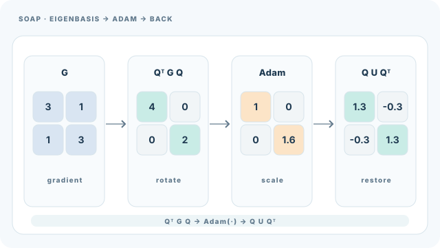

# SOAP

SOAP 在 Shampoo 預條件子的特徵基中執行 Adam。Shampoo 以矩陣統計量對梯度做預條件，而 SOAP 保留這些統計量，但把 Adam 的逐座標縮放套用在它們所定義的旋轉座標中。Vyas 等人（2024）提出此方法，目的是讓 Shampoo 更穩定且更有效率。上層概述見[自適應方法](index.md)，它所建立的矩陣方法是 [Shampoo](../shampoo.md)。

## 概述

Shampoo 功能強大，但需要定期重算其預條件子的根，且對這些設定敏感。SOAP 保留矩陣結構，並以旋轉空間中的 Adam 更新取代逆根更新，從而減少對這些選擇的依賴。

## 問題

Shampoo 的更新使用矩陣統計量的逆根，計算成本高，而且對重新整理的頻率敏感。問題在於，能否保留矩陣幾何，同時讓每步的行為更穩定。

## 核心想法

計算 Shampoo 左右預條件矩陣的特徵基。把梯度轉換到該基底，在其中執行 Adam，再把更新轉換回原座標。在旋轉後的空間中，Adam 的對角縮放等同於 Shampoo 式的矩陣預條件，但不需要每步計算逆根。

## 演算法

令 \(L\) 與 \(R\) 為矩陣參數的 Shampoo 統計量，其特徵向量分別為 \(Q_L\) 與 \(Q_R\)，並定期重算。梯度 \(G\) 旋轉為 \(\tilde G = Q_L^\top G\, Q_R\)。對 \(\tilde G\) 執行 Adam，再把所得更新旋轉回去。特徵基的更新頻率低於梯度，與 Shampoo 相同。

### 教學動畫：在 Shampoo 特徵基中執行 Adam

*原創連續教學動畫（CC BY-SA 4.0）。* **人工設定**的二維範例以 $G=\left[\begin{smallmatrix}3&1\\1&3\end{smallmatrix}\right]$ 與正交基底 $Q=2^{-1/2}\left[\begin{smallmatrix}1&1\\1&-1\end{smallmatrix}\right]$ 表示，因此 $Q^\top GQ=\operatorname{diag}(4,2)$。在旋轉座標中的**示意**自適應更新取 $\tilde U=\operatorname{diag}(1,1.6)$；轉回原座標可得 $U=Q\tilde UQ^\top=\left[\begin{smallmatrix}1.3&-0.3\\-0.3&1.3\end{smallmatrix}\right]$。中間的更新矩陣**不是**從完整指定的 Adam 動量歷史推導而來，也不是模型實測或建議步長。動畫聚焦於座標轉換，而非 Shampoo 特徵基更新頻率、Adam 偏差校正等細節；最終參數更新須沿**負方向**套用。MkDocs 可播放／暫停並支援減少動態效果；GitHub 可檢視[靜態總覽](../../../assets/concept-animations/soap-eigenbasis-adam-still.svg)。參考 Vyas 等人（2024）。

## 主要結果

摘要報告，在大批次情況下，與 AdamW 相比，SOAP 把迭代次數減少超過 40%，把實際執行時間減少超過 35%。與 Shampoo 相比，兩項指標都改善約 20%。摘要未詳述所用模型，因此本頁只引用這些數字。

## 限制

- 特徵基仍需定期重算，這會增加運算成本，並帶來一個重算頻率的超參數。
- 儲存量比 Adam 大，因為每個矩陣參數都必須保存矩陣統計量與特徵基。
- 效益是在特定設定下，與 AdamW 及 Shampoo 比較得出的，應在新問題上重新檢驗。

## 關聯

- [Shampoo](../shampoo.md)是 SOAP 所用特徵基的矩陣預條件子。
- [Adam](adam.md)提供 SOAP 在旋轉空間中執行的逐座標更新。
- [AdamW](adamw.md)是效率比較的基準。
- [二階方法](../second-order.md)涵蓋 Shampoo 與 SOAP 所屬的曲率方法家族。

## 應用

- 預訓練大型語言模型，Shampoo 式方法正被研究其效率。

## 開放問題

- 特徵基應多久重算一次？答案是否取決於模型大小？
- 當特徵基過時時，旋轉空間中的 Adam 更新是否仍保有優勢？

## 參考文獻

### 開創性論文

- Vyas, N., Morwani, D., Zhao, R., Kwun, M., Shapira, I., Brandfonbrener, D., Janson, L. & Kakade, S.（2024）。*SOAP: Improving and Stabilizing Shampoo using Adam*。arXiv。https://arxiv.org/abs/2409.11321 — 在 Shampoo 預條件子的特徵基中執行 Adam，並報告相對 AdamW 與 Shampoo 的效率改善。
- Gupta, V., Koren, T. & Singer, Y.（2018）。*Shampoo: Preconditioned Stochastic Tensor Optimization*。ICML 2018，PMLR 80。https://proceedings.mlr.press/v80/gupta18a.html — SOAP 所建立的矩陣預條件子。查核：PMLR 條目的標題與作者相符。
- Kingma, D. P. & Ba, J.（2015）。*Adam: A Method for Stochastic Optimization*。ICLR。https://arxiv.org/abs/1412.6980 — SOAP 在旋轉空間中套用的逐座標更新。
- Loshchilov, I. & Hutter, F.（2019）。*Decoupled Weight Decay Regularization*。ICLR 2019。https://arxiv.org/abs/1711.05101 — AdamW，即 SOAP 效率比較中的基準。

### 綜述與教科書

- Bottou, L., Curtis, F. E. & Nocedal, J.（2018）。*Optimization Methods for Large-Scale Machine Learning*。SIAM Review。https://arxiv.org/abs/1606.04838 — 自適應隨機方法及其在大規模訓練中取捨的綜述。
