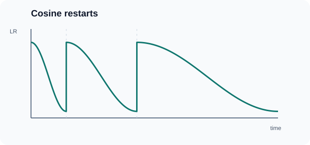

# 附暖重啟的餘弦退火

附暖重啟的餘弦退火（SGDR）讓學習率沿著半個餘弦曲線下降，在固定時點把它重新拉回最大值，然後再次開始下降。每一輪都比前一輪長。Loshchilov 與 Hutter 在 ICLR 2017 提出此方法。上層總覽為[學習率排程與預熱](learning-rate-schedules.zh-TW.md)。

## 概述

單純的餘弦衰減會平滑地從高學習率降到低學習率，是常見的選擇。其弱點在於，學習率在訓練後期大部分時間都很小，最佳化器一旦落在某個區域就難以離開。定期重啟學習率，讓它有機會繼續移動；每一輪結束時的模型，也可以另存為快照。

## 問題

訓練的預算有限，而通常的衰減方式在訓練開始前就已固定。Loshchilov 與 Hutter 想知道，有重啟的排程能否更快找到好的解。他們以*任意時間*（anytime）表現來評估排程，也就是訓練過程中任一時點模型的好壞，而不只看最後的結果。

## 核心概念

在第 \(i\) 輪中，學習率沿餘弦曲線從 \(\eta^i_{\max}\) 下降到 \(\eta^i_{\min}\)。該輪結束時，學習率重設為 \(\eta^i_{\max}\)，這就是「暖重啟」，接著開始第 \(i+1\) 輪。每一輪的長度是前一輪的 \(T_{\mathrm{mult}}\) 倍，因此訓練後段的每個階段都較長。

### 動態排程示意

*AI Wiki 原創動畫，CC BY-SA 4.0。*

移動標記呈現週期長度依序為 1、2、4 的示意排程，學習率上下界保持固定。每次重啟只將**學習率**調回上限，不會重設最佳化器參數。時間與學習率皆為正規化示意值，並非模型訓練量測。

## 演算法

令 \(T_i\) 為第 \(i\) 輪的長度（以 epoch 計），\(T_{\mathrm{cur}}\) 為距離上一次重啟所經過的 epoch 數。論文在每個批次後更新 \(T_{\mathrm{cur}}\)，因此它可以取小數值。學習率為

\[
\eta_t = \eta^i_{\min} + \frac{1}{2}\left(\eta^i_{\max} - \eta^i_{\min}\right)\left(1 + \cos\!\left(\frac{T_{\mathrm{cur}}}{T_i}\,\pi\right)\right)
\]

在重啟時學習率等於 \(\eta^i_{\max}\)，到該輪結束時降到 \(\eta^i_{\min}\)。論文在各次重啟之間保持上下界不變，並設定 \(T_{i+1} = T_{\mathrm{mult}}\, T_i\)。當 \(T_{\mathrm{mult}} = 1\) 時，每一輪的長度相同。論文在各輪結束時取快照，並將這些快照組合成集成模型。

## 結果

- **主要錯誤率。** 以 WRN-28-10 網路為例，論文報告 CIFAR-10 的錯誤率為 3.14%，CIFAR-100 為 16.21%。這些數字來自 16 次執行、每次取 3 個快照的集成，而非單一模型。
- **單一模型。** 單一模型的結果較高。論文中 CIFAR-10 單一模型最佳結果為 3.66%（WRN-28-20，\(T_0 = 200\)），CIFAR-100 單一模型最佳結果為 18.70%（\(T_0 = 10\)，\(T_{\mathrm{mult}} = 2\)）。預設的 WRN-28-10 基準在只取單一快照時，分別為 4.03% 與 19.57%。
- **速度。** 論文指出，SGDR 達到相當或更好的結果所需的 epoch 數，是預設排程的 1/2 到 1/4。預設排程為 200 個 epoch，並在第 60、120、160 個 epoch 將學習率乘以 0.2。
- **縮小尺寸的 ImageNet。** 在 32 × 32 版本的 ImageNet 上，論文報告 top-1 錯誤率 39.24%，top-5 錯誤率 17.17%。作者稱此實驗為初步結果。

## 限制

- **暫時性的退步。** 重啟常使表現暫時變差，因此論文建議取每一輪結束時的解，而非最後一次迭代的結果。
- **任意時間的代價。** 論文指出，\(T_0 = 200\) 的設定除了最後幾個 epoch 外，任意時間表現最差。
- **人工選擇的排程。** \(T_0\) 與 \(T_{\mathrm{mult}}\) 由實驗者設定。論文比較了數種設定，但沒有給出新預算下如何選擇的規則。
- **集成的成本。** 主要數字需要多次執行，因此部分的進步來自集成，且比單一模型耗費更多運算。
- **統計檢定。** 作者表示，主要表格中的粗體標示並非基於統計檢定，因為執行次數太少。

## 變體與相關排程

- **一般餘弦退火**是沒有重啟的單一輪衰減，是同一條曲線最簡單的形式。
- **固定週期的餘弦重啟**使用 \(T_{\mathrm{mult}} = 1\)，因此每一輪長度相同。
- **循環學習率**（例如[三角與三角2策略](cyclical-learning-rates.zh-TW.md)）同樣會重啟學習率，但它在固定的上下界之間使用線性斜坡，而不遵循餘弦曲線。

## 與其他頁面的連結

- [學習率排程與預熱](learning-rate-schedules.zh-TW.md)將此方法與階梯衰減、循環學習率放在一起比較。
- [漸進式預熱](gradual-warm-up.zh-TW.md)是訓練開頭另一段獨立的短暫上升。許多訓練流程會在餘弦衰減前加入預熱，但這是訓練流程的選擇，不屬於此方法本身。
- [正則化與權重衰減](regularisation-and-weight-decay.zh-TW.md)與學習率互相影響，因為每次權重更新的大小取決於當前的學習率。

## 開放問題

- 在長預算與大型資料集上，重啟是否比在短訓練中更有幫助？
- 對於給定的運算預算，是否有原則性的規則可用來選擇 \(T_0\) 與 \(T_{\mathrm{mult}}\)？

## 參考文獻

### 開創性論文

- Loshchilov, I. & Hutter, F. (2017). *SGDR: Stochastic Gradient Descent with Warm Restarts*. ICLR 2017. https://arxiv.org/abs/1608.03983 — 提出附暖重啟的餘弦退火，報告 CIFAR-10 與 CIFAR-100 的任意時間結果，以及快照集成。
- Smith, L. N. (2017). *Cyclical Learning Rates for Training Neural Networks*. WACV 2017, pp. 464–472. doi:[10.1109/WACV.2017.58](https://doi.org/10.1109/WACV.2017.58) — 以範圍測試找出上下界的週期性學習率排程，用於與重啟方法比較。
- Goyal, P., et al. (2017). *Accurate, Large Minibatch SGD: Training ImageNet in 1 Hour*. arXiv. https://arxiv.org/abs/1706.02677 — 漸進式預熱與線性縮放規則，許多結合預熱與衰減的訓練流程都以此為依據。
- Vaswani, A., et al. (2017). *Attention Is All You Need*. NeurIPS 2017. https://arxiv.org/abs/1706.03762 — 線性預熱後接平方根倒數衰減，是 Transformer 所用的另一種衰減形狀。

### 綜述與教科書

- Bottou, L., Curtis, F. E. & Nocedal, J. (2018). *Optimization Methods for Large-Scale Machine Learning*. SIAM Review, 60(2), 223–311. doi:[10.1137/16M1080173](https://doi.org/10.1137/16M1080173) — 隨機梯度方法的步長選擇與收斂理論綜述。
