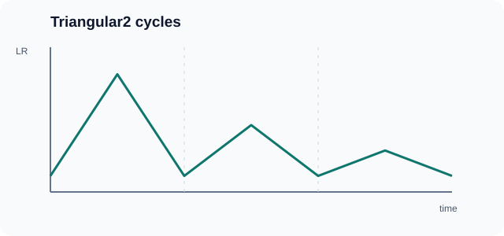

# Cyclical Learning Rates

Cyclical learning rates (CLR) vary the learning rate between a lower and an upper bound, repeatedly, instead of decaying it monotonically. Smith (2017) proposed the method and found the bounds with a short test in which the rate increases linearly. The parent overview is [Learning-Rate Schedules and Warm-up](learning-rate-schedules.md).

## Overview

Most schedules assume the rate should only fall over time. Smith argues that a larger rate lets the optimiser cross saddle-point plateaus more quickly, while a smaller rate lets it settle into a minimum. Cycling between the two covers both needs without a fixed decision about when to lower the rate.

## Problem

The learning rate is, in the paper's words, "the most important hyper-parameter to tune" for deep networks. Finding a good constant rate, or a good decay schedule, takes many training runs. Smith asks whether a simple, cheap rule can find a useful range of rates and then cycle within it.

## Core idea

Estimate two bounds, \(\eta_{\min}\) and \(\eta_{\max}\), with a learning-rate range test: increase the rate linearly over several epochs and watch the accuracy. Then cycle the rate between those bounds for the rest of training.

### Schedule in motion

*Original animation by AI Wiki, CC BY-SA 4.0.*

The moving marker follows three triangular cycles of equal duration. Each cycle rises linearly and falls linearly, while its amplitude is halved between cycles; the lower bound stays fixed. The plotted values are normalized illustrations, not measured model learning rates or accuracy.

## Algorithm

**Range test.** Train for a few epochs while the rate rises linearly from a small value to a large one, and plot accuracy against the rate. The lower bound is where accuracy starts to rise. The upper bound is where accuracy slows, becomes erratic, or starts to fall. The paper suggests setting the lower bound to one third or one quarter of the upper bound. The test takes 8 epochs for CIFAR-10 and 4 epochs for GoogLeNet in the paper.

**Cycle policies.** With a step size \(s\) measured in iterations and \(t\) the current iteration, the *triangular* policy uses

\[
\mathrm{cycle} = \left\lfloor 1 + \frac{t}{2s} \right\rfloor,\qquad x = \left|\frac{t}{s} - 2\,\mathrm{cycle} + 1\right|,\qquad \eta_t = \eta_{\min} + (\eta_{\max} - \eta_{\min})\max(0,\, 1 - x)
\]

so the rate rises and falls linearly, once per \(2s\) iterations. The *triangular2* policy halves the amplitude after each cycle. The *exp_range* policy shrinks the bounds exponentially over time. The paper reports that the choice of window shape made little difference, and it uses the triangular window as the simplest.

**Step size.** The paper finds results "quite robust" to the cycle length, and suggests a step size of 2 to 10 times the number of iterations in an epoch. For CIFAR-10 with 500 iterations per epoch it uses a step size of 2,000 (a 4,000-iteration cycle). For AlexNet and GoogLeNet on ImageNet it uses 30,000 iterations.

## Results

- **CIFAR-10, Caffe.** With a fixed rate, accuracy reaches 81.4% at 70,000 iterations. The triangular2 policy reaches 81.4% at 25,000 iterations.
- **Five-run averages.** For CIFAR-10 and CIFAR-100 with ResNet, Stochastic Depth and DenseNet networks, the paper reports accuracy of 93.6/72.5, 94.5/75.4 and 94.9/75.9 with CLR. Fixed-rate baselines reach 91.8 to 94.6 on CIFAR-10 and 71.2 to 75.3 on CIFAR-100.
- **ImageNet.** AlexNet reaches 58.0% with a fixed rate at 400,000 iterations, and 58.4% with triangular2 at the same count. GoogLeNet reaches 63.0% with a fixed rate at 420,000 iterations, and 64.4% with triangular2 at the same count.

## Limitations

- **Bounds are architecture-specific.** The range test is run for each architecture and dataset, so the bounds must be re-estimated for a new model.
- **Stopping point.** The paper recommends ending training at the end of a cycle, so the rate is low when training stops. Stopping at the peak would leave a noisy model.
- **Replacing a schedule.** The paper suggests replacing each constant-rate phase with at least three cycles, and four or more is better. This makes a cycle a cost decision as well as a choice of shape.
- **Baselines of its time.** The comparisons use fixed-rate and step-decay training on 2015 to 2016 networks. The paper does not test Transformers or the warm-up schedules that became common later.

## Variants and related schedules

- **Triangular, triangular2 and exp_range** are the three policies in the paper, differing in how the amplitude changes over cycles.
- **[Cosine annealing with warm restarts](cosine-annealing-warm-restarts.md)** also restarts the rate, but it decays along a cosine curve inside each run and lengthens the runs over time.

## Connections

- [Learning-Rate Schedules and Warm-up](learning-rate-schedules.md) is the overview that places this method among the others.
- [Gradual warm-up](gradual-warm-up.md) also uses a linear rise of the rate, and the range test in this method plays a similar role.
- [Loss landscape](theory-and-landscapes.md) explains why a larger rate may help the optimiser move through flat regions and saddle points.

## Open questions

- When does a cyclical schedule outperform a well-tuned decay, and when does it not?
- How should the cycle length be chosen for a given budget?
- Does a cyclical rate help adaptive methods such as [Adam](adaptive/adam.md), which already scale each parameter's step?

## References

### Seminal papers

- Smith, L. N. (2017). *Cyclical Learning Rates for Training Neural Networks*. WACV 2017, pp. 464–472. doi:[10.1109/WACV.2017.58](https://doi.org/10.1109/WACV.2017.58) — Proposes cycling the learning rate between bounds found by a linear range test. Preprint: https://arxiv.org/abs/1506.01186
- Loshchilov, I. & Hutter, F. (2017). *SGDR: Stochastic Gradient Descent with Warm Restarts*. ICLR 2017. https://arxiv.org/abs/1608.03983 — Periodic restarts with a cosine decay inside each run, for comparison with cyclical rates.
- Goyal, P., et al. (2017). *Accurate, Large Minibatch SGD: Training ImageNet in 1 Hour*. arXiv. https://arxiv.org/abs/1706.02677 — Gradual warm-up and the linear scaling rule, a different way of changing the rate at the start of training.
- Vaswani, A., et al. (2017). *Attention Is All You Need*. NeurIPS 2017. https://arxiv.org/abs/1706.03762 — Linear warm-up followed by inverse-square-root decay, a monotone schedule that cyclical rates are often compared with.

### Surveys and textbooks

- Bottou, L., Curtis, F. E. & Nocedal, J. (2018). *Optimization Methods for Large-Scale Machine Learning*. SIAM Review, 60(2), 223–311. doi:[10.1137/16M1080173](https://doi.org/10.1137/16M1080173) — Survey of step-size choices for stochastic gradient methods, the background to a range test.
