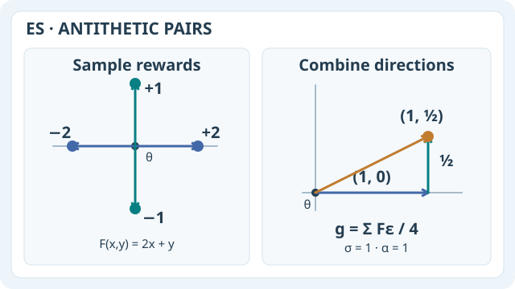

# Evolution Strategies

Evolution strategies (ES) estimate the gradient of an expected reward by sampling a population of perturbed parameters and weighting each sample by its score. Salimans et al. (2017) showed that this simple scheme scales to very many parallel workers and can train policies that compete with reinforcement learning. The parent overview is [Zeroth-Order and Evolutionary Optimisation](zeroth-order-and-evolutionary.md).

## Overview

ES is a zeroth-order method. It needs only the reward of each sampled policy, not its gradient, so it applies to simulators and black-box environments.

## Problem

Maximise an expected reward \(F(\theta)\), where \(F\) may be non-differentiable, or where backpropagation through the environment is impossible. Unlike policy-gradient methods such as REINFORCE, ES perturbs policy parameters rather than sampling actions to estimate a score-function gradient; neither method requires differentiating the environment reward.

## Core idea

Smooth the objective by adding Gaussian noise to the parameters:

\[
F_\sigma(\theta) = \mathbb{E}_{\varepsilon \sim \mathcal{N}(0, I)}\big[F(\theta + \sigma\varepsilon)\big].
\]

The gradient of the smoothed objective can be written without differentiating \(F\):

\[
\nabla_\theta F_\sigma(\theta) = \frac{1}{\sigma}\,\mathbb{E}_{\varepsilon}\big[F(\theta + \sigma\varepsilon)\,\varepsilon\big].
\]

## Algorithm

Sample \(n\) noise vectors \(\varepsilon_1,\dots,\varepsilon_n\) from \(\mathcal{N}(0, I)\), evaluate the reward \(F_i = F(\theta + \sigma\varepsilon_i)\) for each, and form the estimate

\[
g = \frac{1}{n\sigma}\sum_{i=1}^{n} F_i\,\varepsilon_i.
\]

Then update \(\theta \leftarrow \theta + \alpha g\), where \(\alpha\) is a learning rate. Each worker evaluates some of the samples, so only scalar rewards and the random seeds need to be shared between workers.

### Worked example: antithetic perturbations

*Original teaching animation, CC BY-SA 4.0. [Static preview](../../assets/concept-animations/es-antithetic-weighted-update-still.svg) · [Full animation](../../assets/concept-animations/es-antithetic-weighted-update-motion.svg).*

For $m$ independent Gaussian directions paired with their negatives, the raw-reward estimator is

$
\hat g=\frac{1}{2m\sigma}\sum_{j=1}^m [F(\theta+\sigma\varepsilon_j)-F(\theta-\sigma\varepsilon_j)]\varepsilon_j.
$

The animation uses a deliberately constructed two-direction sample, not a random Gaussian draw or a benchmark: $F(x,y)=2x+y$, $\theta=(0,0)$, $\sigma=1$, $\alpha=1$, and directions $(1,0)$ and $(0,1)$ with their negatives. Rewards are $2,-2,1,-1$. Both horizontal perturbations contribute in the positive horizontal direction after reward weighting; likewise for the vertical pair. Dividing the respective pair sums $(4,0)$ and $(0,2)$ by four gives $(1,0)$ and $(0,1/2)$. The estimate and new parameters are $(1,1/2)$, not the exact gradient $(2,1)$: these particular four samples do not reproduce the Gaussian second moment. Mirroring cancels a constant reward offset, but does not make a finite-sample estimate exact.

Salimans et al. (2017; see References) use common random numbers to reconstruct perturbations across workers. The worked example isolates raw-reward arithmetic rather than rank-based fitness shaping or communication timing. The MkDocs Play/Pause control toggles motion; the GitHub and reduced-motion preview shows the completed sum.

## Key results

The abstract reports that ES scales to over a thousand parallel workers and communicates only scalars. The body reports solving the 3D humanoid task in under 10 minutes with 1,440 workers, and competitive results on most Atari games after one hour of training on 720 CPUs, against A3C's published one-day results. The paper's per-game comparison splits, with ES better in 23 games and worse in 28, so this page does not quote per-game scores.

## Limitations

- Each update needs a whole population of rollouts, so ES is sample-hungry compared with gradient methods that use one trajectory per step.
- The variance of the estimate grows with the number of parameters, so large networks need large populations.
- The smoothing scale \(\sigma\) and the learning rate \(\alpha\) must be tuned, and the results depend strongly on them.
- Its advantages in the paper rely on massive parallelism, so the comparison is not a like-for-like one on a single machine.

## Connections

- [Zeroth-Order and Evolutionary Optimisation](zeroth-order-and-evolutionary.md) is the overview where ES sits beside SPSA and CMA-ES.
- [SPSA](spsa.md) estimates a gradient from two perturbations instead of a population.
- [CMA-ES](cma-es.md) adapts a covariance matrix over the same kind of population.
- [Reinforcement learning](../paradigms/reinforcement-learning/index.md) provides the policy-gradient methods that ES is compared against.

## Applications

- Training locomotion policies in physics simulators, as in the humanoid walking result.
- Training agents on Atari from pixels, where reward is available but not differentiable.

## Open questions

- At equal numbers of environment interactions, how does ES compare with policy gradient methods?
- Can the population size be reduced for large networks without losing the gradient estimate's quality?

## References

### Seminal papers

- Salimans, T., Ho, J., Chen, X., Sidor, S. & Sutskever, I. (2017). *Evolution Strategies as a Scalable Alternative to Reinforcement Learning*. arXiv. https://arxiv.org/abs/1703.03864 — Shows that ES scales to over a thousand parallel workers and is competitive with reinforcement learning on MuJoCo and Atari.
- Spall, J. C. (1992). Multivariate stochastic approximation using a simultaneous perturbation gradient approximation. *IEEE Transactions on Automatic Control*, 37(3), 332–341. https://doi.org/10.1109/9.119632 — The gradient-free estimator that ES is an alternative to for black-box objectives.
- Malladi, S., et al. (2023). *Fine-Tuning Language Models with Just Forward Passes*. arXiv. https://arxiv.org/abs/2305.17333 — A later zeroth-order method for language-model fine-tuning, for comparison with ES.

### Surveys and textbooks

- Hansen, N. (2016). *The CMA Evolution Strategy: A Tutorial*. arXiv. https://arxiv.org/abs/1604.00772 — Tutorial on the covariance-adapting member of the evolution strategy family.
- Bottou, L., Curtis, F. E. & Nocedal, J. (2018). *Optimization Methods for Large-Scale Machine Learning*. *SIAM Review*, 60(2), 223–311. https://doi.org/10.1137/16M1080173 — Survey of gradient-based stochastic methods, the baseline against which ES is compared.
