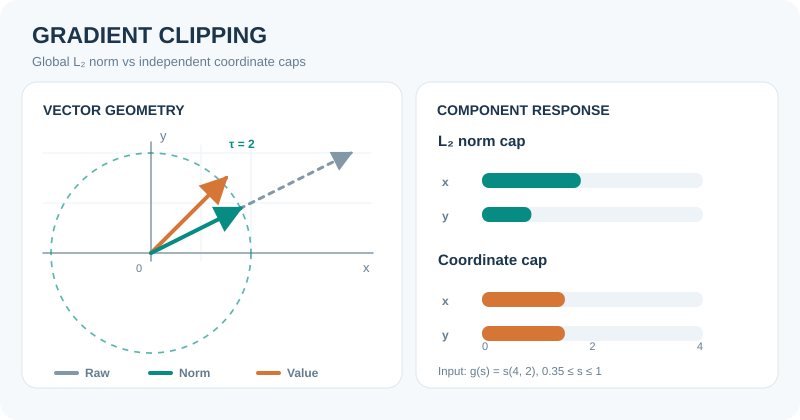
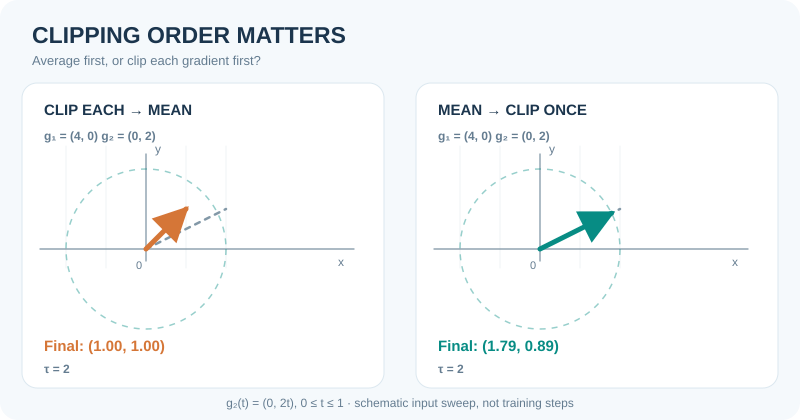
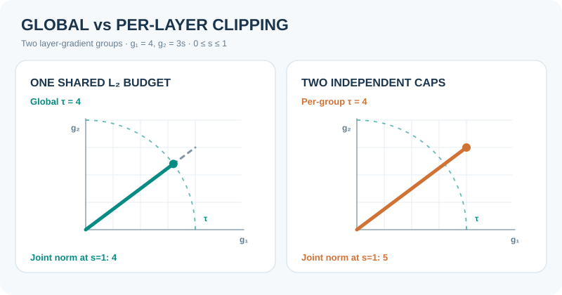
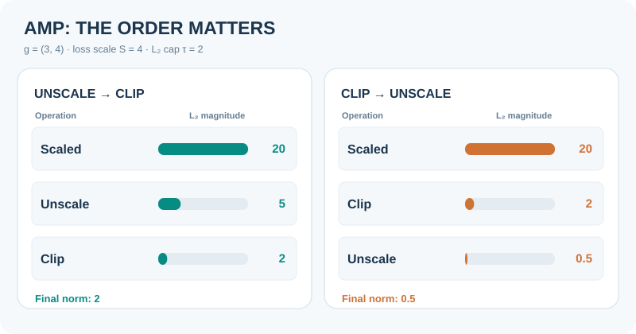

# Gradient Clipping and Normalised Updates

Gradient clipping and normalised updates limit how large a step the optimiser can take. Clipping caps the gradient when its norm is too large, which stops rare explosions from destroying training. Layer-wise normalised updates, such as LARS and LAMB, scale each layer's step by the ratio of its weight norm to its update norm, so that very large batches can be used without the learning rate diverging.

## Overview

Two problems call for different tools. The first is a rare, very large gradient, which can throw the parameters far from where they were useful. Recurrent networks are the classic case, where repeated multiplication through time makes gradients explode. Clipping caps the step in that case and leaves ordinary steps unchanged. The second problem is that a single global learning rate is wrong for layers whose weights differ in scale. Under very large batches, a global rate that suits the early layers can diverge in others. Layer-wise normalisation sets a per-layer step relative to the weight size, so every layer moves by a comparable fraction of its own norm.

## Key concepts

- **Norm clipping**: rescaling the gradient so that its norm does not exceed a threshold, leaving its direction unchanged.
- **Value clipping**: clipping each coordinate to a fixed interval. It changes the direction, and it is less common than norm clipping.
- **Trust ratio**: the ratio of a layer's weight norm to its update norm, used to scale the step for that layer.
- **Layer-wise adaptation**: setting a separate learning rate for each layer, rather than one for the whole network.

## How it works

Clipping is applied to the gradient before the optimiser update. Normalised updates change the update itself, in two steps: compute a direction for the layer, then scale it so that its size is a fixed fraction of the layer's weight norm.

| Technique | Acts on | Effect |
|---|---|---|
| Norm clipping | Whole gradient | Caps the step when the gradient is too large; direction preserved |
| Layer-wise normalisation (LARS) | Each layer's step | Step size proportional to the layer's weight norm |
| Layer-wise normalisation (LAMB) | Each layer's Adam-style update | Adam direction, scaled by the layer's trust ratio |

### Norm clipping versus coordinatewise value clipping

*Original teaching animation (CC BY-SA 4.0).* The synthetic vector is \(g(s)=s(4,2)\), with \(0.35\le s\le1\). **Global L2 clipping** uses \(\tilde g=g\min(1,2/\|g\|_2)\), preserving direction, whereas **coordinate clipping** uses \(\tilde g_j=\max(-1.5,\min(1.5,g_j))\), which can rotate it. At \(s=1\), the global output is approximately **(1.789, 0.894)** and the coordinatewise output **(1.5, 1.5)**. The continuous sweep is a mathematical comparison, **not a measured gradient trace or optimizer trajectory**. [GitHub static preview](../../assets/concept-animations/gradient-clipping-comparison-still.svg). The MkDocs site offers Play/Pause; mobile users can scroll horizontally and focus the figure with a keyboard. Norm clipping follows Pascanu et al. (2013) in References.

### Clipping before versus after averaging accumulated gradients

*Original teaching animation (CC BY-SA 4.0).* Let two invented microbatch gradients be \(g_1=(4,0)\) and \(g_2=(0,2)\), with L2 threshold \(\tau=2\). The operations **do not commute**:

\[
\frac{\operatorname{clip}_2(g_1)+\operatorname{clip}_2(g_2)}{2}=(1,1),\qquad
\operatorname{clip}_2\!\left(\frac{g_1+g_2}{2}\right)=\left(\frac{4}{\sqrt5},\frac{2}{\sqrt5}\right)\approx(1.789,0.894).
\]

The animation varies the second input continuously as \(g_2(t)=(0,2t)\); its intermediate frames compare **hypothetical inputs**, not successive updates. Real gradient accumulation may sum instead of average; any threshold must be interpreted in the chosen scaling convention. **All numbers are analytic teaching examples, not training measurements.** [GitHub static preview](../../assets/concept-animations/gradient-accumulation-clipping-order-still.svg). On MkDocs use Play/Pause; on narrow displays scroll the focusable figure horizontally. Norm clipping is discussed in Pascanu et al. (2013), already cited below.

### Shared global norm budget versus independent layer caps

*Original continuous teaching animation (CC BY-SA 4.0).* Consider two **orthogonal parameter groups** with scalar L2 gradient norms \(g_1=4\) and \(g_2=3s\), \(0\le s\le1\). Their coordinates in the diagram denote **group norms**, not individual tensor directions. For a global threshold \(\tau=4\), the combined norm at \(s=1\) is \(5\), so both groups are rescaled by \(4/5\): the effective pair becomes \((3.2,2.4)\) with joint norm \(4\). Independent per-group thresholds of \(4\) leave \((4,3)\) unchanged because neither group exceeds its cap; their **joint** norm remains \(5\). Increasing the second group's gradient can thus shrink the first group's output *only under a shared budget*. Per-layer clipping is not the trust-ratio update used by LARS or LAMB. This is a **synthetic parameter sweep, not a measured training trace**. [GitHub-readable static preview](../../assets/concept-animations/gradient-global-layer-budget-still.svg). On MkDocs use Play/Pause to compare the vectors; the scrollable figure is keyboard focusable. Global clipping follows Pascanu et al. (2013) in References.

### Automatic mixed precision: unscale gradients before clipping

*Original teaching animation (CC BY-SA 4.0).* Let the unscaled gradient be \(g=(3,4)\), with \(\|g\|_2=5\). A loss scaler multiplies it by \(S=4\), giving a scaled norm of \(20\), while the intended gradient clipping threshold is \(\tau=2\). **Correct:** \(\operatorname{clip}_2(Sg/S)\) has norm \(2\). **Incorrect:** \(\operatorname{clip}_2(Sg)/S\) has norm \(2/4=0.5\), because clipping was performed in the scaled rather than original units. With microbatch gradient accumulation, finish the entire effective batch's accumulation **before unscaling and clipping**. See the [official PyTorch automatic mixed precision example](https://docs.pytorch.org/docs/stable/notes/amp_examples.html), which uses GradScaler.unscale_ before clip_grad_norm_. The highlighted operations show computational order, **not measured training traces or recommended scaler values**; all values are analytical examples. [GitHub-readable static preview](../../assets/concept-animations/gradient-amp-unscale-order-still.svg). The MkDocs player offers Play/Pause, a reduced-motion static fallback, and a keyboard-focusable figure.

## Key methods

Three methods, each with its own page. The first is the oldest and the simplest.

| Method | Year | What separates it |
|---|---|---|
| [Norm clipping](norm-clipping.md) (Pascanu et al., 2013) | 2013 | Caps the norm of the gradient to stop exploding gradients in recurrent networks, and leaves the direction unchanged |
| [LARS](lars.md) (You et al., 2017) | 2017 | Layer-wise adaptive rate scaling for SGD-type updates, used to train with batch sizes of 8K to 32K |
| [LAMB](lamb.md) (You et al., 2019) | 2019 | Applies the layer-wise trust ratio to an Adam update, and is used for BERT |

## Connections

- [Gradual warm-up and linear scaling](gradual-warm-up.md) is the schedule-based fix for large batches. LARS is motivated by the cases where it fails.
- [Adaptive methods](adaptive/index.md) provide the per-coordinate update that LAMB normalises layer by layer.
- [Regularisation and weight decay](regularisation-and-weight-decay.md) interacts with the layer-wise step, because the trust ratio depends on the weight norm.
- [Large-batch and distributed training](large-batch-and-distributed.md) is where layer-wise normalisation is most used.
- [Recurrent networks](../models/rnn/index.md) are the setting where norm clipping was first studied.

## Applications

- Training recurrent and sequence models with clipping, to avoid occasional loss spikes.
- Pre-training large Transformer models with LAMB and very large batches.
- Training convolutional networks such as ResNet-50 with LARS and large batches.

## Open questions

- Is clipping best set as a fixed threshold, or should it adapt to the gradient history?
- When do layer-wise normalisers beat a well-tuned warm-up and decay, and when do they add nothing?
- Why does the trust ratio help, and does it fix a problem in the optimiser or in the parameterisation?

## References

### Seminal papers

- Pascanu, R., Mikolov, T. & Bengio, Y. (2013). *On the Difficulty of Training Recurrent Neural Networks*. ICML. https://arxiv.org/abs/1211.5063 — Analyses exploding and vanishing gradients in recurrent networks and proposes gradient norm clipping.
- You, Y., Gitman, I. & Ginsburg, B. (2017). *Large Batch Training of Convolutional Networks*. arXiv. https://arxiv.org/abs/1708.03888 — Introduces LARS, a layer-wise adaptive rate scaling method for training AlexNet and ResNet-50 with large batches.
- You, Y., et al. (2019). *Large Batch Optimization for Deep Learning: Training BERT in 76 Minutes*. ICLR. https://arxiv.org/abs/1904.00962 — Introduces LAMB, which applies layer-wise adaptation to Adam for BERT pre-training with very large batches.
- Goyal, P., et al. (2017). *Accurate, Large Minibatch SGD: Training ImageNet in 1 Hour*. arXiv. https://arxiv.org/abs/1706.02677 — The linear scaling and warm-up recipe that LARS was proposed to extend.

### Surveys and textbooks

- Bottou, L., Curtis, F. E. & Nocedal, J. (2018). *Optimization Methods for Large-Scale Machine Learning*. SIAM Review. https://arxiv.org/abs/1606.04838 — Survey of stochastic gradient methods, with discussion of step-size control and gradient magnitude.

### Articles and documentation

- PyTorch Contributors. *Automatic Mixed Precision examples: Gradient clipping*. https://docs.pytorch.org/docs/stable/notes/amp_examples.html — Official example of unscaling accumulated gradients before gradient norm clipping with GradScaler.