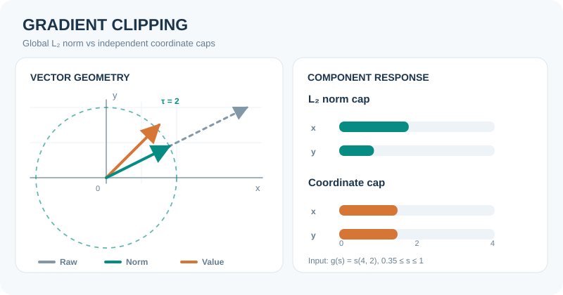
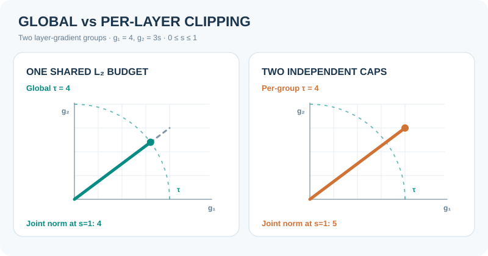
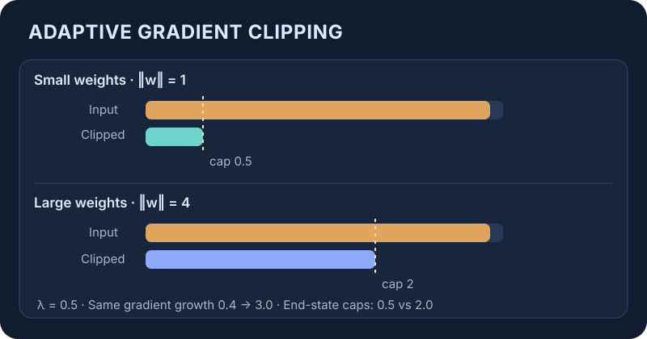
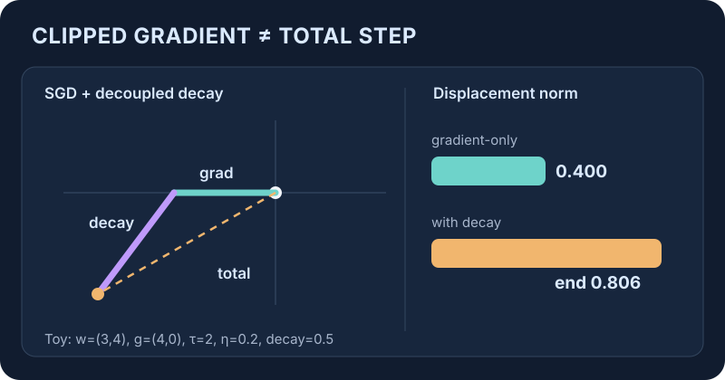

# 梯度裁剪與正規化更新

梯度裁剪限制原始梯度的範數或各座標數值，逐層正規化更新則另行縮放最佳化方向。對 Adam 等自適應最佳化器而言，**裁剪原始梯度並不直接保證最終參數更新量具有相同上限**。裁剪可減輕異常巨大梯度的影響，但不能單獨保證訓練穩定。逐層正規化的更新（如 LARS 與 LAMB）則以每一層權重範數與更新範數的比值縮放該層的步長，使極大批次的訓練不致因學習率發散而失敗。

## 概述

兩類問題需要不同的工具。第一類是罕見但非常大的梯度，它可能把參數推到離有用區域很遠的地方。循環神經網路是典型的例子，因為梯度沿時間重複相乘，容易爆炸。範數裁剪在這種情況下限制梯度範數，對未超過門檻的梯度不做改動。第二類問題是，單一的全域學習率不適合權重尺度各不相同的各層。在極大批次下，適合早期層的全域學習率，可能會使其他層發散。逐層正規化依權重大小設定每層的步長，使每層都依自身範數的相近比例移動。

## 核心概念

- **範數裁剪**：重新縮放梯度，使其範數不超過門檻，方向保持不變。
- **數值裁剪**：把每個座標裁剪到固定區間內。它會改變方向，比範數裁剪少見。
- **信任比**：某一層的權重範數與更新範數之比，用來縮放該層的步長。
- **逐層自適應**：為每一層設定獨立的學習率，而不是整個網路共用一個。

## 運作方式

裁剪在最佳化器更新之前套用於梯度。正規化更新則改變更新本身，分兩步：先算出該層的方向，再縮放使其大小為該層權重範數的固定比例。

| 技術 | 作用對象 | 效果 |
|---|---|---|
| 範數裁剪 | 整個梯度 | 限制原始梯度範數並保留方向；不直接限制自適應更新量 |
| 逐層正規化（LARS） | 每層的步長 | 步長與該層的權重範數成正比 |
| 逐層正規化（LAMB） | 每層的 Adam 式更新 | 採用 Adam 的方向，並以該層的信任比縮放 |

### 梯度範數裁剪與逐座標數值裁剪的差異

*原創教學動畫（CC BY-SA 4.0）。* 使用人工向量 \(g(s)=s(4,2)\)，其中 \(0.35\le s\le1\)。**全域 L2 範數裁剪**依 \(\tilde g=g\min(1,2/\|g\|_2)\) 共同縮放所有座標，因此保留方向；**逐座標數值裁剪**則令 \(\tilde g_j=\max(-1.5,\min(1.5,g_j))\)，方向可能改變。當 \(s=1\) 時，兩者的結果分別約為 **(1.789, 0.894)** 與 **(1.5, 1.5)**。連續動態只是在比較不同輸入值，**不是實際訓練的梯度序列**。[GitHub 靜態回退預覽](../../assets/concept-animations/gradient-clipping-comparison-still.svg)。MkDocs 提供播放／暫停；手機可水平捲動，鍵盤可聚焦圖面。範數裁剪的原始文獻見下方 Pascanu 等人（2013）。

### 梯度累積：先裁剪再平均，不等於先平均再裁剪

*原創教學動畫（CC BY-SA 4.0）。* 設兩個人工微批次梯度 \(g_1=(4,0)\) 和 \(g_2=(0,2)\)，全域 L2 門檻 \(\tau=2\)。裁剪與平均**不符合交換律**：

\[
\frac{\operatorname{clip}_2(g_1)+\operatorname{clip}_2(g_2)}{2}=(1,1),\qquad
\operatorname{clip}_2\!\left(\frac{g_1+g_2}{2}\right)=\left(\frac{4}{\sqrt5},\frac{2}{\sqrt5}\right)\approx(1.789,0.894).
\]

動畫令第二個輸入變為 \(g_2(t)=(0,2t)\)，只是在掃描**不同的假設輸入**，並非連續訓練步驟。實際梯度累積可能採總和或平均，因此必須配合使用的縮放方式解讀門檻。**所有數值皆為數學示例，並非模型實測。** [GitHub 靜態回退預覽](../../assets/concept-animations/gradient-accumulation-clipping-order-still.svg)。MkDocs 可播放／暫停，窄螢幕可水平捲動並用鍵盤聚焦。範數裁剪研究見下方 Pascanu 等人（2013）。

### 全域梯度範數預算與逐層獨立裁剪

*原創連續教學動畫（CC BY-SA 4.0）。* 假設兩組**互相正交的參數群組**，梯度 L2 範數分別為 \(g_1=4\) 及 \(g_2=3s\)，其中 \(0\le s\le1\)。圖中的座標代表**群組梯度範數**，而非各張量本身的方向。若共用全域裁剪門檻 \(\tau=4\)，當 \(s=1\) 時整體範數為 \(5\)，兩組都要乘以 \(4/5\)，得到 \((3.2,2.4)\)，聯合範數為 \(4\)。若兩組各有獨立門檻 \(4\)，則各組範數都未超標，輸出仍是 \((4,3)\)，但其**聯合**範數為 \(5\)。因此，僅在共用門檻的情況下，第二組梯度增加才會使第一組輸出縮小。逐層裁剪亦不等同於 LARS 或 LAMB 的信任比縮放。動畫掃描的是**人工解析參數，並非模型訓練梯度軌跡**。[GitHub 靜態回退預覽](../../assets/concept-animations/gradient-global-layer-budget-still.svg)。MkDocs 支援播放／暫停、鍵盤聚焦與水平捲動。全域裁剪參考下方 Pascanu 等人（2013）。

### 自動混合精度：先還原梯度尺度再裁剪

*原創教學動畫（CC BY-SA 4.0）。* 設還原尺度後的人工梯度 \(g=(3,4)\)、\(\|g\|_2=5\)。使用損失縮放因子 \(S=4\) 時，縮放梯度的範數為 \(20\)，希望的裁剪門檻是 \(\tau=2\)。**正確流程**先還原再裁剪，\(\operatorname{clip}_2(Sg/S)\) 的範數為 \(2\)。**錯誤流程**先裁剪放大後的梯度再還原，\(\operatorname{clip}_2(Sg)/S\) 的範數只有 \(2/4=0.5\)，導致過度縮小。使用梯度累積時，應先完成有效批次的梯度累積，再執行 unscale 與 clipping，否則梯度語意可能改變；詳見 [PyTorch 官方 Automatic Mixed Precision 範例](https://docs.pytorch.org/docs/stable/notes/amp_examples.html) 中的 GradScaler.unscale_。動畫呈現運算依存次序，**不是模型實測資料，也不代表建議使用的縮放因子**。[GitHub 靜態回退預覽](../../assets/concept-animations/gradient-amp-unscale-order-still.svg)。MkDocs 沿用播放／暫停、降低動態效果時的靜態回退，以及鍵盤聚焦與水平捲動。

### 自適應梯度裁剪：相對於權重尺度的門檻

*原創連續教學動畫（CC BY-SA 4.0）。* 自適應梯度裁剪（Adaptive Gradient Clipping, AGC）對**各參數單元**使用相對於權重範數的門檻，而不是共用一個絕對門檻。在權重範數非零且無須下限保護的簡化情況，\(\tau_u=\lambda\|w_u\|_2\)，\(\tilde g_u=g_u\min(1,\tau_u/\|g_u\|_2)\)。圖中刻意把 \(\lambda\) 設為 **0.5 以便觀察**，並非建議的超參數。相同的人工梯度範數從 \(0.4\) 增加至 \(3.0\)；兩個單元的權重範數為 \(1\) 與 \(4\)，末端分別裁剪到 \(0.5\) 與 \(2.0\)。實際 AGC 對近零權重範數會設定下限，單元的定義也取決於張量形狀；動畫未模擬這些細節。此為**人工解析示例，非模型實測**。[GitHub 靜態回退預覽](../../assets/concept-animations/gradient-agc-relative-cap-still.svg)。MkDocs 支援播放／暫停，窄螢幕可鍵盤聚焦並水平捲動。原始研究參見下方 Brock 等人（2021）。

### 裁剪梯度不等於裁剪含權重衰減的總步長

*原創序列教學動畫（CC BY-SA 4.0）。* 採用**無動量 SGD 加上獨立權重衰減的人工更新**，不是 AdamW 的實際最佳化軌跡：

\[
\theta^+=\theta-\eta\,\operatorname{clip}_{\tau}(g)-\eta\lambda\theta.
\]

設 \(\theta=(3,4)\)、\(g=(4,0)\)、\(\tau=2\)、\(\eta=0.2\)、\(\lambda=0.5\)。裁剪後梯度造成 \((-0.4,0)\) 的位移，其範數為 \(0.4=\eta\tau\)；額外的權重衰減造成 \((-0.3,-0.4)\)。合併後的位移是 \((-0.7,-0.4)\)，範數為 \(\sqrt{0.65}\approx0.806\)。因此**梯度裁剪門檻不會同時限制最佳化器另外加入的更新項目**。所有數值都是人工數學示例，非真實訓練量測。[GitHub 靜態回退預覽](../../assets/concept-animations/gradient-decoupled-decay-still.svg)。MkDocs 支援播放／暫停及降低動態效果時的靜態回退。原理參見 Loshchilov 與 Hutter（2019）。

**梯度上限不等於自適應更新上限。** 對沒有額外項目的普通 SGD 而言，\(\|\tilde g\|_2\le\tau\) 可推出 \(\|\Delta\theta\|_2\le\eta\tau\)。但 [Adam](adaptive/adam.md) 的動量與逐座標預條件化會改變從裁剪梯度到最終參數更新的對應關係，因此無法一般性地沿用相同界限。這四張圖呈現的是**梯度域運算，而非 Adam 最終步長上限**。

## 關鍵方法

三個方法各有獨立頁面。第一個最早，也最簡單。

| 方法 | 年份 | 區別所在 |
|---|---|---|
| [範數裁剪](norm-clipping.md)（Pascanu 等人，2013） | 2013 | 限制梯度的範數以防止循環網路的梯度爆炸，並保留方向 |
| [LARS](lars.md)（You 等人，2017） | 2017 | 用於 SGD 類更新的逐層自適應學習率縮放，用於 8K 到 32K 的大批次訓練 |
| [LAMB](lamb.md)（You 等人，2019） | 2019 | 把逐層信任比套用到 Adam 更新上，用於 BERT |

## 關聯

- [漸進式預熱與線性縮放](gradual-warm-up.md)是以排程解決大批次問題的做法。LARS 的提出，動機正是這種做法失效的情況。
- [自適應方法](adaptive/index.md)提供了 LAMB 逐層正規化的逐座標更新。
- [正則化與權重衰減](regularisation-and-weight-decay.md)與逐層步長互相影響，因為信任比取決於權重範數。
- [大批次與分散式訓練](large-batch-and-distributed.md)是逐層正規化使用最多的場景。
- [循環神經網路](../models/rnn/index.md)是範數裁剪最初研究的設定。

## 應用

- 以裁剪訓練循環網路與序列模型，避免偶發的損失驟升。
- 以 LAMB 與極大批次預訓練大型 Transformer 模型。
- 以 LARS 與大批次訓練 ResNet-50 等卷積網路。

## 開放問題

- 裁剪門檻應固定設定，還是應隨梯度歷史自適應？
- 逐層正規化在什麼時候優於調校良好的預熱與衰減，什麼時候毫無幫助？
- 信任比為何有幫助？它修正的是最佳化器的問題，還是參數化的問題？

## 參考文獻

### 開創性論文

- Brock, A., De, S., Smith, S. L. & Simonyan, K. (2021). *High-Performance Large-Scale Image Recognition Without Normalization*. ICML. https://arxiv.org/abs/2102.06171 — 提出 Normalizer-Free Networks 使用的逐單元自適應梯度裁剪。
- Loshchilov, I. & Hutter, F. (2019). *Decoupled Weight Decay Regularization*. ICLR. https://arxiv.org/abs/1711.05101 — 研究獨立權重衰減與梯度更新的差異。

- Pascanu, R., Mikolov, T. & Bengio, Y. (2013). *On the Difficulty of Training Recurrent Neural Networks*. ICML. https://arxiv.org/abs/1211.5063 — 提出以範數裁剪處理梯度爆炸，並分析循環網路中的梯度消失。
- You, Y., Gitman, I. & Ginsburg, B. (2017). *Large Batch Training of Convolutional Networks*. arXiv. https://arxiv.org/abs/1708.03888 — 提出 LARS，以逐層自適應學習率縮放，在大批次下訓練 AlexNet 與 ResNet-50。
- You, Y., et al. (2019). *Large Batch Optimization for Deep Learning: Training BERT in 76 Minutes*. ICLR. https://arxiv.org/abs/1904.00962 — 提出 LAMB，把逐層自適應套用到 Adam 上，用於極大批次的 BERT 預訓練。
- Goyal, P., et al. (2017). *Accurate, Large Minibatch SGD: Training ImageNet in 1 Hour*. arXiv. https://arxiv.org/abs/1706.02677 — 線性縮放與預熱的做法，LARS 即為延伸它而提出。

### 綜述與教科書

- Bottou, L., Curtis, F. E. & Nocedal, J. (2018). *Optimization Methods for Large-Scale Machine Learning*. SIAM Review. https://arxiv.org/abs/1606.04838 — 隨機梯度方法的綜述，討論步長控制與梯度大小。

### 文章與官方文件

- PyTorch Contributors. *Automatic Mixed Precision examples: Gradient clipping*. https://docs.pytorch.org/docs/stable/notes/amp_examples.html — 官方文件示範先對已累積梯度還原尺度，再執行梯度範數裁剪。