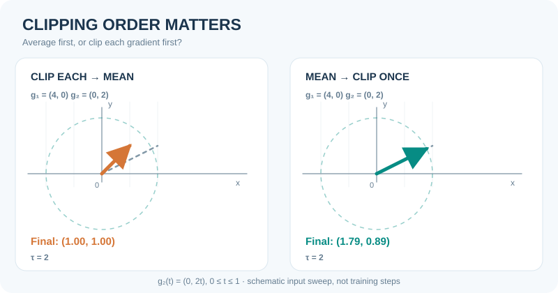

# 梯度裁剪與正規化更新

梯度裁剪與正規化更新限制最佳化器能走的步長。裁剪在梯度範數過大時加以限制，防止偶發的爆炸性梯度破壞訓練。逐層正規化的更新（如 LARS 與 LAMB）則以每一層權重範數與更新範數的比值縮放該層的步長，使極大批次的訓練不致因學習率發散而失敗。

## 概述

兩類問題需要不同的工具。第一類是罕見但非常大的梯度，它可能把參數推到離有用區域很遠的地方。循環神經網路是典型的例子，因為梯度沿時間重複相乘，容易爆炸。裁剪在這種情況下限制步長，對一般的步長則不做改動。第二類問題是，單一的全域學習率不適合權重尺度各不相同的各層。在極大批次下，適合早期層的全域學習率，可能會使其他層發散。逐層正規化依權重大小設定每層的步長，使每層都依自身範數的相近比例移動。

## 核心概念

- **範數裁剪**：重新縮放梯度，使其範數不超過門檻，方向保持不變。
- **數值裁剪**：把每個座標裁剪到固定區間內。它會改變方向，比範數裁剪少見。
- **信任比**：某一層的權重範數與更新範數之比，用來縮放該層的步長。
- **逐層自適應**：為每一層設定獨立的學習率，而不是整個網路共用一個。

## 運作方式

裁剪在最佳化器更新之前套用於梯度。正規化更新則改變更新本身，分兩步：先算出該層的方向，再縮放使其大小為該層權重範數的固定比例。

| 技術 | 作用對象 | 效果 |
|---|---|---|
| 範數裁剪 | 整個梯度 | 梯度過大時限制步長；保留方向 |
| 逐層正規化（LARS） | 每層的步長 | 步長與該層的權重範數成正比 |
| 逐層正規化（LAMB） | 每層的 Adam 式更新 | 採用 Adam 的方向，並以該層的信任比縮放 |

### 梯度範數裁剪與逐座標數值裁剪的差異

*原創教學動畫（CC BY-SA 4.0）。* 使用人工向量 \(g(s)=s(4,2)\)，其中 \(0.35\le s\le1\)。**全域 L2 範數裁剪**依 \(\tilde g=g\min(1,2/\|g\|_2)\) 共同縮放所有座標，因此保留方向；**逐座標數值裁剪**則令 \(\tilde g_j=\max(-1.5,\min(1.5,g_j))\)，方向可能改變。當 \(s=1\) 時，兩者的結果分別約為 **(1.789, 0.894)** 與 **(1.5, 1.5)**。連續動態只是在比較不同輸入值，**不是實際訓練的梯度序列**。[GitHub 靜態回退預覽](../../assets/concept-animations/gradient-clipping-comparison-still.svg)。MkDocs 提供播放／暫停；手機可水平捲動，鍵盤可聚焦圖面。範數裁剪的原始文獻見下方 Pascanu 等人（2013）。

### 梯度累積：先裁剪再平均，不等於先平均再裁剪

*原創教學動畫（CC BY-SA 4.0）。* 設兩個人工微批次梯度 \(g_1=(4,0)\) 和 \(g_2=(0,2)\)，全域 L2 門檻 \(\tau=2\)。裁剪與平均**不符合交換律**：

\[
\frac{\operatorname{clip}_2(g_1)+\operatorname{clip}_2(g_2)}{2}=(1,1),\qquad
\operatorname{clip}_2\!\left(\frac{g_1+g_2}{2}\right)=\left(\frac{4}{\sqrt5},\frac{2}{\sqrt5}\right)\approx(1.789,0.894).
\]

動畫令第二個輸入變為 \(g_2(t)=(0,2t)\)，只是在掃描**不同的假設輸入**，並非連續訓練步驟。實際梯度累積可能採總和或平均，因此必須配合使用的縮放方式解讀門檻。**所有數值皆為數學示例，並非模型實測。** [GitHub 靜態回退預覽](../../assets/concept-animations/gradient-accumulation-clipping-order-still.svg)。MkDocs 可播放／暫停，窄螢幕可水平捲動並用鍵盤聚焦。範數裁剪研究見下方 Pascanu 等人（2013）。

## 關鍵方法

三個方法各有獨立頁面。第一個最早，也最簡單。

| 方法 | 年份 | 區別所在 |
|---|---|---|
| [範數裁剪](norm-clipping.md)（Pascanu 等人，2013） | 2013 | 限制梯度的範數以防止循環網路的梯度爆炸，並保留方向 |
| [LARS](lars.md)（You 等人，2017） | 2017 | 用於 SGD 類更新的逐層自適應學習率縮放，用於 8K 到 32K 的大批次訓練 |
| [LAMB](lamb.md)（You 等人，2019） | 2019 | 把逐層信任比套用到 Adam 更新上，用於 BERT |

## 關聯

- [漸進式預熱與線性縮放](gradual-warm-up.md)是以排程解決大批次問題的做法。LARS 的提出，動機正是這種做法失效的情況。
- [自適應方法](adaptive/index.md)提供了 LAMB 逐層正規化的逐座標更新。
- [正則化與權重衰減](regularisation-and-weight-decay.md)與逐層步長互相影響，因為信任比取決於權重範數。
- [大批次與分散式訓練](large-batch-and-distributed.md)是逐層正規化使用最多的場景。
- [循環神經網路](../models/rnn/index.md)是範數裁剪最初研究的設定。

## 應用

- 以裁剪訓練循環網路與序列模型，避免偶發的損失驟升。
- 以 LAMB 與極大批次預訓練大型 Transformer 模型。
- 以 LARS 與大批次訓練 ResNet-50 等卷積網路。

## 開放問題

- 裁剪門檻應固定設定，還是應隨梯度歷史自適應？
- 逐層正規化在什麼時候優於調校良好的預熱與衰減，什麼時候毫無幫助？
- 信任比為何有幫助？它修正的是最佳化器的問題，還是參數化的問題？

## 參考文獻

### 開創性論文

- Pascanu, R., Mikolov, T. & Bengio, Y. (2013). *On the Difficulty of Training Recurrent Neural Networks*. ICML. https://arxiv.org/abs/1211.5063 — 提出以範數裁剪處理梯度爆炸，並分析循環網路中的梯度消失。
- You, Y., Gitman, I. & Ginsburg, B. (2017). *Large Batch Training of Convolutional Networks*. arXiv. https://arxiv.org/abs/1708.03888 — 提出 LARS，以逐層自適應學習率縮放，在大批次下訓練 AlexNet 與 ResNet-50。
- You, Y., et al. (2019). *Large Batch Optimization for Deep Learning: Training BERT in 76 Minutes*. ICLR. https://arxiv.org/abs/1904.00962 — 提出 LAMB，把逐層自適應套用到 Adam 上，用於極大批次的 BERT 預訓練。
- Goyal, P., et al. (2017). *Accurate, Large Minibatch SGD: Training ImageNet in 1 Hour*. arXiv. https://arxiv.org/abs/1706.02677 — 線性縮放與預熱的做法，LARS 即為延伸它而提出。

### 綜述與教科書

- Bottou, L., Curtis, F. E. & Nocedal, J. (2018). *Optimization Methods for Large-Scale Machine Learning*. SIAM Review. https://arxiv.org/abs/1606.04838 — 隨機梯度方法的綜述，討論步長控制與梯度大小。
