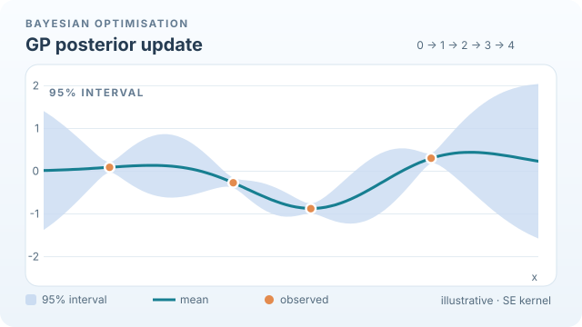
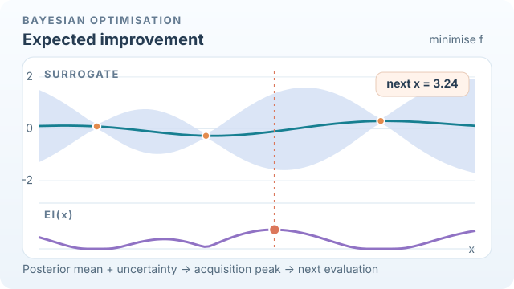

# Bayesian optimisation (Snoek et al., 2012)

Bayesian optimisation fits a probabilistic surrogate, usually a Gaussian process, to the scores of the settings tried so far, and chooses the next setting by maximising an acquisition function such as expected improvement. Part of [Hyperparameter optimisation](index.md).

## Overview

Snoek, Larochelle and Adams (2012) applied this idea to the tuning of machine learning algorithms, where each evaluation is a full training run and is therefore expensive. A surrogate that gives a mean and an uncertainty at every setting lets the search spend its next run where a good score is likely, or where the score is still uncertain. The paper also showed that the choice of prior for the surrogate strongly affects the result.

## Key concepts

- **Surrogate**: a probabilistic model of the objective \(f(x)\), given the observed pairs \((x_i, f(x_i))\). In the paper it is a Gaussian process with mean \(\mu(x)\) and variance \(\sigma^2(x)\).
- **Acquisition function**: a score for each candidate setting that trades off a good predicted mean against high uncertainty.
- **Incumbent**: the best score observed so far, \(f^\ast\).
- **Variable cost**: the paper's extension for settings whose training time differs, and its extension to parallel evaluation.

## Problem

Given a few expensive evaluations, which setting should be tried next so that the best setting is found with the fewest runs?

## How it works

The loop is as follows. Fit the surrogate to the observed settings. Maximise the acquisition function over the search space to get the next setting. Train that setting, add its score to the data, and repeat.

For minimisation, the expected-improvement acquisition is the expected amount by which a new setting beats the incumbent. With the Gaussian-process posterior mean \(\mu(x)\) and standard deviation \(\sigma(x)\), it has the closed form

\[
\mathrm{EI}(x) = \sigma(x)\bigl[z\,\Phi(z) + \phi(z)\bigr], \qquad z = \frac{f^\ast - \mu(x)}{\sigma(x)},
\]

where \(\Phi\) and \(\phi\) are the standard normal cumulative distribution function and density. Large \(\mathrm{EI}\) comes from a low predicted mean, or from high uncertainty, or from both.

### GP conditioning: how evidence changes the posterior

*Original teaching motion, CC BY-SA 4.0.* Each new observation conditions a Gaussian-process surrogate; the shaded **95% posterior interval** narrows near observed inputs, but remains wider where the search has less information. This is a deterministic **illustration, not results from trained models**. We use a one-dimensional zero-mean GP with squared-exponential kernel (length scale **0.92**, prior variance **1**) and illustrative observation-noise standard deviation **0.06**. Evaluations at \(x=0.80,2.30,4.70\) have scores approximately \(0.092,-0.269,0.304\), and the fourth point \(x=3.24\) has score \(-0.876\). Smooth in-between frames depict the visual transition between posterior fits, **not extra GP observations or optimisation steps**. The MkDocs figure has keyboard-operable Play/Pause; for static reading, [view the GitHub fallback](../../../assets/concept-animations/bo-gp-conditioning-still.svg) or [open the motion SVG](../../../assets/concept-animations/bo-gp-conditioning-motion.svg).[^bo-visual]

### Expected improvement: where to evaluate next

*Original teaching motion, CC BY-SA 4.0.* With only the **first three** observations above, the incumbent for minimisation is \(f^*\approx -0.269\). At each candidate, we evaluate the **plug-in expected improvement** from the fixed Gaussian-process posterior; the scanning marker follows \(\mathrm{EI}(x)\), then highlights \(x\approx3.24\) with \(\mathrm{EI}\approx0.222\) on a **0.06-spaced grid**. This is an acquisition maximum—not a claim that the true function minimiser is there. The example treats the observed incumbent as fixed although its GP fit has a small illustrative noise term, rather than implementing a noise-aware EI policy. The subsequent synthetic outcome at \(x=3.24\) appears in the first animation. No predictive or optimisation benchmark was measured. On MkDocs use Play/Pause, or [view the GitHub static preview](../../../assets/concept-animations/bo-expected-improvement-still.svg).[^bo-visual]

[^bo-visual]: See Snoek, Larochelle & Adams (2012) and Frazier (2018) in References for Gaussian-process Bayesian optimisation and expected improvement; all trajectories and numerical values in these figures are newly constructed examples.

## Key methods

This page covers one method: a Gaussian-process surrogate with expected improvement, as set out by Snoek et al. (2012).

1. Choose a prior for the surrogate, including the kernel and its length scales. The paper shows that this choice matters.
2. Fit the hyperparameters of the Gaussian process to the observed scores.
3. Maximise \(\mathrm{EI}\) over the search space, often with multi-start local optimisation.
4. Train the proposed setting and add its score to the data.

## Variants

- **Other acquisition functions** include upper confidence bound and probability of improvement, which change how strongly the search explores.
- **Parallel proposals** choose several settings at once, so that several runs train in parallel.
- **Variable-cost proposals** take the training time of each setting into account, so that cheap settings are not penalised.
- **Non-Gaussian surrogates** replace the Gaussian process with another model, which can scale better to many observations.

## Results and limits

- In the experiments of Snoek et al. (2012), the method reached or surpassed expert-level tuning of several learning algorithms, including convolutional networks and latent Dirichlet allocation.
- The result depends strongly on the prior and on how the surrogate's hyperparameters are handled. The authors show that thoughtful choices can change the outcome considerably.
- Gaussian-process fitting costs grow quickly with the number of observations, so the method suits small budgets better than large ones.
- The surrogate becomes less reliable as the number of dimensions grows, and for spaces with many categorical or conditional choices.

## Applications

- **Tuning expensive models**, such as deep networks or large simulations, where a few dozen runs are affordable.
- **Parallel tuning** on a cluster, using batch proposals.
- **Scientific design problems**, where each evaluation is a costly experiment.

## Open questions

- How should the surrogate be designed for spaces with many conditional or categorical hyperparameters?
- Can the method stay efficient when there are thousands of observations, without a fixed-size approximation that loses accuracy?

## Connections

- Parent topic: [Hyperparameter optimisation](index.md)
- Cheaper alternative for large budgets: [Hyperband](hyperband.md)
- Surrogate-based search across the wider field: Shahriari et al. (2016), cited on the [parent page](index.md)

## References

### Seminal papers

- Snoek, J., Larochelle, H. & Adams, R. P. (2012). Practical Bayesian Optimization of Machine Learning Algorithms. In *NeurIPS 2012*. arXiv:1206.2944. https://arxiv.org/abs/1206.2944 — Introduces Gaussian-process Bayesian optimisation for tuning machine learning algorithms, with variable-cost and parallel extensions.
- Močkus, J. (1974). On Bayesian methods for seeking the extremum. In *Optimization Techniques IFIP Technical Conference*, Springer, 400–404. https://doi.org/10.1007/3-540-07165-2_55 — Early statement of the expected-improvement idea for seeking the optimum of an unknown function.
- Shahriari, B. et al. (2016). Taking the Human Out of the Loop: A Review of Bayesian Optimization. *Proceedings of the IEEE* 104(1), 148–175. https://doi.org/10.1109/JPROC.2015.2494218 — Review of surrogates and acquisition functions.

### Surveys and textbooks

- Frazier, P. I. (2018). A Tutorial on Bayesian Optimization. arXiv:1807.02811. https://arxiv.org/abs/1807.02811 — Tutorial that derives expected improvement and related acquisition functions.
- Feurer, M. & Hutter, F. (2019). Hyperparameter Optimization. In *Automated Machine Learning*, Springer, 3–33. https://doi.org/10.1007/978-3-030-05318-5_1 — Chapter covering Bayesian optimisation alongside other tuning methods.
- Bergstra, J. & Bengio, Y. (2012). Random Search for Hyper-Parameter Optimization. *Journal of Machine Learning Research* 13, 281–305. https://jmlr.org/papers/v13/bergstra12a.html — The random-search baseline that model-based methods must beat.
