# Hyperband（Li 等人，2017）

Hyperband 在數種起始預算上執行連續減半。它取樣許多設定，短暫訓練，只保留最好的一部分，並把更多預算給倖存者；這個過程會在多個分支中重複，分支之間則權衡設定數量與每個設定所得的預算。本頁是[超參數最佳化](index.md)的一部分。

## 概述

隨機搜尋會把完整的訓練預算花在每個取樣的設定上，因此大部分運算花在表現差的設定上。Li、Jamieson、DeSalvo、Rostamizadeh 與 Talwalkar（2017）把超參數搜尋視為純探索的老虎機問題，其中預算是可以分配給各設定的資源。Jamieson 與 Talwalkar（2016）提出的連續減半給出了基本的排程。Hyperband 則不需要決定要嘗試多少設定，它會執行數種排程並從中選擇。

## 關鍵概念

- **資源** \(r\)：一次執行的預算，例如週期數、資料樣本數或迭代數。
- **最大資源** \(R\)：完整執行的預算。
- **縮減因子** \(\eta\)：每一輪保留的比例為 \(1/\eta\)，每個倖存者的預算則增加 \(\eta\) 倍。
- **分支**：連續減半的一種排程，在設定數量與起始預算之間有固定的權衡。

## 問題

在固定的總預算下，當設定的早期表現只是其最終表現的雜訊指標時，應嘗試多少設定，每個設定應分得多少資源？

## 運作方式

連續減半以 \(n\) 個設定開始，每個給予預算 \(r\)。每一輪之後，最好的 \(1/\eta\) 設定以 \(\eta\) 倍的預算繼續。第 \(i\) 輪的排程為

\[
n_i = \left\lfloor n\,\eta^{-i} \right\rfloor \text{ 個設定，每個預算為 } r_i = r\,\eta^{i}.
\]

Hyperband 會以數個分支執行此程序。令 \(s_{\max} = \lfloor \log_\eta (R/r) \rfloor\)。分支 \(s\) 以一定數量的設定與最小預算開始，其選擇使每個分支的總預算大致相同。\(s\) 大的分支嘗試許多設定，每個給予少量預算；\(s = 0\) 的分支則把少數設定執行到完整預算。所有分支中最佳的最終分數即為回傳結果。

*原創四階段教學動畫，CC BY-SA 4.0。* 示意分支 A 使用縮減因子 **3**，將資源量 1 的 9 組設定逐輪縮減為資源量 3 的 3 組，最後保留資源量 9 的 1 組；分支 B 則獨立從資源量 3 的 3 組設定開始，保留 1 組至資源量 9。字母、排名與資源單位皆為教學示意，**不是實測結果或效能比較**；兩個分支分別抽樣設定。動畫僅呈現資源配置，不代表早期排名必然可靠。MkDocs 網站支援播放／暫停及減少動態效果的靜態回退；GitHub 可[檢視靜態總覽圖](../../../assets/concept-animations/hyperband-budget-still.svg)。

## 主要方法

本頁只涵蓋一種方法：連續減半，在數個分支中執行，各分支對設定數量與其預算的權衡不同。

1. 選擇 \(R\)、\(\eta\) 與 \(r\)，其中 \(R/r\) 決定可進行的減半輪數。
2. 對每個分支 \(s\)，為該分支取樣設定，並在它們上執行連續減半。
3. 從所有分支的最終分數中保留最佳者。

## 變體

- **單獨的連續減半**，即只有一個分支，但需要事先決定設定數量。
- **模型引導的混合方法**把隨機取樣設定換成依分數擬合的模型，保留提早停止，並改善設定的選擇（Falkner 等人，2018）。
- **非同步變體**在工作者空閒時立即啟動新設定，而不必等待每一輪結束。

## 結果與限制

- 在 Li 等人（2017）的實驗中，Hyperband 在深度學習與核方法學習問題上，相較於包括貝氏最佳化方法在內的比較對象，獲得超過一個數量級的加速。
- Jamieson 與 Talwalkar（2016）在老虎機設定下分析了連續減半，而 Li 等人（2017）為分支排程補充了保證。
- 此方法假設在小預算下的設定排序，能預測完整預算下的排序。當這個假設不成立時，好的設定可能被過早捨棄。
- 它不建模哪些設定有希望。隨機取樣會把部分預算花在模型原本會拒絕的設定上，這正是混合方法的動機。

## 應用

- **調校深度網路**，當訓練執行可以提早停止時，例如以週期數作為資源。
- **在資料子集上調校**，此時資源是訓練資料量。
- **叢集上的大規模掃描**，許多便宜的執行可以平行進行。

## 開放問題

- 當不同設定改變每個週期的成本時，應如何選擇資源？
- 早期表現何時無法預測最終表現，方法能否偵測這種情況？

## 與其他頁面的連結

- 上層主題：[超參數最佳化](index.md)
- 以模型為基礎的替代方案：[貝氏最佳化](bayesian-optimisation.md)
- 在訓練中調整設定的族群替代方案：[基於族群的訓練](../../paradigms/reinforcement-learning/multi-agent-rl/population-based-training/index.md)

## 參考文獻

### 奠基性論文

- Li, L., Jamieson, K., DeSalvo, G., Rostamizadeh, A. & Talwalkar, A. (2017). Hyperband: A Novel Bandit-Based Approach to Hyperparameter Optimization. *Journal of Machine Learning Research* 18(185). arXiv:1603.06560. https://arxiv.org/abs/1603.06560 — 提出 Hyperband，在數個分支中執行連續減半。
- Jamieson, K. & Talwalkar, A. (2016). Non-stochastic Best Arm Identification and Hyperparameter Optimization. In *AISTATS 2016*, PMLR 51. https://proceedings.mlr.press/v51/jamieson16.html — 給出連續減半排程及其理論分析。
- Falkner, S., Klein, A. & Hutter, F. (2018). BOHB: Robust and Efficient Hyperparameter Optimization at Scale. In *Proceedings of the 35th ICML*, PMLR 80. https://proceedings.mlr.press/v80/falkner18a.html — 以良好設定的模型取代 Hyperband 中的隨機取樣。

### 綜述與教科書

- Bergstra, J. & Bengio, Y. (2012). Random Search for Hyper-Parameter Optimization. *Journal of Machine Learning Research* 13, 281–305. https://jmlr.org/papers/v13/bergstra12a.html — Hyperband 透過在設定之間分配預算而勝過的隨機搜尋基準。
- Snoek, J., Larochelle, H. & Adams, R. P. (2012). Practical Bayesian Optimization of Machine Learning Algorithms. In *NeurIPS 2012*. arXiv:1206.2944. https://arxiv.org/abs/1206.2944 — Hyperband 實驗中的以模型為基礎的競爭方法。
- Feurer, M. & Hutter, F. (2019). Hyperparameter Optimization. In *Automated Machine Learning*, Springer, 3–33. https://doi.org/10.1007/978-3-030-05318-5_1 — 比較提早停止與以模型為基礎調校的章節。
