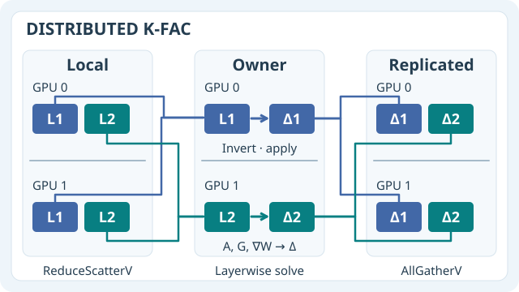

# 分散式 K-FAC

分散式 K-FAC 把 [K-FAC](index.zh-TW.md) 跨許多加速器執行，使克羅內克因子與其逆矩陣能在各處理程序之間並行計算並共享。Osawa 等人（2019）描述了一個用於卷積網路的大規模版本。他們在最多 1,024 個 GPU 上以 K-FAC 訓練 ImageNet 的 ResNet-50，約 10 分鐘完成。此方法針對大批次訓練，在這種情況下，除非仔細調校排程，一階方法的準確率會下降。

## 問題

大批次 SGD 只在一定程度內加快訓練。當小批次大小超過某個值後，驗證準確率開始下降。Goyal 等人（2017）提出的標準對策，是按小批次大小成比例調整學習率，並在最初幾個訓練週期做學習率預熱。K-FAC 等二階方法所需的步數較少，但其因子計算成本高昂，因此必須分散執行，才能在實際時間上具有競爭力。

## 核心想法

因子的計算與求逆分散到各處理程序上，結果透過 MPI 與 NCCL 的集體通訊合併。此設計旨在把計算克羅內克因子的額外成本降到最低。論文也檢驗因子可以過時多久，效能才會受影響。對批次正規化層，論文不把費雪矩陣分解為 $A$ 與 $G$，而只保留其對角部分。

## 公式或演算法

套用到每一層的更新，就是 [K-FAC](index.zh-TW.md) 頁面所述的預處理梯度。分散式方案改變的是因子的計算、合併與更新方式，並不改變更新的形式。

### 層級分工與集體通訊

*原創教學動畫，CC BY-SA 4.0。 [靜態預覽](../../../assets/concept-animations/distributed-kfac-layer-ownership-still.svg) · [完整動畫](../../../assets/concept-animations/distributed-kfac-layer-ownership-motion.svg).*

移動的資料封包說明 Osawa 等人（2019，第 3.3 節與演算法 1；見參考文獻）的資料平行與模型平行混合設計。各工作者先計算兩層的局部因子及梯度。ReduceScatterV 將這些統計量歸約並分配各層：本例由 GPU 0 負責 L1、GPU 1 負責 L2。各負責者計算加入阻尼的因子逆矩陣，並預處理該層梯度；接著 AllGatherV 將兩層的預處理方向傳回每個工作者。結果是各工作者仍有完整的模型參數，而非永久切割模型。

局部批次大小相等時，全域因子為局部二階矩的算術平均；樣本數不等時，必須一致地彙整原始加總與樣本數。先平均因子再求逆，通常不同於先在各工作者求逆再平均；因此動畫將求逆安排在歸約之後。層級配置與封包移動均為示意，不代表 GPU 實測時間，也不模擬集體通訊的內部路由。MkDocs 提供播放／暫停與減少動態效果的回退顯示；GitHub 預覽呈現完整路徑與終點。

**閱讀歸約階段。** 以輸入因子的純量簡化算例來看，GPU 0 有一筆觀測值，局部二階矩為 1；GPU 1 有三筆觀測值，局部二階矩為 5。負責該層的工作者必須得到依觀測數加權的全域二階矩 $(1+3\cdot5)/4=4$，而非工作者平均值 3。若純量阻尼為 1，示意梯度為 10，則預處理結果為 $10/(4+1)=2$，錯用工作者平均值則為 $10/(3+1)=2.5$。對卷積因子而言，計數必須與該統計量的正規化方式一致（例如區塊平均所使用的空間區塊數），不一定等於序列數或裝置數。這是單一因子的算術練習，並非完整雙因子 K-FAC 更新或訓練實測結果。

## 結果

論文以 K-FAC 在小批次大小 4,096 至 32,768 下訓練 ImageNet 的 ResNet-50。回報的單一裁剪 top-1 驗證準確率為 75.1% 至 75.3%，在 35 至 45 個訓練週期內達成。最突出的結果是：在 1,024 個 Tesla V100 GPU 上，ResNet-50 在 ImageNet 上 10 分鐘即可訓練至 74.9% 的 top-1 準確率。論文的表 2 把這個結果與已發表的大批次 ImageNet 訓練結果並列比較。

## 限制

- 最突出的結果都是 ResNet-50 在 ImageNet 上的，因此速度上的主張只適用於該設定。
- 此方法需要具備快速互連的大型 GPU 叢集，其速度取決於通訊設計。
- 因子在兩次更新之間會過時。能容忍多少過時，取決於模型與批次大小。
- 此方法繼承了克羅內克近似的假設，而批次正規化層使用的是對角結構，而非克羅內克分解。

## 關鍵方法

- [大批次與分散式訓練](../large-batch-and-distributed.zh-TW.md)涵蓋本方法所比較的一階大批次方案。
- [K-FAC](index.zh-TW.md)是單一處理程序的方法，本方法在此基礎上並行計算其因子。
- [KFC](kfc.zh-TW.md)是卷積層的克羅內克分解，也是本論文所處的設定。

## 開放問題與相關變體

- **過時程度。** 能容忍多少過時的曲率，以及這如何取決於模型與批次大小，仍需更多研究。
- **公平比較。** 在相同的計算預算下，比較二階方法與經過調校的一階方法，是開放的方法論問題。

## 相關連結

- [深度學習](../../deep-learning/index.zh-TW.md)描述了為各因子提供導數的反向傳播。
- [訓練](../../../engineering/training/index.zh-TW.md)涵蓋大規模訓練的系統層面。

## 參考文獻

### 開創性論文

- Osawa, K., Tsuji, Y., Ueno, Y., Naruse, A., Yokota, R. & Matsuoka, S. (2019). *Large-Scale Distributed Second-Order Optimization Using Kronecker-Factored Approximate Curvature for Deep Convolutional Neural Networks*. IEEE/CVF Conference on Computer Vision and Pattern Recognition (CVPR). https://doi.org/10.1109/cvpr.2019.01264 — 把 K-FAC 分散到多個 GPU 上，並在 10 分鐘內以 ResNet-50 訓練 ImageNet。
- Goyal, P., et al. (2017). *Accurate, Large Minibatch SGD: Training ImageNet in 1 Hour*. arXiv:1706.02677. https://arxiv.org/abs/1706.02677 — 本研究所比較的大批次 SGD 方案，包含學習率縮放與預熱。
- Grosse, R. & Martens, J. (2016). *A Kronecker-factored approximate Fisher matrix for convolution layers*. ICML, PMLR 48:573–582. https://proceedings.mlr.press/v48/grosse16.html — 卷積層的克羅內克分解，即本論文所用的卷積設定。
- Martens, J. & Grosse, R. (2015). *Optimizing Neural Networks with Kronecker-factored Approximate Curvature*. arXiv:1503.05671. https://arxiv.org/abs/1503.05671 — 提出此處被分散執行的 K-FAC 方法。

### 綜述與教科書

- Bottou, L., Curtis, F. E. & Nocedal, J. (2018). *Optimization Methods for Large-Scale Machine Learning*. arXiv:1606.04838. https://arxiv.org/abs/1606.04838 — 大規模最佳化者的綜述，包含分散式訓練中的權衡。
