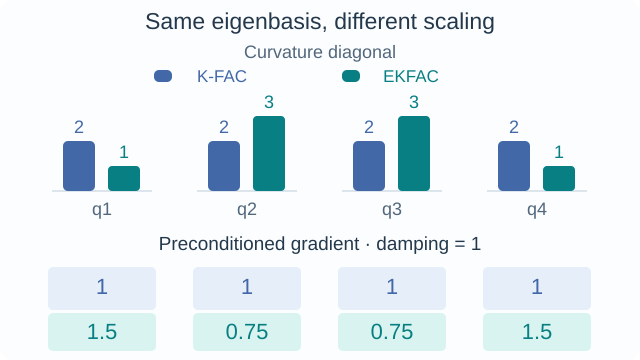

# EKFAC

EKFAC (Eigenvalue-corrected Kronecker factorisation) keeps the Kronecker-factored eigenbasis of [K-FAC](index.md), but tracks a diagonal second moment in that basis instead of using the product of the factor eigenvalues as the scaling. George et al. (2018) introduced it. They argue that it is a provably better approximation of the Fisher matrix than K-FAC, and that its per-iteration cost stays low once the eigenbasis is available.

## Problem

K-FAC approximates the Fisher with a Kronecker product $A \otimes G$. Its preconditioner rescales the gradient in the eigenbasis of that product, but the scaling it uses, the product of the factor eigenvalues, need not match the true second moment of the gradient along each eigenvector. Computing the eigenbasis is also expensive, so K-FAC must refresh it infrequently, and the basis can lag behind the local curvature.

## Core idea

Take the eigenvectors of the two K-FAC factors, $U_A$ and $U_G$, and use their Kronecker product $U = U_A \otimes U_G$ as the basis. In that basis, track a running estimate of the second moment of each rotated gradient coordinate. Preconditioning rotates the gradient into the basis, divides each coordinate by its tracked value, and rotates back. The diagonal can be updated at every iteration, while the eigenbasis is recomputed only occasionally.

## Equation or algorithm

With $\nabla\theta$ the gradient and $\epsilon$ a damping constant, each step is

1. Rotate: $\tilde{g} = U^\top \nabla\theta$.
2. Rescale: $\tilde{g}_i \leftarrow \tilde{g}_i / (s_i + \epsilon)$, where $s_i$ is a running average of $\tilde{g}_i^{\,2}$.
3. Rotate back: $\Delta\theta = U\,\tilde{g}$.

The paper's key point is in step 2. The scale is the second moment measured along the eigenvectors themselves, not the scale predicted from the factor eigenvalues.

### Worked example: correcting the diagonal

*Original CC BY-SA 4.0 illustration of George et al. (2018; see References). [Static preview](../../../assets/concept-animations/ekfac-eigenvalue-correction-still.svg) · [Full animation](../../../assets/concept-animations/ekfac-eigenvalue-correction-motion.svg).*

Fix an eigenbasis and let the K-FAC product diagonal be $(2,2,2,2)$, while the second moments in that basis are $(1,3,3,1)$. For a test gradient with rotated coordinates $(3,3,3,3)$ and scalar damping $\epsilon=1$, the K-FAC direction in the basis is $(1,1,1,1)$, whereas the EKFAC direction is $(1.5,0.75,0.75,1.5)$. Both use the same basis; only the diagonal differs. The example uses scalar damping of the full diagonal, not separately damped factors.

The illustrated diagonals can arise from the same curvature samples. Take eight equally weighted activation–derivative pairs with $a=e_i$ and $g=\sqrt{8}\,e_j$, where $e_1,e_2$ are coordinate unit vectors. Let the counts for $(i,j)=(1,1),(1,2),(2,1),(2,2)$ be $(1,3,3,1)$. Then $A=\mathbb{E}[aa^\top]=I/2$, $G=\mathbb{E}[gg^\top]=4I$, and $A\otimes G=2I_4$. But the second moment of $a\otimes g$ is $\operatorname{diag}(1,3,3,1)$. The coordinate basis is one valid eigenbasis (the factors have repeated eigenvalues). This is a synthetic second-moment construction, not a measured model Fisher; the test gradient is a separate vector.

For a symmetric curvature matrix $F$ and fixed orthonormal basis $U$, write $C=U^\top F U$. The squared Frobenius error separates into an unchanged off-diagonal error and the diagonal mismatch:

$
\|F-UDU^\top\|_F^2
=\sum_{i\ne j}C_{ij}^2+\sum_i(C_{ii}-D_{ii})^2.
$

Choosing $D_{ii}=C_{ii}$ minimizes this error for the fixed basis; it does not recover the off-diagonal terms or guarantee a better optimization step. For the synthetic samples above, the squared error falls from 4 to 0.

The growing bars reveal the final measured-coordinate moments, not the time course of an actual running estimator. The lower blue and teal rows show the respective preconditioned directions before rotation back. These are constructed numbers, not model measurements. In the MkDocs player, use Play/Pause; reduced-motion mode and GitHub show the complete still.

## Results

On a deep autoencoder task and on convolutional networks trained on CIFAR-10, the paper reports that EKFAC reduces training loss faster than K-FAC over epochs. A variant that the paper calls EKFAC-ra also reduces training loss faster than K-FAC per unit of wall-clock time. The two methods reach similar validation performance.

## Limitations

- The eigenbasis is expensive to compute, so between refreshes it can lag behind the true curvature. The refresh frequency is an extra hyperparameter.
- The claim of a better Fisher approximation is made under the paper's own criterion. The empirical gains come from a small number of architectures.
- EKFAC inherits the independence assumptions of the underlying Kronecker approximation.

## Key methods

- [K-FAC](index.md) is the factored preconditioner whose eigenbasis EKFAC reuses.
- [KFC](kfc.md) extends the Kronecker factorisation to convolution layers, and the paper's experiments include convolutional networks.
- [Adam](../adaptive/adam.md) tracks a diagonal second moment in the parameter basis. EKFAC keeps that diagonal idea but applies it in a rotated basis.

## Open issues and related variants

- **Refresh schedule.** How often the eigenbasis should be recomputed, given its cost, is a practical question that the paper studies only in part.
- **Other bases.** Whether other rotated bases give a better diagonal approximation than the Kronecker-factored eigenbasis is open.

## Connections

- [Second-order and quasi-Newton methods](../second-order.md) is the overview where the K-FAC family sits.
- [Adaptive methods](../adaptive/index.md) share the idea of per-coordinate scaling.

## References

### Seminal papers

- George, T., Laurent, C., Bouthillier, X., Ballas, N. & Vincent, P. (2018). *Fast Approximate Natural Gradient Descent in a Kronecker-factored Eigenbasis*. arXiv:1806.03884. https://arxiv.org/abs/1806.03884 — Tracks a diagonal second moment in the Kronecker-factored eigenbasis, which the paper argues is a provably better Fisher approximation than K-FAC.
- Martens, J. & Grosse, R. (2015). *Optimizing Neural Networks with Kronecker-factored Approximate Curvature*. arXiv:1503.05671. https://arxiv.org/abs/1503.05671 — Introduces the K-FAC factors whose eigenbasis EKFAC uses.
- Grosse, R. & Martens, J. (2016). *A Kronecker-factored approximate Fisher matrix for convolution layers*. ICML, PMLR 48:573–582. https://proceedings.mlr.press/v48/grosse16.html — The convolution extension of K-FAC, for comparison on convolutional networks.
- Amari, S. (1998). *Natural Gradient Works Efficiently in Learning*. Neural Computation, 10(2), 251–276. https://doi.org/10.1162/089976698300017746 — The natural-gradient method that EKFAC approximates.

### Surveys and textbooks

- Bottou, L., Curtis, F. E. & Nocedal, J. (2018). *Optimization Methods for Large-Scale Machine Learning*. arXiv:1606.04838. https://arxiv.org/abs/1606.04838 — Survey of large-scale optimisers that places natural-gradient methods in context.
