# K-FAC

K-FAC（Kronecker 分解近似曲率）是神經網路自然梯度的實用近似。它逐層近似費雪資訊矩陣，把每個區塊寫成兩個小矩陣的克羅內克積，然後對這兩個小矩陣求逆。Martens 與 Grosse（2015）提出了此方法。上層概述見[二階與擬牛頓方法](../second-order.md)。

## 概述

自然梯度下降以費雪資訊矩陣的逆來預處理梯度。這使得更新與參數的寫法無關，對許多模型而言，它也是比原始梯度更有意義的方向。困難在於，神經網路的費雪矩陣有數百萬列，無法形成也無法求逆。K-FAC 利用全連接層的結構，讓求逆變得可負擔。

## 問題

自然梯度法有原則性的基礎，但對神經網路而言，費雪矩陣太大，無法形成或求逆。Martens 與 Grosse 想知道，能否以有結構的近似，使求逆的成本低到能保有自然梯度的進展，同時每步成本接近 SGD。

## 核心想法

對於輸入激活為 $a$、輸出梯度為 $g$ 的全連接層，其權重矩陣的梯度為 $\nabla W = g a^\top$。作者以克羅內克積 $A \otimes G$ 近似每層的費雪區塊，其中 $A$ 為激活的二階矩，$G$ 為反向傳播得到的輸出梯度的二階矩。克羅內克積的逆是各因子的逆之克羅內克積，因此只需對兩個小因子求逆。

論文也把整個區塊結構矩陣的逆近似為區塊對角或區塊三對角。作者為費雪矩陣的逆提出這項論證，但對費雪矩陣本身並不成立，實驗也確認，逆矩陣只是近似地具有此結構。

### 動態概念解說

*原創 CC BY-SA 4.0 教學動畫，依據 Martens 與 Grosse（2015；見參考文獻）。四階段呈現激活與輸出梯度的二階矩因子 $A=\mathbb E[aa^\top]$、$G=\mathbb E[gg^\top]$、兩個加入**阻尼**後的逆矩陣，以及逐層預處理方向 $G^{-1}(\nabla W)A^{-1}$。矩陣顏色深淺與方向皆為**教學示意**，不是模型的共變異數或實測數據。此圖省略跨層相關性，也不代表對兩個因子分別加入阻尼，等同於對完整費雪區塊加上純量阻尼。MkDocs 網站可使用支援鍵盤的**播放／暫停**按鈕；偏好減少動態效果時，預設顯示 [GitHub 可讀的靜態概覽](../../../assets/concept-animations/kfac-factor-preconditioning-still.svg)。[開啟完整動畫](../../../assets/concept-animations/kfac-factor-preconditioning-motion.svg)。*

## 演算法

對每一層 $\ell$：

1. 在一段小批次窗口上累積激活共變異數 $A_\ell$ 與輸出梯度共變異數 $G_\ell$ 的滾動估計。
2. 對兩個因子求逆，並為每個因子加上阻尼項以維持穩定。
3. 以 $\Delta W_\ell = G_\ell^{-1}\,\nabla W_\ell\,A_\ell^{-1}$ 預處理該層的梯度，因子如上加上阻尼。
4. 以學習率套用更新。動量施加在這個更新之上，論文認為這在實務上很重要。

因子的逆比梯度更新得少。論文的實驗中，每 $T_3 = 20$ 次迭代才重新求逆一次，梯度則在每一步都使用。

## 結果

- 摘要把 K-FAC 描述為費雪矩陣「可有效求逆的近似」，其更新能比帶動量的隨機梯度下降取得更快的進展，並且每次更新的計算成本「只比普通的隨機梯度高出數倍」。
- 論文的主要實驗訓練了三個深度自編碼器，資料分別為 MNIST、CURVES 與 FACES，來自 Hinton 與 Salakhutdinov（2006）。帶動量的 K-FAC 在相同的計算時間內，達到的訓練誤差比調校良好的帶動量 SGD 基線更低（見論文圖 10）。
- 這些增益依賴動量技術。沒有它，K-FAC 並不會明顯比基線快。

## 限制

- 克羅內克積與區塊結構的逆都是近似，它們忽略了層與層之間的相關性。
- 此方法針對全連接層設計。卷積與循環層需要進一步的近似，見下方的變體。
- 每次更新的成本約為 SGD 的數倍。因子的更新間隔、阻尼排程與動量都會增加 SGD 沒有的超參數。
- 證據來自自編碼器基準。若要主張在其他任務上也更快，需要各自的實驗。

## 變體

每個變體都有各自的頁面。

- **[卷積的 K-FAC（KFC）](kfc.md)。** Grosse 與 Martens（2016）把克羅內克分解改寫為適用於卷積層的形式，卷積層的權重在空間位置之間共享。[arXiv:1602.01407](https://arxiv.org/abs/1602.01407)
- **[EKFAC](ekfac.md)。** George 等人（2018）保留克羅內克分解的特徵基底，但在其中追蹤對角的變異數，論文主張這比 K-FAC 更能忠實地近似費雪矩陣。[arXiv:1806.03884](https://arxiv.org/abs/1806.03884)
- **[分散式 K-FAC](distributed-kfac.md)。** Osawa 等人（2019）把因子的計算分散到多個 GPU 上，並在約 10 分鐘內以 ResNet-50 訓練 ImageNet。[doi:10.1109/cvpr.2019.01264](https://doi.org/10.1109/cvpr.2019.01264)

## 關聯

- [二階與擬牛頓方法](../second-order.md)是上層概述，K-FAC 與 L-BFGS、Shampoo 並列於其中。
- [L-BFGS](../lbfgs.md)是確定性的擬牛頓替代方法。
- [Shampoo](../shampoo.md)是相關的矩陣結構預條件子，它的建構來自梯度統計量而非費雪矩陣。
- [深度學習](../../deep-learning/index.md)描述了為各因子提供輸出梯度的反向傳播。

## 應用

- 訓練大型前饋網路與卷積網路，這些情況下每步成本必須接近 SGD。卷積變體涵蓋後一種情況。
- 以行動者–評論者方法進行強化學習。Wu 等人（2017）在信賴域方法中，以 K-FAC 計算行動者與評論者的自然梯度更新。[arXiv:1708.05144](https://arxiv.org/abs/1708.05144)

## 開放問題

- 克羅內克近似與精確費雪矩陣之間的差距，在實務上有多重要？
- K-FAC 的好處有多少來自曲率估計，又有多少來自阻尼、更新與動量的排程？

## 參考文獻

### 開創性論文

- Martens, J. & Grosse, R. (2015). *Optimizing Neural Networks with Kronecker-factored Approximate Curvature*. ICML. https://arxiv.org/abs/1503.05671 — 提出 K-FAC，為神經網路的自然梯度提供克羅內克分解近似。
- Amari, S. (1998). *Natural Gradient Works Efficiently in Learning*. Neural Computation, 10(2), 251–276. https://doi.org/10.1162/089976698300017746 — K-FAC 所近似的自然梯度方法。
- Grosse, R. & Martens, J. (2016). *A Kronecker-factored approximate Fisher matrix for convolution layers*. ICML, PMLR 48:573–582. https://proceedings.mlr.press/v48/grosse16.html — 把克羅內克分解擴展到卷積層。
- George, T., et al. (2018). *Fast Approximate Natural Gradient Descent in a Kronecker-factored Eigenbasis*. arXiv. https://arxiv.org/abs/1806.03884 — 在克羅內克分解的特徵基底中追蹤對角變異數，論文主張這是比 K-FAC 更好的費雪近似。
- Osawa, K., et al. (2019). *Large-Scale Distributed Second-Order Optimization Using Kronecker-Factored Approximate Curvature for Deep Convolutional Neural Networks*. IEEE/CVF CVPR. https://doi.org/10.1109/cvpr.2019.01264 — 把 K-FAC 分散到多個 GPU 上，在數分鐘內以 ResNet-50 訓練 ImageNet。
- Wu, Y., et al. (2017). *Scalable trust-region method for deep reinforcement learning using Kronecker-factored approximation*. arXiv. https://arxiv.org/abs/1708.05144 — 把 K-FAC 以信賴域方法應用於行動者–評論者強化學習。
- Gupta, V., Koren, T. & Singer, Y. (2018). *Shampoo: Preconditioned Stochastic Tensor Optimization*. arXiv. https://arxiv.org/abs/1802.09568 — 相關的矩陣結構預條件子，與基於費雪矩陣的做法作比較。
- Liu, D. C. & Nocedal, J. (1989). *On the Limited Memory BFGS Method for Large Scale Optimization*. Mathematical Programming, 45, 503–528. https://doi.org/10.1007/BF01589116 — 與 K-FAC 形成對比的確定性擬牛頓法。

### 綜述與教科書

- Bottou, L., Curtis, F. E. & Nocedal, J. (2018). *Optimization Methods for Large-Scale Machine Learning*. SIAM Review. https://arxiv.org/abs/1606.04838 — 將自然梯度與曲率方法與一階方法並列的綜述。
