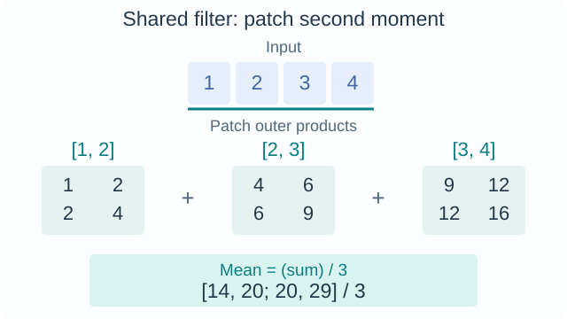

# 卷積的 K-FAC（KFC）

KFC（Kronecker Factors for Convolution）把 [K-FAC](index.zh-TW.md) 擴展到卷積網路。它把每個卷積層的費雪區塊近似為兩個小矩陣的克羅內克積，使自然梯度更新能以 K-FAC 用於全連接層的同一種廉價求逆來計算。Grosse 與 Martens（2016）提出了此方法。

## 問題

K-FAC 的克羅內克分解是針對全連接層推導的，在那裡每個權重只乘上一個輸入激活。卷積層中，同一組濾波器權重在每個空間位置都會共享，而每個輸出依賴輸入的一個局部區塊。這個分解無法直接套用，因此卷積網路無法使用 K-FAC 的自然梯度更新。

## 核心想法

KFC 對反向傳播得到的導數建立一個結構化的機率模型。它假設激活與導數彼此獨立、兩者都具有空間同質性（在每個位置的統計量相同），並且導數之間在空間上不相關。在這些假設下，每個卷積層的費雪區塊分解為克羅內克積。其中一個因子由濾波器所見的輸入區塊構成，並在空間位置上取平均；另一個因子由輸出導數構成，並在各位置上累加。求逆時只需處理這兩個小因子，與 K-FAC 相同。

## 公式或演算法

KFC 的近似形式為

$$
\mathcal{F}_\ell \approx \Omega_\ell \otimes \Gamma_\ell
$$

其中 $\Omega_\ell$ 是該層輸入區塊的二階矩，$\Gamma_\ell$ 是反向傳播導數的二階矩。更新即為 K-FAC 的預處理步驟，兩個因子都加上阻尼，並且逆矩陣的更新頻率低於梯度。論文也指出，所得的更新對常用的重新參數化（例如對激活做中心化）具有不變性。

### 計算範例：空間區塊統計

*原創 CC BY-SA 4.0 圖解，依據 Grosse 與 Martens（2016；見參考文獻）的區塊統計。 [靜態預覽](../../../assets/concept-animations/kfc-patch-second-moment-still.svg) · [完整動畫](../../../assets/concept-animations/kfc-patch-second-moment-motion.svg).*

對一維輸入 $(1,2,3,4)$，寬度為二、步幅為一、無填補及偏置的濾波器會看到三個區塊 $p_1=(1,2)$、$p_2=(2,3)$、$p_3=(3,4)$。動畫依序走訪各位置並累加其外積。區塊外積的空間平均為

$
\frac{1}{3}\sum_{t=1}^{3}p_t p_t^\top
=\frac{1}{3}\begin{pmatrix}14&20\\20&29\end{pmatrix}.
$

這僅是採用空間平均慣例的輸入端因子；導數端因子必須一致地納入空間加總的尺度。圖中未計算導數端因子，也不主張在缺少 KFC 假設的情況下完整費雪矩陣仍可精確分解。數值為教學構造，非模型實測。MkDocs 播放器提供播放／暫停；減少動態效果模式與 GitHub 顯示完整靜態圖。

## 結果

摘要回報，使用 KFC 的近似自然梯度下降，訓練卷積網路的速度比仔細調校的帶動量 SGD 快數倍，且所需的迭代次數少 10 到 20 倍。實驗使用 CIFAR-10 與街景門牌號碼（SVHN）資料集。論文宣稱的目標是在既有的架構上評估最佳化器，而非追求最先進的準確率。論文也在訓練好的網路上檢驗其機率假設，發現導數在空間上與跨特徵圖之間的相關性都很弱。

## 限制

- 三個機率假設都是近似。論文的量測在其自身的網路上支持這些假設，但並非對每種架構都有保證。
- 卷積比全連接情形需要更多的運算，因為每一層都必須擷取並累加輸入區塊。
- 實驗使用兩個影像基準與較舊的架構，因此速度上的主張不能直接套用到現代網路。
- 與 K-FAC 一樣，此方法需要阻尼與逆矩陣的更新排程，這些都是額外的超參數。

## 關鍵方法

- [K-FAC](index.zh-TW.md)是全連接的方法，KFC 擴展了它的克羅內克分解。
- [EKFAC](ekfac.zh-TW.md)保留克羅內克分解的特徵基底，並在其中追蹤對角變異數。作者回報，它在數種架構上比 K-FAC 改善了最佳化。
- [分散式 K-FAC](distributed-kfac.zh-TW.md)在大規模訓練中，於許多 GPU 上執行同類的卷積曲率計算。

## 開放問題與相關變體

- **近似品質。** 在深層卷積網路中，KFC 的因子與精確費雪矩陣的接近程度，尚無定論。
- **區塊統計量的成本。** 對大影像與多通道而言，累加區塊統計量是實務上的瓶頸，較便宜的估計方法仍是開放問題。

## 相關連結

- [卷積網路](../../models/cnn/index.zh-TW.md)是 KFC 所針對的架構家族。
- [二階與擬牛頓方法](../second-order.zh-TW.md)是上層概述，K-FAC 與 L-BFGS、Shampoo 並列於其中。

## 參考文獻

### 開創性論文

- Grosse, R. & Martens, J. (2016). *A Kronecker-factored approximate Fisher matrix for convolution layers*. ICML, PMLR 48:573–582. https://proceedings.mlr.press/v48/grosse16.html — 提出 KFC，即卷積層費雪區塊的克羅內克分解。
- Martens, J. & Grosse, R. (2015). *Optimizing Neural Networks with Kronecker-factored Approximate Curvature*. arXiv:1503.05671. https://arxiv.org/abs/1503.05671 — 為全連接層提出 K-FAC，KFC 擴展了它。
- George, T., et al. (2018). *Fast Approximate Natural Gradient Descent in a Kronecker-factored Eigenbasis*. arXiv:1806.03884. https://arxiv.org/abs/1806.03884 — 保留克羅內克分解特徵基底的後續變體，供比較之用。
- Amari, S. (1998). *Natural Gradient Works Efficiently in Learning*. Neural Computation, 10(2), 251–276. https://doi.org/10.1162/089976698300017746 — KFC 所近似的自然梯度方法。

### 綜述與教科書

- Bottou, L., Curtis, F. E. & Nocedal, J. (2018). *Optimization Methods for Large-Scale Machine Learning*. arXiv:1606.04838. https://arxiv.org/abs/1606.04838 — 把自然梯度與曲率方法置於大規模最佳化者之中的綜述。
