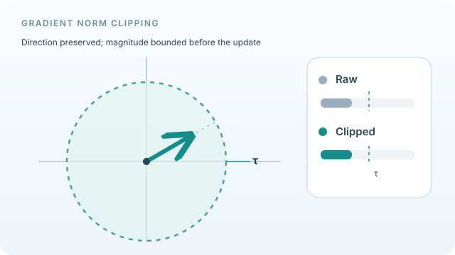

# Norm Clipping

Norm clipping rescales the gradient whenever its norm exceeds a fixed threshold, so the step length is capped while its direction is kept. Pascanu, Mikolov and Bengio (2013) proposed it to stop exploding gradients in recurrent networks. The parent overview is [Gradient Clipping and Normalised Updates](gradient-clipping-and-normalisation.md).

## Overview

A recurrent network applies the same weights at every time step, so its gradient is a product of many Jacobians. When these have norms above one, the product can grow without bound, and a single update can throw the parameters far away. The fix must be cheap and rare, because most gradients are fine. Pascanu et al. propose capping the gradient norm as a simple remedy for the explosions.

## Problem

Training recurrent networks by backpropagation through time is often unstable. Exploding gradients cause sudden loss spikes, and vanishing gradients stop learning from long-range dependencies. The abstract names both problems and attributes them to earlier analysis. The paper asks whether a simple remedy can handle the explosions, and proposes a soft constraint for the vanishing case.

## Core idea

Compute the gradient as usual. If its norm is greater than a threshold, rescale it so that its norm equals the threshold. Otherwise leave it unchanged. Rescaling multiplies the gradient by a positive number, so its direction is unchanged and only its length is bounded. The paper argues that the clipped update remains a descent direction for the current minibatch.

## Algorithm

Let \(g\) be the gradient and \(\tau\) the threshold.

1. Compute \(\|g\|\).
2. If \(\|g\| > \tau\), set \(g \leftarrow \tau\, g / \|g\|\).
3. Apply the optimiser update with the clipped gradient.

The threshold is a hyperparameter. The paper suggests choosing it from statistics of the gradient norm averaged over many updates.

*Original looping geometric teaching animation, CC BY-SA 4.0.* The dashed circle represents a global L2 norm threshold \(\tau\). The grey raw gradient grows beyond it, while the teal clipped vector is rescaled to \(\tau g/\|g\|_2\); as the raw gradient shrinks below the threshold, both lengths again agree. Their direction is preserved throughout. The bar lengths and trajectory are **illustrative, not measured training gradients**. The bound applies to the gradient **before the optimiser update**, not necessarily to the parameter-step norm of an adaptive optimiser. See [Pascanu et al. (2013)](https://arxiv.org/abs/1211.5063). The wiki website supports pausing and reduced-motion playback.

## Results

The abstract states that the authors propose a gradient norm clipping strategy to deal with exploding gradients, and that the hypotheses and proposed solutions are validated empirically in the experiments. It gives no specific numbers, so this page does not quote any.

## Limitations

- The threshold must be chosen. Too small slows learning, and too large does little.
- Clipping does not address vanishing gradients, which the paper handles with a separate soft constraint.
- Clipping by norm is a global operation over all parameters, so it treats layers with very different scales as one.

## Connections

- [Gradient Clipping and Normalised Updates](gradient-clipping-and-normalisation.md) is the overview, where norm clipping sits beside LARS and LAMB.
- [Recurrent networks](../models/rnn/index.md) are the setting for which the method was designed.
- [LARS](lars.md) provides a layer-wise alternative that scales each layer rather than the whole gradient.
- [Learning-rate schedules](learning-rate-schedules.md) interact with clipping, because the threshold and the step size together set the largest possible update.

## Open questions

- Should the threshold adapt over training, instead of being fixed in advance?
- Is clipping by norm the right unit for models whose layers differ widely in scale, such as Transformers?

## References

### Seminal papers

- Pascanu, R., Mikolov, T. & Bengio, Y. (2013). *On the Difficulty of Training Recurrent Neural Networks*. ICML. https://arxiv.org/abs/1211.5063 — Proposes gradient norm clipping for exploding gradients and analyses vanishing gradients in recurrent networks.
- You, Y., Gitman, I. & Ginsburg, B. (2017). *Large Batch Training of Convolutional Networks*. arXiv. https://arxiv.org/abs/1708.03888 — A layer-wise alternative to a global step size.
- Goyal, P., et al. (2017). *Accurate, Large Minibatch SGD: Training ImageNet in 1 Hour*. arXiv. https://arxiv.org/abs/1706.02677 — Warm-up as a different approach to controlling early instability.

### Surveys and textbooks

- Bottou, L., Curtis, F. E. & Nocedal, J. (2018). *Optimization Methods for Large-Scale Machine Learning*. SIAM Review. https://arxiv.org/abs/1606.04838 — Survey of step-size control and gradient magnitude in stochastic methods.
- Goodfellow, I., Bengio, Y. & Courville, A. (2016). *Deep Learning*, Chapter 10 on sequence modelling. MIT Press. https://www.deeplearningbook.org/ — Textbook treatment of exploding and vanishing gradients in recurrent networks, with gradient clipping, free online.
