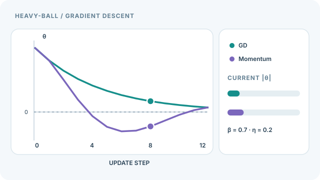

# 重球動量

重球動量由 Polyak（1964）提出，為梯度下降加上一個速度項。每次更新會保留一部分前一步的位移，因此迭代點在梯度方向一致的地方累積速度，在震盪的地方則會減速。這個方法是今日 SGD 所用動量項的起源。概述見 [SGD 與動量](index.md)頁。

## 概述

在條件數不佳的二次問題上，普通梯度下降會在狹窄的山谷中來回折返，沿山谷的前進很慢。Polyak 問：加上一個與前一步成正比的項能否加速？他證明，在適當的步長與動量係數下，這個二階遞迴在二次問題上比普通梯度下降收斂得更快。名稱來自一顆沉重的球在損失曲面上滾動的想像。

## 核心概念

- **速度** \(v_t\)：過去梯度的累加，以動量係數 \(\beta\) 縮放。
- **動量係數** \(\beta\)：保留多少前一個速度。常見值約為 0.9。
- **震盪抑制**：在速度中，正負翻轉的梯度分量會互相抵消，方向一致的分量則會累積。
- **重球遞迴**：以二階差分方程表示的更新規則，這是 Polyak 分析它的方式。

## 運作方式

更新式使用速度：

\[
\begin{aligned}
v_t &= \beta\, v_{t-1} + g_t \\
\theta_t &= \theta_{t-1} - \eta\, v_t
\end{aligned}
\]

展開後，步長是所有過去梯度的加權和，權重以 \(\beta\) 的速率幾何遞減。這就是它為何是梯度的指數移動平均，也是它為何能抑制震盪。Polyak 在二次目標上的分析顯示，選擇適當的 \(\eta\) 與 \(\beta\) 時，在相同條件數下收斂速率優於普通梯度下降。

## 動態示範：動量為何會超越最佳點

*原創連續教學動畫，CC BY-SA 4.0。* [GitHub 可檢視的靜態 SVG](../../../assets/concept-animations/heavy-ball-overshoot-still.svg)。移動點依照上述遞迴式計算，使用 $f(\theta)=\theta^2/2$、$\theta_0=3$、$v_0=0$、$\eta=0.2$ 與 $\beta=0.7$。曲線為方便觀察而在離散更新點之間插值；在此示例中，重球動量於第 4 步首次跨越零點，普通梯度下降則始終為正。**這是解析式示例，不是模型訓練實測，也不代表動量法必然較快收斂。** MkDocs 網站可用播放／暫停操作；偏好減少動態效果時會顯示靜態版本。

## 關鍵方法

### Heavy-ball method（Polyak，1964）

- **問題：** 條件數不佳的問題上，梯度下降會來回折返，收斂緩慢。
- **核心想法：** 加入累積過去位移的速度項，使方向一致的步伐加速，震盪的方向則互相抵消。
- **公式或演算法：** 上述兩行更新式，\(\eta\) 為學習率，\(\beta\) 為動量係數。
- **結果：** 論文分析了二次問題上的加速效果，顯示在適當參數選擇下，收斂比普通梯度下降快。數值常數來自該分析，此處不重複。
- **限制：** 分析針對二次目標。對於一般的光滑凸函數，固定參數的重球法未知能否達到 Nesterov 變體所具有的最佳 \(O(1/T^2)\) 速率（見 [Nesterov 動量](nesterov.md)）。[Lessard 等人（2016）](https://arxiv.org/abs/1408.3595) 以數值方式比較了兩者的速率。

## 關聯

- [Nesterov 動量](nesterov.md)是在前瞻點計算梯度的變體。
- [Adam](../adaptive/adam.md) 的一階矩也是同樣的速度概念。
- 上層的 [SGD 與動量](index.md)頁涵蓋普通 SGD 與動量的概述。

## 開放問題

- 批次很大、梯度雜訊很小時，\(\beta\) 與 \(\eta\) 應如何耦合？

## 參考文獻

### 開創性論文

- Polyak, B. T. (1964). Some methods of speeding up the convergence of iteration methods. *USSR Computational Mathematics and Mathematical Physics*. doi:[10.1016/0041-5553(64)90137-5](https://doi.org/10.1016/0041-5553(64)90137-5) — 提出重球動量，並分析其在二次問題上的加速效果。
- Sutskever, I., Martens, J., Dahl, G. & Hinton, G. (2013). On the importance of initialization and momentum in deep learning. ICML. https://proceedings.mlr.press/v28/sutskever13.html — 顯示在適當初始化下，動量可以訓練深層與循環網路。
- Lessard, L., Recht, B. & Packard, A. (2016). Analysis and Design of Optimization Algorithms via Integral Quadratic Constraints. *SIAM Journal on Optimization*. doi:[10.1137/15M1009597](https://doi.org/10.1137/15M1009597) — 推導梯度法、重球法與 Nesterov 法在凸函數上的數值收斂界。

### 綜述與教科書

- Bottou, L., Curtis, F. E. & Nocedal, J. (2018). Optimization Methods for Large-Scale Machine Learning. *SIAM Review*. https://arxiv.org/abs/1606.04838 — 動量與隨機梯度方法的綜述，說明其收斂行為。
- Bubeck, S. (2014). Convex Optimization: Algorithms and Complexity. https://arxiv.org/abs/1405.4980 — 關於梯度方法複雜度的專著，包含加速變體。

### 文章與文件

- Stanford CS231n，*Optimization* 講義。https://cs231n.github.io/optimization-1/ — 動量與其對更新方向影響的附圖筆記。
