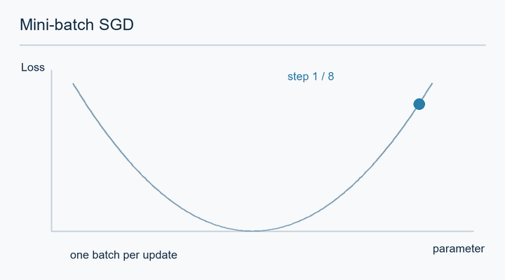

# SGD and Momentum

Stochastic gradient descent (SGD) and its momentum variants are the simplest optimisers widely used for deep learning. They use one learning rate for every parameter and rely on the gradient alone. They remain a common baseline, and Wilson et al. (2017) found that on some tasks they generalise better than adaptive methods. The [overview](../index.md) places them among the other families.

## Overview

Gradient descent moves the parameters against the gradient of the training loss, \(\theta \leftarrow \theta - \eta\, \nabla L(\theta)\). Computing the gradient on the full dataset is expensive, so practical training uses a mini-batch \(B\) and the gradient \(g_t = \nabla_\theta \frac{1}{|B|}\sum_{i\in B} \ell_i(\theta)\). The step is cheap and its direction is noisy, but on average it points the right way.

*Original animation by AI Wiki, CC BY-SA 4.0.*

Each orange segment joins successive parameter values; the blue dot moves between updates. For this one-dimensional toy example the displayed full-data loss is \(L(\theta)=\theta^2/2\), while each update uses a batch gradient \(g_t=\theta_t+\epsilon_t\) and fixed learning rate 0.35. The fixed illustrative noise sequence can make a step differ from the full gradient; it does not establish unbiasedness or typical training behaviour. The curved trace shows the loss at each interpolated parameter, not a continuous training trajectory. Values and timings are schematic, not measurements of a model. The loop resets to the initial point.

## Key concepts

- **Mini-batch**: a random subset of the data used to estimate the gradient at one step.
- **Learning rate \(\eta\)**: the step size. Too large makes the loss diverge; too small makes training slow.
- **Momentum**: a running average of past gradients that smooths the direction and speeds progress along consistent slopes.
- **Nesterov momentum**: a variant that evaluates the gradient at a look-ahead point.
- **Learning-rate schedule**: a rule that changes \(\eta\) during training, covered in [Learning-rate schedules](../learning-rate-schedules.md).

## How it works

### Plain SGD

For a strongly convex objective, SGD with a suitable decreasing step size converges at rate \(O(1/k)\) after \(k\) steps. Full-batch gradient descent converges linearly on the same problem, so the stochastic method is slower per step (Bottou, Curtis & Nocedal, 2018). A stochastic gradient is an unbiased estimate of the full gradient, so the expected update is correct but adds variance. The classical conditions for convergence of this kind of stochastic approximation are \(\sum_t \eta_t = \infty\) and \(\sum_t \eta_t^2 < \infty\) (Robbins & Monro, 1951).

The noise is not only a cost. Adding noise to gradient steps helps an optimiser escape saddle points (Ge et al., 2015). Keskar et al. (2017) report that large mini-batches generalise worse and converge to sharper minima than small ones, which suggests that the noise of small batches contributes to generalisation. Whether flatness explains generalisation is still debated.

### Heavy-ball momentum

The full method, with its analysis, is on the [Heavy-ball momentum](heavy-ball.md) page.

Polyak (1964) introduced the heavy-ball method. In the form common in deep learning software it keeps a velocity:

\[
\begin{aligned}
v_t &= \beta\, v_{t-1} + g_t \\
\theta_t &= \theta_{t-1} - \eta\, v_t
\end{aligned}
\]

Directions that repeat accumulate, and directions that flip sign cancel. This damps oscillation in narrow valleys of the loss surface, where plain gradient descent zig-zags.

### Nesterov momentum

The full method, with its guarantees, is on the [Nesterov momentum](nesterov.md) page.

Nesterov's variant computes the gradient at the look-ahead point \(\theta_{t-1} - \eta\beta v_{t-1}\) rather than at \(\theta_{t-1}\). This corrects the velocity before it is applied. Sutskever et al. (2013) study both methods for training deep networks and show that Nesterov's form, with a momentum schedule, trains well.

## Comparison

| Method | Gradient evaluated at | Update in one line | Detail |
|---|---|---|---|
| Plain SGD | Current parameters | \(\theta \leftarrow \theta - \eta g\) | This page |
| Heavy-ball | Current parameters | Accumulate velocity, then step | [Heavy-ball momentum](heavy-ball.md) |
| Nesterov | Look-ahead point | Correct velocity before the step | [Nesterov momentum](nesterov.md) |

## Practical notes

- A momentum of about \(\beta = 0.9\) is a common default. Goyal et al. (2017) use it when training ImageNet models with SGD.
- Batch size and learning rate interact. Goyal et al. (2017) show that scaling the learning rate linearly with the batch size works up to a point in their experiments, when combined with a warm-up period.
- SGD with momentum can generalise better than adaptive methods on some tasks, but adaptive methods can reach low training loss faster. Wilson et al. (2017) show that on simple overparameterised problems the two families find different solutions.

## Connections

- [Adaptive methods](../adaptive/index.md) rescale each coordinate of the same update.
- [Deep learning](../../deep-learning/index.md) explains the backpropagation step that produces \(g_t\).
- [NeuroAI](../../../brain-mind/neuroai/index.md) compares gradient-based training with learning in the brain.

## Applications

- Training image classification networks with SGD and momentum (Goyal et al., 2017).
- Baseline optimiser in studies that compare new methods with SGD (Wilson et al., 2017).

## Open questions

- Why does SGD noise tend to find solutions that generalise, and how strong is this effect across architectures?
- How should momentum be tuned when the batch size is very large?

## References

### Seminal papers

- Robbins, H. & Monro, S. (1951). A stochastic approximation method. *Annals of Mathematical Statistics*, 22, 400–407. doi:[10.1214/aoms/1177729586](https://doi.org/10.1214/aoms/1177729586) — Introduces stochastic approximation with decreasing step sizes, the basis of SGD.
- Polyak, B. T. (1964). Some methods of speeding up the convergence of iteration methods. *USSR Computational Mathematics and Mathematical Physics*, 4, 1–17. doi:[10.1016/0041-5553(64)90137-5](https://doi.org/10.1016/0041-5553(64)90137-5) — Introduces heavy-ball momentum and analyses its acceleration on quadratic problems.
- Ge, R., Huang, F., Jin, C. & Yuan, Y. (2015). Escaping From Saddle Points: Online Stochastic Gradient for Tensor Decomposition. COLT. https://arxiv.org/abs/1503.02101 — Shows that noise added to stochastic gradient steps lets the optimiser escape saddle points.
- Sutskever, I., Martens, J., Dahl, G. & Hinton, G. (2013). On the importance of initialization and momentum in deep learning. ICML. https://proceedings.mlr.press/v28/sutskever13.html — Studies momentum and Nesterov's method for training deep and recurrent networks.
- Keskar, N. S., Mudigere, D., Nocedal, J., Smelyanskiy, M. & Tang, P. T. P. (2017). On Large-Batch Training for Deep Learning: Generalization Gap and Sharp Minima. ICLR. https://arxiv.org/abs/1609.04836 — Reports that large mini-batches generalise worse and converge to sharper minima.
- Goyal, P. et al. (2017). Accurate, Large Minibatch SGD: Training ImageNet in 1 Hour. arXiv. https://arxiv.org/abs/1706.02677 — Uses momentum SGD with a linear learning-rate scaling rule and warm-up to train with very large batches.
- Wilson, A. C., Roelofs, R., Stern, M., Srebro, N. & Recht, B. (2017). The Marginal Value of Adaptive Gradient Methods in Machine Learning. NeurIPS. https://arxiv.org/abs/1705.08292 — Shows that adaptive methods can find solutions that generalise worse than SGD on simple overparameterised problems.

### Surveys and textbooks

- Bottou, L., Curtis, F. E. & Nocedal, J. (2018). Optimization Methods for Large-Scale Machine Learning. *SIAM Review*. https://arxiv.org/abs/1606.04838 — Survey of stochastic gradient methods and their convergence behaviour on large datasets.
- Goodfellow, I., Bengio, Y. & Courville, A. (2016). *Deep Learning*, Chapter 8. MIT Press. https://www.deeplearningbook.org/ — Textbook treatment of SGD, momentum and training in practice, free online.

### Articles and documentation

- Stanford CS231n, *Optimization* lecture notes. https://cs231n.github.io/optimization-1/ — Clear, illustrated notes on gradient descent, learning rates and momentum.
