# Nesterov 動量

Nesterov 動量是重球動量的變體，它在前瞻點計算梯度，也就是動量即將帶著參數到達的位置，而不是在目前的點。這會在套用速度前先修正它。它是卷積網路訓練中與 SGD 最常搭配使用的動量形式。概述見 [SGD 與動量](index.md)頁，它所修改的方法是[重球動量](heavy-ball.md)。

## 概述

重球動量可能會過衝，因為速度在計算新點的梯度之前就已套用。Nesterov 提議在速度單獨會到達的點計算梯度。這個方法在光滑凸問題上的最壞情況收斂速率，證明優於普通梯度下降；一般而言，重球法未知能達到這點。

## 核心概念

- **前瞻點**：\(\theta_{t-1} - \eta\beta v_{t-1}\)，即只靠動量時參數會被帶到的位置。
- **修正後的速度**：新速度使用前瞻點的梯度，因此能反映前方的曲率。
- **加速**：在光滑凸問題上，比普通梯度下降更快的收斂速率。

## 運作方式

深度學習中常見的 Nesterov 加速梯度形式為

\[
\begin{aligned}
v_t &= \beta\, v_{t-1} + \nabla L\big(\theta_{t-1} - \eta\beta\, v_{t-1}\big) \\
\theta_t &= \theta_{t-1} - \eta\, v_t
\end{aligned}
\]

與重球法相比，改變的只是計算梯度的位置。實務上，框架常使用等價的重新排列，在目前的點計算梯度，再改寫參數更新，因此不需要額外的前向計算。

*原創四階段教學動畫，CC BY-SA 4.0。* 橘色虛線表示僅由動量預測的前瞻位移；青綠色箭頭示意前瞻點的負梯度修正，最後藍色箭頭則從**原始參數位置**出發，而非從前瞻點更新。位置與箭頭長度皆為教學示意，並非實際最佳化軌跡。MkDocs 網站支援播放／暫停與減少動態效果的靜態回退；GitHub 可[檢視靜態總覽圖](../../../assets/concept-animations/nesterov-lookahead-still.svg)。

## 關鍵方法

### 加速梯度法（Nesterov，1983；見 Nesterov，2004）

- **問題：** 光滑凸問題上的梯度下降，最壞情況速率為 \(O(1/T)\)，而重球法等動量方法一般不會改善這個速率。
- **核心想法：** 在只靠動量會到達的前瞻點計算梯度，使步伐在執行前就已修正。
- **公式或演算法：** 上述更新式，\(\eta\) 為步長，\(\beta\) 為動量係數；理論成立時，兩者必須依光滑性與凸性常數選擇。
- **結果：** Nesterov（2004）與 Bubeck（2014）指出，對於光滑凸函數，此方法的最壞情況收斂速率優於普通梯度下降。本頁依循他們的呈現方式，數值常數此處不重複。
- **限制：** 理論保證針對光滑凸問題，而深度網路兩者皆非，因此實務上的好處是經驗性的，且取決於調校。

## 關聯

- [重球動量](heavy-ball.md)是此變體所修正的方法。
- 上層的 [SGD 與動量](index.md)頁比較普通 SGD 與動量在實務中的表現。
- [Adam](../adaptive/adam.md) 使用同類的動量項，但沒有前瞻。

## 開放問題

- 對於雜訊很大的隨機梯度，前瞻修正是否重要？
- 在什麼條件下，Nesterov 動量對深度網路會優於重球法？

## 參考文獻

### 開創性論文

- Sutskever, I., Martens, J., Dahl, G. & Hinton, G. (2013). On the importance of initialization and momentum in deep learning. ICML. https://proceedings.mlr.press/v28/sutskever13.html — 顯示在仔細初始化下，Nesterov 式動量可以訓練深層與循環網路。
- Polyak, B. T. (1964). Some methods of speeding up the convergence of iteration methods. *USSR Computational Mathematics and Mathematical Physics*. doi:[10.1016/0041-5553(64)90137-5](https://doi.org/10.1016/0041-5553(64)90137-5) — Nesterov 變體所修改的重球法。

### 綜述與教科書

- Goodfellow, I., Bengio, Y. & Courville, A. (2016). *Deep Learning*，第 8 章。MIT Press。https://www.deeplearningbook.org/ — 動量與 Nesterov 動量在訓練中的教科書說明，可線上免費閱讀。
- Bubeck, S. (2014). Convex Optimization: Algorithms and Complexity. https://arxiv.org/abs/1405.4980 — 呈現加速梯度下降及其複雜度分析的專著。
- Bottou, L., Curtis, F. E. & Nocedal, J. (2018). Optimization Methods for Large-Scale Machine Learning. *SIAM Review*. https://arxiv.org/abs/1606.04838 — 動量變體及其在隨機訓練中行為的綜述。
- Nesterov, Y. (2004). *Introductory Lectures on Convex Optimization: A Basic Course*. Springer. doi:[10.1007/978-1-4419-8853-9](https://doi.org/10.1007/978-1-4419-8853-9) — 加速梯度法及其在光滑凸函數上最壞情況速率的教科書式說明。
