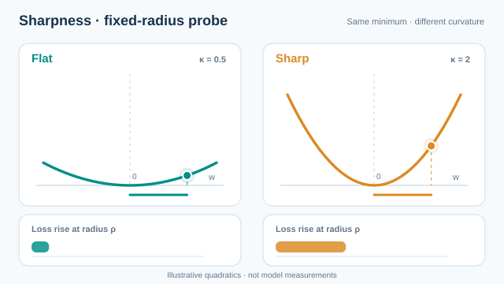
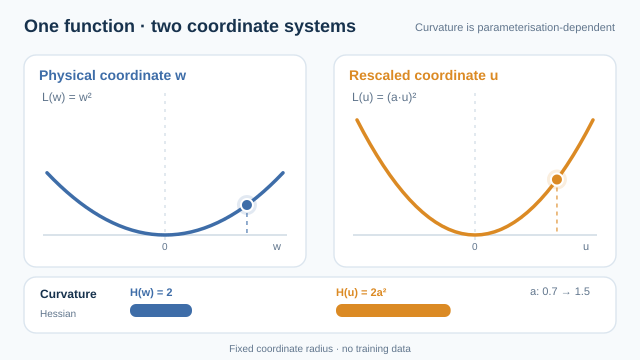

# Sharp Minima and Large-Batch Generalisation

Keskar et al. (2017) reported that training with large batches converges to sharp minima of the loss, and that these minima generalise worse than the flat minima reached with small batches. The paper is the classic reference for the generalisation gap in large-batch training. The parent overview is [Regularisation and Weight Decay in Optimisation](regularisation-and-weight-decay.md).

## Overview

A minimum is sharp when the loss rises quickly in some directions away from it, and flat when it rises slowly. The idea is that a flat minimum tolerates small shifts between the training and test distributions, so the same parameters perform similarly on unseen data. A sharp minimum is more sensitive to such shifts. The question is what the optimiser does that makes the difference, and batch size is one candidate, because the gradient noise from small batches changes the path the optimiser takes.

## Visual explanation: probing sharpness and changing coordinates

**1. Equal-radius loss probe.** Consider two illustrative losses, \(L_\kappa(w)=\tfrac12\kappa w^2\), with curvatures \(\kappa=0.5\) and \(\kappa=2\). Both reach the same minimum value at \(w=0\), but a perturbation of radius \(\rho\) increases the loss by \(\Delta L_\kappa=\tfrac12\kappa\rho^2\). As the radius grows, the markers and loss-rise bars move continuously. At every common radius the sharp quadratic has **four times** the loss increase; this is a property of these constructed functions, **not evidence of different test accuracy**.

*Original continuous teaching SVG, CC BY-SA 4.0. GitHub shows a static, readable state; on MkDocs, Play/Pause toggles the looping version. The quadratic curves, numbers and trajectories are illustrative, not model measurements.* [Full SVG animation](../../assets/concept-animations/sharpness-radius-loss-motion.svg).

### Interactive experiment: fixed-radius sharpness

Adjust the common radius in the computed panel below. The two loss curves and their loss-rise bars update from the **same** $L_\kappa(w)=\kappa w^2/2$ expressions as the reviewed animation. Use the native slider (arrow keys), **Next step**, Play/Pause and playback-speed control. At $\rho=0.8$, the constructed increases are $0.16$ and $0.64$, a 4:1 ratio.

*Calculated browser-side toy experiment, CC BY-SA 4.0. The GitHub-safe static SVG immediately above remains available without JavaScript; this panel only runs on MkDocs. Illustration, not an observed training trajectory.*

**2. Sharpness is coordinate-dependent.** For \(L(w)=w^2\), introduce a reparameterisation \(w=a u\). The **same objective** now appears as \(\widetilde L(u)=a^2u^2\): its second derivative in \(u\) is \(2a^2\), while the second derivative in \(w\) remains 2. As \(a\) moves between 0.7 and 1.5, the right-hand curve steepens without changing the original left-hand function. The two markers use equal **coordinate** offsets \(0.5\), which are not equal physical perturbations because \(\Delta w=a\Delta u\). This is the limitation of unnormalised, fixed-radius flatness measures discussed by Dinh et al. (2017) in the References; it does **not** establish that sharp or flat minima generalise differently.

*Original continuous teaching SVG, CC BY-SA 4.0. GitHub uses the static fallback; MkDocs provides Play/Pause and reduced-motion fallback. The scaling and Hessian values are analytic toy quantities, not measurements from a trained network.* [Full SVG animation](../../assets/concept-animations/sharpness-reparam-curvature-motion.svg).

### Interactive experiment: coordinate-dependent curvature

Change $a$ while holding the *coordinate* offset $\Delta u=0.6$. The left plot remains $L(w)=w^2$, whereas the right plot is $\widetilde L(u)=a^2u^2$. The readout calculates $H_u=2a^2$, $\Delta w=a\Delta u$ and $\Delta\widetilde L=a^2(\Delta u)^2$ together; at $a=1.5$, these are $4.5$, $0.9$ and $0.81$, respectively. These are **not** two differently trained models.

*Calculated interactive companion, CC BY-SA 4.0. The static fallback immediately above is readable on GitHub. Control by keyboard or slider; reduced-motion settings disable autoplay but retain manual computation.*

## Problem

Large batches make each step cheaper in wall-clock time when many devices are used, but accuracy on held-out data often falls compared with small batches, even when training loss is matched. Keskar et al. ask whether the gap is due to the batch size itself and what kind of minimum each batch size reaches.

## Core idea

Batch size changes the kind of minimum the optimiser reaches. Small batches, with their noisy gradients, tend to settle into flat minima. Large batches, with accurate gradients, tend to settle into sharp minima. The authors link the sharpness to the generalisation gap and discuss strategies that may reduce it.

## Algorithm

The paper does not introduce a new update rule. The method is an empirical comparison: train the same network with a small batch and with a large batch, measure the test accuracy and a sharpness measure around the solution, and compare.

1. Choose a fixed network and dataset.
2. Train with a small batch, typically 32 to 512 examples, and with a large batch.
3. Measure the test accuracy of both solutions.
4. Measure the sharpness of each solution, for example by how much the loss rises within a small neighbourhood.

## Results

- The abstract reports that large-batch methods consistently converge to sharp minimisers, and that small-batch methods consistently find flat minimisers. It attributes this to the noise in gradient estimates from small samples.
- The abstract says the authors "discuss several strategies to attempt to help large-batch methods eliminate this generalization gap", without naming them in the abstract. The paper should be consulted for the specific results.
- The abstract gives no numeric accuracy drops, so none are quoted on this page.

## Limitations

- The abstract gives no numbers, so the size of the gap depends on the experiments in the paper.
- Sharpness is a measure that depends on the choice of neighbourhood and parameterisation. [Dinh et al. (2017)](https://arxiv.org/abs/1703.04933) argue that common flatness measures are problematic as explanations, and this page does not take a side on the question.
- The result is about batch size. Later work on large-batch training, including the linear scaling rule and warm-up of Goyal et al. (2017), shows that the gap can be reduced with a change in schedule.

## Connections

- [Regularisation and Weight Decay in Optimisation](regularisation-and-weight-decay.md) is the overview that places implicit bias next to explicit penalties.
- [SGD noise scale](sgd-noise-scale.md) gives a quantitative account of the same batch-size effect.
- [Gradual warm-up and linear scaling](gradual-warm-up.md) is the schedule change that reduces the large-batch penalty in practice.
- [Large-batch and distributed training](large-batch-and-distributed.md) is where the gap matters for systems.

## Open questions

- Is sharpness a cause of poor generalisation, or a symptom of the optimiser's path?
- Can the gap be closed by a change to the optimiser that keeps the large batch, rather than by a change in schedule?

## References

### Seminal papers

- Keskar, N. S., Mudigere, D., Nocedal, J., Smelyanskiy, M. & Tang, P. T. P. (2017). *On Large-Batch Training for Deep Learning: Generalization Gap and Sharp Minima*. ICLR. https://arxiv.org/abs/1609.04836 — Reports that large-batch training converges to sharp minima and generalises worse than small-batch training.
- Smith, S. L. & Le, Q. V. (2018). *A Bayesian Perspective on Generalization and Stochastic Gradient Descent*. ICLR. https://arxiv.org/abs/1710.06451 — Explains the batch-size effect through the noise scale of SGD, a quantitative companion to the sharpness account.
- Goyal, P., et al. (2017). *Accurate, Large Minibatch SGD: Training ImageNet in 1 Hour*. arXiv. https://arxiv.org/abs/1706.02677 — Shows that linear scaling and warm-up close much of the large-batch gap in practice.
- Dinh, L., Pascanu, R., Bengio, S. & Bengio, Y. (2017). *Sharp Minima Can Generalize for Deep Nets*. ICML. https://arxiv.org/abs/1703.04933 — Argues that most common notions of flatness are problematic as explanations of generalisation.

### Surveys and textbooks

- Bottou, L., Curtis, F. E. & Nocedal, J. (2018). *Optimization Methods for Large-Scale Machine Learning*. SIAM Review. https://arxiv.org/abs/1606.04838 — Survey of stochastic gradient methods, with discussion of batch size and gradient noise.
