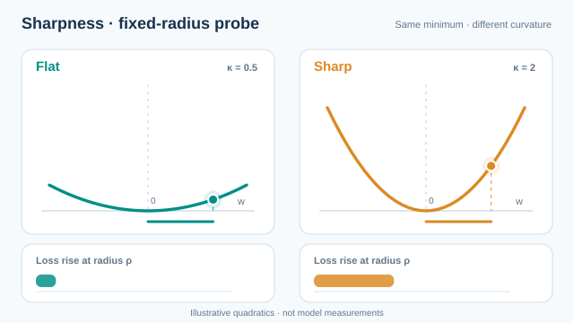
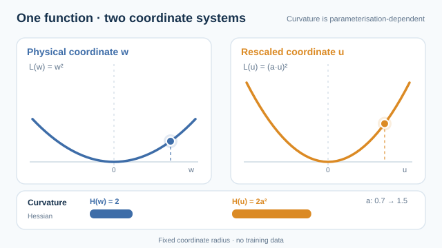

# 尖銳極小值與大批次泛化

Keskar 等人（2017）報告，以大批次訓練會收斂到損失函數的尖銳極小值，而這些極小值的泛化能力，比小批次所到達的平坦極小值差。此論文是大批次訓練泛化差距的經典參考文獻。上層概述見[最佳化中的正則化與權重衰減](regularisation-and-weight-decay.md)。

## 概述

當損失在離開極小值的某些方向上快速上升時，該極小值是尖銳的；上升緩慢時則是平坦的。其想法是：平坦極小值能容忍訓練分布與測試分布之間的小偏移，因此同樣的參數在未見過的資料上表現相近。尖銳極小值對這類偏移則較為敏感。問題在於，最佳化器做了什麼，造成了這種差異。批次大小是一個候選因素，因為小批次的梯度雜訊會改變最佳化器所走的路徑。

## 動態示範：損失地形銳度與重新參數化

**1. 相同半徑下的損失增量。** 考慮兩個人工建構的損失函數 \(L_\kappa(w)=\tfrac12\kappa w^2\)，曲率分別為 \(\kappa=0.5\) 與 \(\kappa=2\)。兩者在 \(w=0\) 都有相同的最小損失，但在共同擾動半徑 \(\rho\) 下，損失增加量為 \(\Delta L_\kappa=\tfrac12\kappa\rho^2\)。動畫同步調整兩個曲線上的探測點及損失增量條。無論半徑多少，較尖銳曲線的損失增加量都是較平坦曲線的**四倍**；這只是示意二次函數的解析結果，**不是模型測試準確率的證據**。

*原創連續教學 SVG，CC BY-SA 4.0。GitHub 顯示可直接閱讀的靜態狀態；MkDocs 網站提供播放／暫停及減少動態效果回退。曲線、數值與軌跡皆為人工數學示意，非模型實測。* [觀看完整 SVG 動畫](../../assets/concept-animations/sharpness-radius-loss-motion.svg)。

### 可操作實驗：固定半徑下的銳度

使用下方滑桿控制共同半徑，圖中的兩條損失曲線、探測點與損失增量長條，會依照 (L_kappa(w)=kappa w^2/2) **重新計算**。可使用方向鍵、**下一步**、播放／暫停與速度選單。當 (
ho=0.8) 時，兩種人工損失的增量分別為 (0.16) 與 (0.64)，比例為 4:1。

*原創可運算教學實驗，CC BY-SA 4.0。上方靜態 SVG 可供 GitHub 與無 JavaScript 環境閱讀；本實驗在 MkDocs 網站執行。所有數值皆為人工解析式示意，並非模型訓練軌跡。*

**2. 銳度依賴座標系統。** 對於 \(L(w)=w^2\)，進行重新參數化 \(w=a u\) 後，**同一個目標函數**在新座標下為 \(\widetilde L(u)=a^2u^2\)。對 \(u\) 的二階導數為 \(2a^2\)，而對原本 \(w\) 的二階導數固定為 2。當 \(a\) 在 0.7 至 1.5 之間變化，右側曲線會改變銳度，但左側代表的目標函數並未改變。兩側探測點使用相同的**座標偏移** 0.5，並不是相同的實際參數擾動，因為 \(\Delta w=a\Delta u\)。這說明 Dinh 等人（2017）在參考文獻指出的「固定半徑、未正規化銳度指標」限制；**不能據此推論泛化能力**。

*原創連續教學 SVG，CC BY-SA 4.0。GitHub 提供靜態回退預覽，MkDocs 網站支援播放／暫停與減少動態效果。縮放係數與 Hessian 為解析式示意數值，並非已訓練網路的量測結果。* [觀看完整 SVG 動畫](../../assets/concept-animations/sharpness-reparam-curvature-motion.svg)。

### 可操作實驗：重新參數化後的曲率

調整 (a)，並固定**新座標**位移 (Delta u=0.6)。左側仍為 (L(w)=w^2)，右側為 (widetilde L(u)=a^2u^2)；面板同步計算 (H_u=2a^2)、原始參數位移 (Delta w=aDelta u) 及損失變化 (Deltawidetilde L=a^2(Delta u)^2)。例如 (a=1.5) 時，分別為 (4.5)、(0.9) 及 (0.81)。**不是兩個模型的實測地形比較**。

*原創互動式數值示範，CC BY-SA 4.0。上方 GitHub 靜態預覽不依賴 JavaScript；可使用鍵盤、滑桿操作，減少動態效果模式停用自動播放而保留手動控制。*

## 問題

大批次在使用大量裝置時，能縮短每一步的牆鐘時間，但即使訓練損失相當，其在留出資料上的準確率往往低於小批次。Keskar 等人想知道，這個差距是否來自批次大小本身，以及不同批次大小會到達哪一種極小值。

## 核心想法

批次大小會改變最佳化器到達的極小值種類。帶有雜訊梯度的小批次傾向落入平坦極小值。準確梯度的大批次則傾向落入尖銳極小值。作者把尖銳度與泛化差距連結起來，並討論可能縮小差距的策略。

## 演算法

論文並未提出新的更新規則。此方法是一項經驗比較：以相同的網路，分別用小批次與大批次訓練，量測測試準確率，以及解附近的尖銳度量，再加以比較。

1. 選定一個固定的網路與資料集。
2. 分別以小批次（通常為 32 到 512 筆資料）與大批次訓練。
3. 量測兩種解的測試準確率。
4. 量測每個解的尖銳度，例如在一個小鄰域內損失上升多少。

## 結果

- 摘要指出，大批次方法一致地收斂到尖銳的極小值，小批次方法則一致地找到平坦的極小值，並將其歸因於小樣本梯度估計中的雜訊。
- 摘要表示作者「討論了幾種策略，試圖幫助大批次方法消除這個泛化差距」，但摘要中並未列出這些策略。具體結果應參考論文。
- 摘要未給出準確率下降的數字，因此本頁不引用數值。

## 限制

- 摘要沒有數字，因此差距的大小取決於論文中的實驗。
- 尖銳度取決於鄰域與參數化的選擇。[Dinh 等人（2017）](https://arxiv.org/abs/1703.04933) 認為，常見的平坦度度量作為解釋都有問題，本頁不對此問題表態。
- 此結果針對批次大小。後續關於大批次訓練的研究，包括 Goyal 等人（2017）的線性縮放與預熱，顯示透過排程的改變可以縮小差距。

## 關聯

- [最佳化中的正則化與權重衰減](regularisation-and-weight-decay.md)是上層概述，把隱含偏好與顯式懲罰並列。
- [SGD 雜訊尺度](sgd-noise-scale.md)以定量方式解釋同一種批次大小效應。
- [漸進式預熱與線性縮放](gradual-warm-up.md)是在實務中縮小大批次差距的排程改動。
- [大批次與分散式訓練](large-batch-and-distributed.md)是此差距對系統層面有影響之處。

## 開放問題

- 尖銳度是泛化不佳的原因，還是最佳化器路徑的症狀？
- 能否不改變排程，而以保留大批次的最佳化器改動來縮小差距？

## 參考文獻

### 開創性論文

- Keskar, N. S., Mudigere, D., Nocedal, J., Smelyanskiy, M. & Tang, P. T. P. (2017). *On Large-Batch Training for Deep Learning: Generalization Gap and Sharp Minima*. ICLR. https://arxiv.org/abs/1609.04836 — 報告大批次訓練收斂到尖銳極小值，泛化能力不如小批次訓練。
- Smith, S. L. & Le, Q. V. (2018). *A Bayesian Perspective on Generalization and Stochastic Gradient Descent*. ICLR. https://arxiv.org/abs/1710.06451 — 以 SGD 雜訊尺度解釋批次大小效應，是尖銳度論述的定量補充。
- Goyal, P., et al. (2017). *Accurate, Large Minibatch SGD: Training ImageNet in 1 Hour*. arXiv. https://arxiv.org/abs/1706.02677 — 顯示線性縮放與預熱在實務中能縮小大批次的大部分差距。
- Dinh, L., Pascanu, R., Bengio, S. & Bengio, Y. (2017). *Sharp Minima Can Generalize for Deep Nets*. ICML. https://arxiv.org/abs/1703.04933 — 論證多數常見的平坦度概念，作為泛化的解釋都有問題。

### 綜述與教科書

- Bottou, L., Curtis, F. E. & Nocedal, J. (2018). *Optimization Methods for Large-Scale Machine Learning*. SIAM Review. https://arxiv.org/abs/1606.04838 — 隨機梯度方法的綜述，討論批次大小與梯度雜訊。
