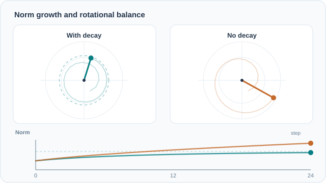

# 旋轉平衡

Kosson、Messmer 與 Jaggi（2023）研究權重衰減如何影響個別神經元的更新行為。他們的主要主張是：在 AdamW 下，每個神經元的權重會達到一個平衡，此時衰減與梯度更新互相抵消。平衡的達成時間尺度由學習率與衰減的乘積決定，而梯度統計不同的神經元會停在不同的旋轉速率。上層子主題是[權重範數動態](index.md)。

## 概述

尺度不變的神經元是指：權重乘上常數時，輸出不會改變。這種神經元的梯度與其權重向量正交，因此每次更新都會旋轉權重並增加範數，而衰減則把範數拉回。論文追蹤的正是每一步權重的旋轉量。

## 問題

當權重衰減很小時，訓練曲線上的權重範數常會持續增長，有效學習率也隨之縮小。實務上衰減值多半依慣例設定，而不清楚某個數值在訓練預算內是否小到幾乎沒有作用。論文問的是：權重衰減如何決定每個神經元的範數與旋轉，而系統要花多久才能到達那個狀態。

## 核心想法

論文在 AdamW、學習率 \(\eta\) 與衰減 \(\lambda\) 下追蹤每個神經元的權重 \(\omega \in \mathbb{R}^C\)，其中 \(C\) 為權重向量的維度。平衡範數為

\[
\|\omega\| = \sqrt{\frac{\eta C}{2\lambda - \eta\lambda^2}} \approx \sqrt{\frac{\eta C}{2\lambda}},
\]

平衡時每步期望旋轉約為 \(\sqrt{2\eta\lambda(1-\beta_1)/(1+\beta_1)}\)，其中 \(\beta_1\) 為動量係數。平方範數以每步 \((1-\eta\lambda)^2\) 的倍率向平衡收縮，因此時間尺度約為 \(1/(\eta\lambda)\) 步。論文把這個收縮視為近似。

依此說法，衰減太小時，時間尺度會遠長於訓練長度。權重因此可能到不了平衡，範數持續增長。衰減較大則縮短時間尺度，使旋轉在訓練中達到穩定值。

## 動態圖解

*原創連續教學動畫（CC BY-SA 4.0）。* 青綠色向量含權重衰減，橘色向量則在相同的**正交更新幅度**下不施加衰減。兩者使用簡化的切向更新遞迴式 $w_{t+1}=a w_t+u v_t$，其中 $v_t$ 為垂直於 $w_t$ 的單位向量，$a=1-\eta\lambda$、$u=0.17$，且 $\lVert w_0\rVert=0.30$。因此 $r_{t+1}^2=a^2r_t^2+u^2$。取 $a=0.96$ 時，$r_\infty=u/\sqrt{1-a^2}\approx0.607$；第 24 步的範數約 **0.574**，而不施加衰減時約為 **0.885**。青綠色虛線圓表示極限平衡半徑。此為**解析式示意，並非實際 AdamW 訓練軌跡或論文的 AdamW 平衡範數公式**；圖中特意省略自適應動量統計與動量項，以隔離切向更新和徑向收縮的關係。MkDocs 網站可使用播放／暫停按鈕（聚焦後按 Enter 或空白鍵），偏好減少動態效果時會顯示靜態圖。[GitHub 可讀的靜態預覽](../../../assets/concept-animations/rotational-norm-balance-still.svg)。

## 運作方式

1. 選定學習率 \(\eta\) 與衰減 \(\lambda\)，以步數計算時間尺度 \(1/(\eta\lambda)\)。
2. 與訓練步數比較。若時間尺度遠大於訓練步數，衰減在本次訓練中幾乎沒有作用。
3. 監測每個神經元的範數與旋轉，而不只是整層。梯度徑向分量不平衡的神經元會以不同速率旋轉。
4. 平衡旋轉速率，例如使用論文報告能平衡各神經元旋轉的權重標準化（Weight Standardisation）。

## 結果

論文結合推導與實驗，把預測的平衡與訓練好的網路相比。論文報告，權重標準化使每個神經元成為尺度不變，並平衡各神經元間的旋轉（論文的圖 7）。論文也比較 AdamW 與帶 L2 懲罰的 Adam，發現 AdamW 表現較好；論文主要把差距歸因於 AdamW 下的旋轉較平衡，並在附錄中分析。確切數字應在論文中核對後再使用。

## 限制

- 平衡結果是針對尺度不變的神經元推導的。沒有接正規化的層（例如分類頭）不在推導範圍內，其行為需要另外的證據。
- 旋轉的期望值是近似，只在相對更新小、徑向分量小時成立。論文以實驗檢驗，但常數對每種架構不一定精確。
- 時間尺度規則以步數表示。只有在每個 epoch 的步數固定時，它才會變成以 epoch 計的規則，這一點在 [AdamW 權重衰減縮放](adamw-weight-decay-scaling.md) 中有進一步說明。

## 相關主題

- [權重範數動態](index.md) 把此結果放在其他範數增長的解釋之中。
- [AdamW](../adaptive/adamw.md) 是推導平衡所針對的最佳化器。
- [正則化與權重衰減](../regularisation-and-weight-decay.md) 提供衰減的一般觀點。
- 範數增長在注意力 logit 上的一面，見 [QK 正規化](../../models/transformer/qk-norm.md) 頁面。

## 開放問題

- 平衡的圖像是否適用於非尺度不變的層，也就是衰減直接作用於輸出尺度的情況。
- 神經元間的旋轉不平衡，與超大模型中自適應最佳化器的逐參數縮放如何互動。

## 參考文獻

- Kosson, A., Messmer, B., & Jaggi, M. (2023). *Rotational Equilibrium: How Weight Decay Balances Learning Across Neural Networks*. arXiv:2305.17212. https://arxiv.org/abs/2305.17212 — 平衡範數、旋轉與時間尺度結果的來源。
- Loshchilov, I., & Hutter, F. (2019). *Decoupled Weight Decay Regularization*. ICLR 2019. https://arxiv.org/abs/1711.05101 — 提出分析所用的解耦權重衰減。
- Wan, R., Zhu, Z., Zhang, X., & Sun, J. (2020). *Spherical Motion Dynamics: Learning Dynamics of Neural Network with Normalization, Weight Decay, and SGD*. arXiv:2006.08419. https://arxiv.org/abs/2006.08419 — 較早分析 SGD 加衰減時的範數動態，並附有所列假設。
- Li, Z., & Arora, S. (2019). *An Exponential Learning Rate Schedule for Deep Learning*. ICLR 2020. https://arxiv.org/abs/1910.07454 — 說明權重衰減與正規化併用時，等同於在指數增長學習率下的 SGD。
- Wang, X., & Aitchison, L. (2024). *How to Set AdamW's Weight Decay as You Scale Model and Dataset Size*. arXiv:2405.13698. https://arxiv.org/abs/2405.13698 — 以相同的時間尺度觀點，為不同規模選擇衰減。
