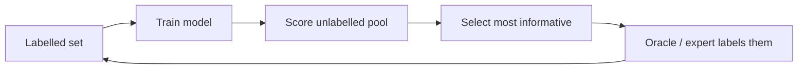

---
related:
- applications/science
---

# Active Learning

## Idea

Let the model **choose which examples to label**. If labelling is expensive (an expert's time, a wet-lab experiment), asking for the most informative labels can reach the same accuracy with far fewer of them.

## Query strategies

| Strategy | Pick examples where… |
|---|---|
| Uncertainty sampling | The model is least confident (least confidence, margin, entropy) |
| Query-by-committee | An ensemble disagrees most |
| Expected model change | The gradient update would be largest |
| Expected error reduction | Labelling would most reduce future error |
| Bayesian (BALD) | Mutual information between the label and model parameters is highest |
| Diversity / core-set | Selected batch covers the data distribution |
| Hybrid (BADGE etc.) | Both uncertain and diverse |

## Related: Bayesian optimisation and optimal experimental design

When each "label" is an experiment (a molecule's activity, a material's property, a hyperparameter setting), **Bayesian optimisation** uses a surrogate model (often a Gaussian process) and an acquisition function (expected improvement, UCB) to pick the next experiment. This drives **self-driving laboratories** — see [Scientific Discovery](../../../applications/science/index.md).

## Pitfalls

- **Cold start**: uncertainty estimates are poor with very few labels — start with random or diverse samples.
- **Sampling bias**: the labelled set no longer represents the population; keep a random test set.
- **Outliers**: uncertainty sampling can chase noise.
- **Annotator cost varies**: some examples are much harder to label.
- With strong pre-trained models, gains over random sampling can be smaller than early literature suggested — always compare.

## Curiosity and question-asking

Active learning is the machine counterpart of **curiosity**:

- Humans preferentially seek information where uncertainty is intermediate and learning progress is fastest (Gottlieb, Oudeyer et al., 2013; Kidd & Hayden, 2015).
- Children's questions are informative in ways that optimal-experiment models predict (Ruggeri & Lombrozo, 2015).
- **Active sensing**: eye movements are chosen to maximise information about a scene (Yang, Lengyel & Wolpert, 2016).
- In RL, **intrinsic motivation** rewards (novelty, prediction error, information gain) play the same role; see [Reinforcement Learning](../reinforcement-learning/index.md).

## Subtopics

- [Uncertainty sampling and query strategies](uncertainty-sampling/index.md): least confidence, query by committee and information gain.
- [Batch and diversity](batch-and-diversity/index.md): core-sets, gradient embeddings and BatchBALD.
- [Theory and sample complexity](theory-and-sample-complexity/index.md): when active learning provably saves labels.
- [Deep active learning](deep-active-learning/index.md): uncertainty for neural networks and loss prediction.
- [Practice and labelling cost](practice-and-labelling-cost/index.md): cold start, stopping rules and annotation cost.

## Further reading

- Ren et al. (2021), "A Survey of Deep Active Learning", ACM Computing Surveys. https://arxiv.org/abs/2009.00236
- Garnett, *Bayesian Optimization* (2023). Free online at https://bayesoptbook.com/
- [modAL](https://modal-python.readthedocs.io/) library

## References

### Seminal papers

- Lewis & Gale (1994), "A sequential algorithm for training text classifiers", SIGIR, https://arxiv.org/abs/cmp-lg/9407020 — Introduces uncertainty sampling, the basic query strategy.
- Dasgupta (2005), "Coarse sample complexity bounds for active learning", NeurIPS. https://proceedings.neurips.cc/paper/2005/hash/6e82873a32b95af115de1c414a1849cb-Abstract.html — Early theory on when active learning reduces the number of labels.
- Gal, Islam & Ghahramani (2017), "Deep Bayesian active learning with image data", ICML, [arXiv:1703.02910](https://arxiv.org/abs/1703.02910) — Makes uncertainty-based active learning work with deep networks.
- Sener & Savarese (2018), "Active learning for convolutional neural networks: a core-set approach", ICLR, [arXiv:1708.00489](https://arxiv.org/abs/1708.00489) — Core-set selection, a strong deep baseline.

### Surveys and textbooks

- Settles (2009), "Active learning literature survey", Computer Sciences Technical Report 1648, University of Wisconsin-Madison. https://research.cs.wisc.edu/techreports/2009/TR1648.pdf — The standard survey of query strategies and their settings.
- Ren et al. (2020), "A survey of deep active learning", [arXiv:2009.00236](https://arxiv.org/abs/2009.00236) — Survey of active learning methods for deep networks.
