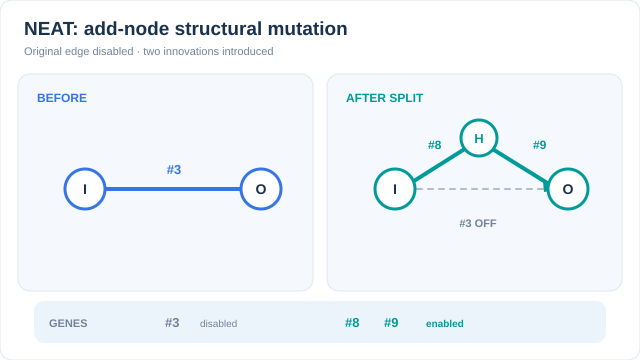

# NEAT

NEAT evolves a neural network's connection weights and its topology together. It starts from minimal networks with no hidden nodes and adds nodes and connections over generations. Stanley and Miikkulainen (2002) introduced it with two mechanisms that make structural change workable: historical markings, which align genes across genomes, and speciation, which protects a new structure until it has been tuned. Part of [Evolutionary & Swarm Intelligence](index.md).

## Overview

Earlier neuroevolution methods fixed the network's topology in advance and evolved only the weights. NEAT treats the structure as part of the search, so networks grow only as complex as the task needs.

## Problem

Two obstacles make evolving topologies hard. The first is the competing conventions problem: two parents can encode the same function with hidden nodes in different orders, so crossover between them can destroy the function. The second is that a new structure usually lowers fitness at first, because a freshly added node has not been tuned yet. Selection then removes it before it can improve.

## Core idea

Each gene carries an innovation number, a global id given to each new structural mutation. Genes with the same number are matched during crossover even when they sit in different positions, so parents are aligned by their history rather than by position. Genomes are grouped into species by the similarity of their genes, and fitness is shared within each species. A new structure therefore competes mainly with similar networks and survives while it is tuned.

## Algorithm

A genome is a list of node genes and connection genes. Each connection gene records its input, output, weight, an enabled flag and an innovation number. Mutations change a weight, add a connection between two nodes that are not yet linked, or split an existing connection by inserting a node.

Crossover aligns the two genomes by innovation number. Matching genes are inherited at random from either parent, and excess or disjoint genes come from the fitter parent. The paper measures how far two genomes are apart with a compatibility distance,

\[
\delta = \frac{c_1 E}{N} + \frac{c_2 D}{N} + c_3 \bar W,
\]

where \(E\) and \(D\) count excess and disjoint genes, \(\bar W\) is the mean weight difference of matching genes, \(N\) is the size of the larger genome, and \(c_1, c_2, c_3\) are coefficients. Genomes whose distance falls below a threshold are placed in the same species.

## Animated walkthrough: add-node mutation

  

[Static GitHub and reduced-motion preview](../../../assets/concept-animations/neat-add-node-innovation-still.svg). On MkDocs, use **Play/Pause** (Tab and Enter or Space); the still shows both topologies and the post-mutation genome.

The left graph has a single enabled input-to-output connection with innovation ID **#3**. On the right, the *add-node* mutation **disables #3**, creates a hidden node, and introduces two enabled links with new innovation IDs **#8** and **#9**. The moving amber marker traces the new route after the structural edit. The ID values are invented to make historical marking visible; their particular magnitudes are not meaningful. This is **one mutation event, not a generational fitness or training trajectory**. In a full NEAT population, identical historical structural innovations share IDs for crossover alignment; each new structural innovation receives an appropriate innovation identifier. The underlying mechanism is described in Stanley and Miikkulainen (2002), already cited below.

*Original instructional animation and static fallback, CC BY-SA 4.0.*

### Trace a single add-node mutation

The following schematic gene edit is **one atomic mutation**, not three independent mutations:

1. Start with enabled connection **#3**, \(\mathrm{In}\to\mathrm{Out}\), weight \(w\).
2. Mark connection **#3 as disabled**; preserve its gene and innovation ID for future genome alignment.
3. Insert a new hidden node, with enabled **#8** (\(\mathrm{In}\to\mathrm{Hidden}\), weight 1) and **#9** (\(\mathrm{Hidden}\to\mathrm{Out}\), weight \(w\)). The two new innovation IDs denote distinct connections.

For an **identity** hidden activation and input \(x=0.8,w=1.4\), the original output is \(wx=1.12\), and the split route gives \(w(1x)=1.12\). This algebra explains the usual initial weight assignment but **does not guarantee function preservation for arbitrary nonlinear hidden activations**, biases, or subsequent weight mutations. The numbering and values are constructed; population-level historical bookkeeping is outside this one-genome illustration.

## Key results

The full text was not retrieved in this check, because the publisher page and the author's site refused access. This page therefore quotes no results. Its statements about the experiments, namely double pole balancing and growth from minimal networks, still need checking against the paper's experiment section.

## Limitations

- Each genome must be evaluated by running the task, so large populations are expensive.
- The compatibility coefficients and the species threshold are set by hand.
- The encoding is direct, so every connection is stored explicitly. This limits how far the method scales to very large networks.
- Gradient-based training is far more efficient for large networks. NEAT's main strength is in small networks and control problems.

## Connections

- [Evolutionary & Swarm Intelligence](index.md) is the overview where NEAT sits beside the other population methods.
- [Genetic algorithms](genetic-algorithms.md) and [genetic programming](genetic-programming.md) are the representation-based methods that NEAT extends to neural networks.
- [Multilayer perceptrons](../../models/mlp/index.md) are the fixed-topology networks that NEAT builds from, and that gradient training normally optimises.
- [Zeroth-order and evolutionary optimisation](../../optimization/zeroth-order-and-evolutionary.md) covers the continuous-parameter methods that evolve weights without changing structure.

## Applications

- Control problems with small networks, such as pole balancing and simulated robot controllers.
- Game-playing agents and other settings where the network is small and evaluation is cheap.

## Open questions

- Can innovation-based topology search scale to networks with millions of weights, or does it need an indirect encoding?
- Should the speciation threshold adapt during a run, rather than being fixed in advance?

## References

### Seminal papers

- Stanley, K. O. & Miikkulainen, R. (2002). Evolving Neural Networks through Augmenting Topologies. *Evolutionary Computation*, 10, 99–127. https://doi.org/10.1162/106365602320169811 — Introduces NEAT, with innovation numbers, speciation and growth from minimal networks.
- Stanley, K. O., Clune, J., Lehman, J. & Miikkulainen, R. (2019). Designing neural networks through neuroevolution. *Nature Machine Intelligence*, 1, 24–35. https://doi.org/10.1038/s42256-018-0006-z — Reviews neuroevolution methods, including the approach of evolving topology alongside weights.
- Real, E., Aggarwal, A., Huang, Y. & Le, Q. V. (2018). Regularized Evolution for Image Classifier Architecture Search. arXiv:1802.01548. https://arxiv.org/abs/1802.01548 — Evolves network architectures with tournament selection and ageing, as an alternative to speciation for large search spaces.

### Surveys and textbooks

- Eiben, A. E. & Smith, J. E. (2015). *Introduction to Evolutionary Computing*. Springer. https://doi.org/10.1007/978-3-662-44874-8 — Textbook covering the selection and variation operators that NEAT's reproduction builds on.
- Bäck, T. (1996). *Evolutionary Algorithms in Theory and Practice*. Oxford University Press. https://doi.org/10.1093/oso/9780195099713.001.0001 — Textbook on evolution strategies, genetic algorithms and their analysis, for readers who want the theory behind population search.

## Further learning

Optional pointers for readers who want to go further. These are not references.

- [NEAT-Python](https://neat-python.readthedocs.io/) is an open-source Python implementation of NEAT with documentation and examples.
