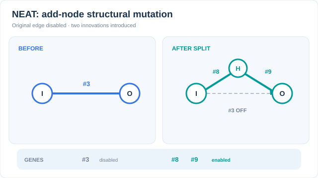

# NEAT

NEAT 同時演化神經網路的連結權重與拓撲結構。它從沒有隱藏節點的最小網路開始，並在世代間逐步加入節點與連結。Stanley 與 Miikkulainen（2002）提出此方法，並以兩個機制讓結構變化可行：使不同基因組間的基因對齊的歷史標記，以及保護新結構直到其被調校完成的物種分化。上層概述見[演化與群體智慧](index.zh-TW.md)。

## 概述

早期的神經演化方法事先固定網路拓撲，只演化權重。NEAT 則把結構本身納入搜尋，因此網路只會長到任務所需的複雜度。

## 問題

有兩個障礙使拓撲演化變得困難。第一是競爭慣例問題：兩個親代可能以不同順序的隱藏節點編碼相同的函數，因此它們之間的交叉可能破壞該函數。第二是新結構一開始通常會降低適應度，因為新加入的節點尚未調校。選擇機制會在它改善之前就將其淘汰。

## 核心想法

每個基因帶有一個創新編號，即每次新結構突變所獲得的全域編號。交叉時，編號相同的基因會被配對，即使它們位於不同位置，因此親代是依其歷史而非位置來對齊。基因組依基因相似度被分入不同物種，且適應度在物種內共享。因此新結構主要與相似的網路競爭，並在被調校期間存活下來。

## 演算法

基因組由節點基因與連結基因組成。每個連結基因記錄其輸入、輸出、權重、啟用旗標與創新編號。突變會改變權重、在尚未相連的兩個節點之間加入連結，或在既有連結中插入一個節點以將其切分。

交叉時依創新編號對齊兩個基因組。配對的基因隨機從任一親代繼承，多出的（excess）或不相交的（disjoint）基因則來自較優的親代。論文以相容距離衡量兩個基因組的差異：

\[
\delta = \frac{c_1 E}{N} + \frac{c_2 D}{N} + c_3 \bar W,
\]

其中 \(E\) 與 \(D\) 分別為多出與不相交基因的數目，\(\bar W\) 為配對基因的平均權重差，\(N\) 為較大基因組的大小，\(c_1, c_2, c_3\) 為係數。距離低於門檻的基因組被歸入同一物種。

## 動畫解讀：新增節點的結構突變

  

[GitHub 靜態與減少動態效果預覽](../../../assets/concept-animations/neat-add-node-innovation-still.svg)。MkDocs 網站提供**播放／暫停**按鈕，鍵盤可透過 Tab 及 Enter 或空白鍵操作；靜態圖可同時比較突變前後的網路與基因狀態。

左側只有一條從輸入連到輸出的有效連結，其創新編號為 **#3**。右側的*新增節點突變*會**停用 #3**、插入隱藏節點，並產生兩條新連結，編號示意為 **#8** 與 **#9**。橘色標記沿著新路徑移動。這些編號僅為說明歷史標記的**人工編號**，沒有特定數值意義；圖中是**單次結構突變，不是世代適應度或模型訓練軌跡**。在完整的 NEAT 族群中，具有相同歷史來源的結構創新會沿用對應編號，以協助交叉時對齊基因。原始方法見下方 Stanley 與 Miikkulainen（2002）。

*原創教學動畫與靜態回退，CC BY-SA 4.0。*

### 逐項檢查一次新增節點突變

以下基因編輯是**一次原子性的結構突變**，不是三次互不相關的突變：

1. 原始有效連結為 **#3**，從輸入連到輸出，權重 \(w\)。
2. 將 **#3 標為停用**，但保留原基因與創新編號，以便之後做基因組對齊。
3. 插入隱藏節點，新增有效連結 **#8**（輸入到隱藏節點，權重為 1）與 **#9**（隱藏節點到輸出，權重為 \(w\)）。兩個新編號代表不同的連結。

若隱藏節點採用**恆等活化函數**，並設 \(x=0.8,w=1.4\)，原始輸出 \(wx=1.12\)，拆分後為 \(w(1x)=1.12\)。這說明典型初始權重配置的代數關係，但對**任意非線性活化函數**、偏置或之後的權重突變，**不能保證函數完全不變**。編號與數值都是人工示意；族群層級的歷史標記管理不在這個單一基因組案例的範圍內。

## 主要結果

本次檢查未能取得論文全文（出版社頁面拒絕存取，作者網站被封鎖），因此本頁不引用任何結果。關於實驗的敘述（雙桿平衡與從最小網路成長）仍需對照論文的實驗章節核實。

## 限制

- 每個基因組都必須實際執行任務來評估，因此大型族群成本很高。
- 相容係數與物種門檻需手動設定。
- 編碼是直接的，每條連結都被明確儲存，這限制了方法能擴展到的網路規模。
- 對大型網路而言，梯度訓練的效率遠高於此方法。NEAT 的主要優勢在於小型網路與控制問題。

## 關聯

- [演化與群體智慧](index.zh-TW.md)是上層概述，NEAT 與其他群體方法並列於其中。
- [遺傳演算法](genetic-algorithms.zh-TW.md)與[遺傳規劃](genetic-programming.zh-TW.md)是以表徵為基礎的方法，NEAT 將其延伸到神經網路。
- [多層感知器](../../models/mlp/index.zh-TW.md)是 NEAT 所建構的固定拓撲網路，通常以梯度法訓練。
- [零階與演化最佳化](../../optimization/zeroth-order-and-evolutionary.zh-TW.md)涵蓋只演化權重、不改變結構的連續參數方法。

## 應用

- 使用小型網路的控制問題，例如雙桿平衡與模擬機器人的控制器。
- 遊戲代理與其他網路小、評估成本低的情境。

## 未解問題

- 以創新編號為基礎的拓撲搜尋能否擴展到具有數百萬權重的網路，或是需要間接編碼？
- 物種門檻是否應在執行過程中自適應調整，而非事先固定？

## 參考文獻

### 開創性論文

- Stanley, K. O. & Miikkulainen, R.（2002）。Evolving Neural Networks through Augmenting Topologies。*Evolutionary Computation*，10，99–127。https://doi.org/10.1162/106365602320169811 — 提出 NEAT，包含創新編號、物種分化與從最小網路開始的成長。
- Stanley, K. O., Clune, J., Lehman, J. & Miikkulainen, R.（2019）。Designing neural networks through neuroevolution。*Nature Machine Intelligence*，1，24–35。https://doi.org/10.1038/s42256-018-0006-z — 回顧神經演化方法，包括與權重並行演化拓撲的做法。
- Real, E., Aggarwal, A., Huang, Y. & Le, Q. V.（2018）。Regularized Evolution for Image Classifier Architecture Search。arXiv:1802.01548。https://arxiv.org/abs/1802.01548 — 以錦標賽選擇與老化機制演化網路架構，作為大型搜尋空間中物種分化的替代方案。

### 綜述與教科書

- Eiben, A. E. & Smith, J. E.（2015）。*Introduction to Evolutionary Computing*。Springer。https://doi.org/10.1007/978-3-662-44874-8 — 教科書，涵蓋 NEAT 繁殖所依賴的選擇與變異運算子。
- Bäck, T.（1996）。*Evolutionary Algorithms in Theory and Practice*。Oxford University Press。https://doi.org/10.1093/oso/9780195099713.001.0001 — 教科書，討論演化策略、遺傳演算法及其分析，適合想了解群體搜尋背後理論的讀者。

## 延伸學習

供想進一步探索的讀者參考，這些不是參考文獻。

- [NEAT-Python](https://neat-python.readthedocs.io/) 是開源的 NEAT Python 實作，附有文件與範例。
