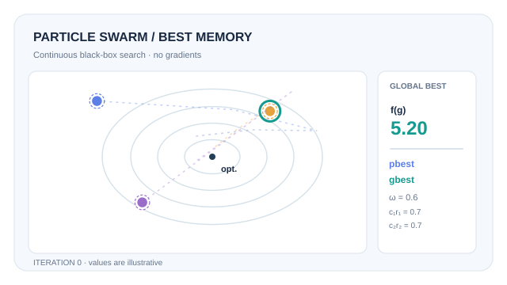

# Particle Swarm Optimisation

Particle swarm optimisation (PSO) searches a continuous space with a population of particles. Each particle moves through the space, pulled toward the best position it has found and the best position found by its neighbours. No gradient is used.

## Overview

Part of [Evolutionary & Swarm Intelligence](index.md). The parent page compares PSO with genetic algorithms, evolution strategies and ant colony optimisation.

## Problem

Many continuous objectives can be evaluated but not differentiated, or are noisy and multi-modal. A method is needed that explores a space using only function values, and that does not require a population to converge on one point.

## Core idea

Kennedy and Eberhart (1995) model each particle as having a position \(x_i\) and a velocity \(v_i\). At each step, the velocity is updated toward two attractors: the best position that particle has visited (\(p_i\)) and the best position visited by the swarm or by its neighbourhood (\(g\)). Because the velocity carries momentum from the previous step, particles overshoot and search around the attractors instead of stopping at them.

## Algorithm

With random numbers \(r_1, r_2\) drawn uniformly from \([0,1]\) at each step, the standard form is

\[
v_i \leftarrow \omega\, v_i + c_1 r_1 (p_i - x_i) + c_2 r_2 (g - x_i), \qquad x_i \leftarrow x_i + v_i,
\]

where \(\omega\) is an inertia weight, and \(c_1\) and \(c_2\) weight the pull toward personal and neighbourhood bests. The inertia term was added later by Shi and Eberhart (1998); the original 1995 formulation has no such weight. After each move, \(p_i\) and \(g\) are updated if the new position is better. The method is not guaranteed to converge; in practice the swarm settles near the best region found.

## Animated walkthrough: personal and global bests

*Original CC BY-SA 4.0 teaching animation.* [Static GitHub and reduced-motion preview](../../../assets/concept-animations/particle-swarm-best-still.svg). On MkDocs, use **Play animation / Pause animation** (keyboard Enter or Space); horizontally scroll the figure on narrow screens.

The **solid particles** are current positions $x_i$, the **dashed rings** retain each personal best $p_i$, and the **teal ring** tracks the global best $g$. The background ellipses are level sets of the illustrative objective $f(x,y)=(x-4)^2+(y-3)^2$, not a fitted response surface. The example holds $\omega=0.6$ and the two *effective* pull coefficients $c_1r_1=c_2r_2=0.7$ fixed to make one reproducible trajectory; normal PSO resamples the random multipliers. The initial best objective is $5.20$; subsequent illustrated best values include $1.27$ and $0.51$ (rounded). Only the discrete positions at iteration boundaries are PSO updates; the smooth travel between them is a visual interpolation. **All positions and values are synthetic, not an empirical optimisation benchmark.** See Kennedy and Eberhart (1995) and Shi and Eberhart (1998) in References.

## Key results

This page does not quote results from Kennedy and Eberhart (1995), since the paper was not checked against its full text.

## Limitations

- No convergence guarantee in general. Results depend on the inertia and attraction parameters, which need tuning.
- Performance degrades in high-dimensional problems, where a fixed number of particles covers little of the space.
- Constraints and discrete variables need extra handling; the basic method assumes a continuous, box-bounded space.

## Connections

- [Evolutionary & Swarm Intelligence](index.md) places PSO among the population methods.
- [Ant colony optimisation](ant-colony.md) is the swarm method for discrete routing problems.
- [Zeroth-order and evolutionary optimisation](../../optimization/zeroth-order-and-evolutionary.md) covers the gradient-free methods that estimate search directions from function values.

## Applications

- Hyperparameter and parameter tuning when gradients are unavailable.
- Engineering design, where simulators are the only objective.

## Open questions

- How should the inertia and attraction parameters be set, or adapted during a run?
- How well does PSO scale to high-dimensional deep-learning problems compared with gradient methods?

## References

### Seminal papers

- Kennedy, J. & Eberhart, R. (1995). *Particle swarm optimization*. Proceedings of ICNN'95 - International Conference on Neural Networks, 4, 1942–1948. https://doi.org/10.1109/ICNN.1995.488968 — Introduces PSO, in which each particle moves toward its own best and the swarm's best position.
- Eberhart, R. C. & Shi, Y. (2001). *Particle swarm optimization: developments, applications and resources*. Proceedings of the IEEE Congress on Evolutionary Computation. https://doi.org/10.1109/cec.2001.934374 — Reviews early developments and applications of PSO.
- Shi, Y. & Eberhart, R. (1998). *A modified particle swarm optimizer*. Proceedings of the 1998 IEEE International Conference on Evolutionary Computation, 69–73. https://doi.org/10.1109/ICEC.1998.699146 — Adds the inertia weight to the velocity update, the form used in the equation above.
- Clerc, M. & Kennedy, J. (2002). *The particle swarm: explosion, stability, and convergence in a multidimensional complex space*. IEEE Transactions on Evolutionary Computation, 6, 58–73. https://doi.org/10.1109/4235.985692 — Analyses the particle dynamics and introduces a constriction coefficient for the velocity update.
- Poli, R. (2008). *Analysis of the publications on the applications of particle swarm optimisation*. Journal of Artificial Evolution and Applications. https://doi.org/10.1155/2008/685175 — Surveys the published applications of PSO.
- Bonyadi, M. R. & Michalewicz, Z. (2017). *Particle swarm optimization for single objective continuous space problems: a review*. Evolutionary Computation, 25, 1–54. https://doi.org/10.1162/evco_r_00180 — Reviews PSO variants for single-objective continuous problems.

## Further learning

- [Particle swarm optimisation on Wikipedia](https://en.wikipedia.org/wiki/Particle_swarm_optimization) gives an accessible overview of the variants.
