---
related:
- theory/paradigms/supervised/loss-functions-and-optimization/index.md
- engineering/training/index.md
tags:
  - federated learning
  - FedAvg
  - distributed optimisation
---

# Federated Averaging

Federated averaging is the basic algorithm of federated learning. Each participating device trains a copy of the model on its own data for a few local steps, and a server averages the resulting models. The raw data never leaves the devices, and only model updates are communicated.

## Overview

A round of training picks a subset of clients, sends them the current global model, has each run local stochastic gradient descent, and averages the returned weights, usually weighted by the number of local examples. Local steps reduce communication, but they also make the local models drift apart when the data differs between clients.

## Animated walkthrough: local updates and weighted averaging

*Original process animation, CC BY-SA 4.0.* Moving markers represent **local model parameters**, not training data uploaded to the server. Three schematic scalar models start at `θ = 0` and finish at `−1.0, +0.5, +2.0` after local steps. With client dataset sizes `n = 2, 3, 5`, the server combines them by **data-size weighting**:

\[
w^{t+1}=\sum_{k\in S_t}\frac{n_k}{\sum_{j\in S_t}n_j}w_k^{t+1}
=\frac{2(-1.0)+3(0.5)+5(2.0)}{10}=0.95.
\]

This is **illustrative scalar arithmetic, not a model measurement**. Real FedAvg aggregates parameter vectors; local training on non-IID data may drift, and accuracy need not improve every round. Based on [McMahan et al. (2017)](https://proceedings.mlr.press/v54/mcmahan17a.html). The MkDocs site adds a Play/Pause button; a [GitHub-readable static fallback](../../../../assets/concept-animations/fedavg-weighted-round-still.svg) shows the final state.

## Key ideas

- **Local updates**: several local steps per round trade extra computation on devices for fewer communication rounds.
- **Weighted averaging**: combine client models in proportion to their data sizes, which is the simplest form of aggregation.
- **Client sampling**: train on a random subset of devices each round, which keeps the cost manageable with millions of phones.
- **Proximal regularisation**: add a term that keeps local models close to the global model, which stabilises training when clients are heterogeneous.

## Connections

Federated averaging is distributed [supervised learning](../../supervised/loss-functions-and-optimization/index.md) with stochastic gradient descent on each client. Engineering details of distributed training appear in [training](../../../../engineering/training/index.md). The heterogeneity problem that local updates create is the subject of [heterogeneity and personalisation](../heterogeneity-and-personalisation/index.md).

## Applications

Next-word prediction on mobile keyboards, on-device health and activity models, and hospital networks that train a shared model without sharing patient records.

## Open questions

Averaging can slow or prevent convergence when client data is very different. Communication, client availability and fairness across devices remain practical limits.

## References

### Seminal papers

- McMahan, Moore, Ramage, Hampson & Agüera y Arcas (2017), "Communication-efficient learning of deep networks from decentralized data", AISTATS, [arXiv:1602.05629](https://arxiv.org/abs/1602.05629) — Introduces federated averaging and shows that it trains deep networks with far less communication.
- Konečný, McMahan, Yu, Richtárik, Suresh & Bacon (2016), "Federated learning: strategies for improving communication efficiency", [arXiv:1610.05492](https://arxiv.org/abs/1610.05492) — Early paper that proposes structured and sketched updates to reduce communication.
- Li, Sahu, Zaheer, Sanjabi, Talwalkar & Smith (2020), "Federated optimization in heterogeneous networks", MLSys, [arXiv:1812.06127](https://arxiv.org/abs/1812.06127) — FedProx, a proximal extension of federated averaging for heterogeneous clients.

### Surveys and textbooks

- Kairouz et al. (2021), "Advances and open problems in federated learning", Foundations and Trends in Machine Learning, [arXiv:1912.04977](https://arxiv.org/abs/1912.04977) — Broad survey of federated learning with a list of open problems.
- Yang, Liu, Chen & Tong (2019), "Federated machine learning: concept and applications", ACM Transactions on Intelligent Systems and Technology, [arXiv:1902.04885](https://arxiv.org/abs/1902.04885) — Introduces the taxonomy of horizontal and vertical federated learning.

### Lectures and videos

No further entries for this page.

### Articles and documentation

No further entries for this page.

## Further reading

- Bonawitz et al. (2019), "Towards federated learning at scale: system design", SysML. https://arxiv.org/abs/1902.01046 — Describes the system design for running federated learning across very large device populations.
