# 聯邦平均（Federated Averaging）

聯邦平均（FedAvg）是聯邦學習中常見的模型聚合演算法。各裝置以自己的資料訓練模型副本，再由伺服器合併模型權重。原始資料不必上傳，但**模型更新仍可能洩漏資訊**，所以 FedAvg 本身並非隱私保護協定。

## 概述

每一輪先選擇部分客戶端，傳送目前的全域模型，讓它們執行數步本地隨機梯度下降（SGD），再回傳更新後的權重。伺服器通常依據各客戶端的樣本數進行加權平均。較多本地步數可以減少通訊輪次，但在非獨立同分布（non-IID）資料上也可能造成客戶端偏移。

## 教學動畫：本地更新與加權平均

*原創教學動畫，CC BY-SA 4.0。* 移動的圓點代表**本地模型參數**，並非上傳的資料。三個示意純量模型都從 `θ = 0` 開始，本地更新後的參數為 `−1.0、+0.5、+2.0`。若各自的樣本數為 `2、3、5`，則

\[
w^{t+1}=\sum_{k\in S_t}\frac{n_k}{\sum_{j\in S_t}n_j}w_k^{t+1}
=\frac{2(-1.0)+3(0.5)+5(2.0)}{10}=0.95.
\]

這些純量參數、樣本數及軌跡**都是人為教學示意，不是模型實測結果**。實際 FedAvg 聚合參數向量，且異質資料上的效能不保證每輪都改善。流程對照 [McMahan 等人（2017）](https://proceedings.mlr.press/v54/mcmahan17a.html)。MkDocs 網站可播放或暫停；GitHub 提供[靜態回退預覽](../../../../assets/concept-animations/fedavg-weighted-round-still.svg)。

## 核心概念

- **本地更新：** 讓客戶端多次更新模型，降低集中通訊頻率。
- **加權平均：** 依各客戶端樣本數分配權重，而非一律等權。
- **客戶端抽樣：** 每輪只選取部分裝置，使跨大量行動裝置的訓練可行。
- **近端正則化：** FedProx 等延伸方法可限制本地模型與全域模型的偏離程度。

## 相關連結

FedAvg 與[監督式學習](../../supervised/loss-functions-and-optimization/index.md)的 SGD 最佳化有關。系統工程見[訓練](../../../../engineering/training/index.md)；資料分布差異帶來的困難見[異質性與個人化](../heterogeneity-and-personalisation/index.md)。

## 應用

手機鍵盤的下一字預測、裝置端健康與活動辨識，以及不集中原始病歷的跨醫院模型訓練。

## 開放問題

客戶端資料差異可能讓訓練變慢或不收斂；通訊成本、裝置可用性、資源公平性也都是實務限制。

## References

### 原始論文

- McMahan et al.（2017），*Communication-Efficient Learning of Deep Networks from Decentralized Data*，AISTATS。https://arxiv.org/abs/1602.05629 — 提出 FedAvg 的本地更新與週期性模型聚合。
- Konečný et al.（2016），*Federated Learning: Strategies for Improving Communication Efficiency*。https://arxiv.org/abs/1610.05492 — 探討結構化與壓縮更新以節省傳輸量。
- Li et al.（2020），*Federated Optimization in Heterogeneous Networks*，MLSys。https://arxiv.org/abs/1812.06127 — 提出 FedProx，改善異質資料上的最佳化。

### 綜述與教科書

- Kairouz et al.（2021），*Advances and Open Problems in Federated Learning*。https://arxiv.org/abs/1912.04977 — 彙整聯邦學習的最佳化、隱私與系統問題。
- Yang et al.（2019），*Federated Machine Learning: Concept and Applications*。https://arxiv.org/abs/1902.04885 — 說明水平、垂直與其他聯邦學習類型。

## Further learning

- Bonawitz et al.（2019），*Towards Federated Learning at Scale: System Design*。https://arxiv.org/abs/1902.01046 — 討論跨大量裝置的部署架構。
