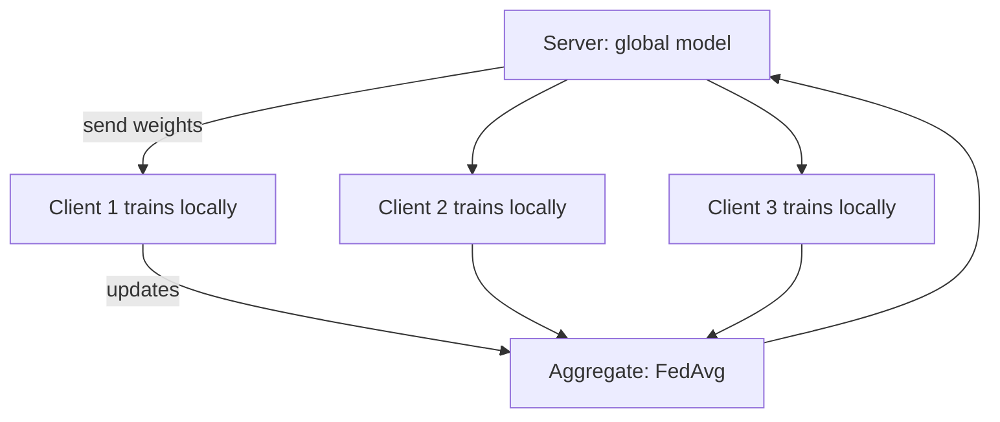

---
related:
- applications/healthcare
- society/ethics
- applications/finance
---

# Federated & Privacy-Preserving Learning

## Federated learning

Train a shared model **without centralising the data**. Each client (phone, hospital, bank) trains locally and sends only model updates; a server aggregates them.

**FedAvg** (McMahan et al., 2017): clients run several local SGD steps, the server averages their weights in proportion to their data size.

| Variant | Setting |
|---|---|
| Cross-device | Millions of phones, intermittently available (e.g. keyboard next-word prediction) |
| Cross-silo | A few institutions (hospitals, banks) with large datasets |
| Horizontal | Same features, different samples |
| Vertical | Same samples, different features (a bank and a retailer sharing customers) |
| Federated fine-tuning of foundation models | LoRA adapters trained across sites |

**Challenges**: non-i.i.d. data across clients (FedProx, SCAFFOLD address drift), communication cost, stragglers, personalisation, and the fact that **updates can leak data** (gradient inversion attacks) — federated learning alone is not a privacy guarantee.

## Privacy-enhancing technologies

| Technique | Guarantee | Cost |
|---|---|---|
| Differential privacy (DP, DP-SGD) | Bounded influence of any one individual (ε, δ) | Accuracy loss, especially for small groups |
| Secure aggregation | Server sees only the sum of updates | Communication / crypto overhead |
| Homomorphic encryption | Compute on encrypted data | Very slow for large models |
| Secure multi-party computation | Joint computation without revealing inputs | Complex, slow |
| Trusted execution environments | Hardware-isolated computation | Trust in hardware vendor; side channels |
| Synthetic data | Share generated rather than real data | Utility and privacy must both be verified |

Differential privacy definition: a mechanism \(M\) is (ε, δ)-DP if for neighbouring datasets \(D, D'\) and any output set \(S\),
\(\Pr[M(D)\in S] \le e^\varepsilon \Pr[M(D')\in S] + \delta\).

## Attacks motivating this area

- **Membership inference**: was this person in the training set?
- **Model inversion / training-data extraction**: LLMs can regurgitate memorised text, including personal data (Carlini et al., 2021).
- **Attribute inference** and **gradient leakage**.

## Applications

- Mobile keyboards, voice assistants
- Multi-hospital medical imaging models (e.g. federated tumour segmentation, FeTS)
- Financial fraud detection across banks
- Neuroscience: federated analysis of brain-imaging data across consortia (e.g. ENIGMA-style collaborations) where raw scans cannot be shared

## Subtopics

- [Federated averaging](federated-averaging/index.md): local updates and weighted averaging of client models.
- [Heterogeneity and personalisation](heterogeneity-and-personalisation/index.md): non-IID data, FedProx and SCAFFOLD.
- [Privacy and secure aggregation](privacy-and-secure-aggregation/index.md): secure sums of updates and differentially private training.
- [Communication efficiency](communication-efficiency/index.md): quantisation, sparsification and fewer rounds.
- [Vertical and cross-silo learning](vertical-and-cross-silo/index.md): training across organisations that hold different features.

## Further reading

- Dwork & Roth, *The Algorithmic Foundations of Differential Privacy*. Foundations and Trends in Theoretical Computer Science, 9(3–4). https://doi.org/10.1561/0400000042 — The standard textbook on differential privacy, with the mechanisms and proofs in full.
- [Flower](https://flower.ai/), [TensorFlow Federated](https://www.tensorflow.org/federated), [Opacus](https://opacus.ai/) (DP for PyTorch)

## References

### Seminal papers

- McMahan et al. (2017), "Communication-efficient learning of deep networks from decentralized data", AISTATS, arXiv:1602.05629 — Introduces federated averaging, the basic algorithm for training on decentralised data.
- Li et al. (2020), "Federated optimization in heterogeneous networks", MLSys, arXiv:1812.06127 — FedProx, a proximal extension of federated averaging for heterogeneous clients.
- Bonawitz et al. (2017), "Practical secure aggregation for privacy-preserving machine learning", CCS. https://doi.org/10.1145/3133956.3133982 — Secure aggregation protocol that lets the server learn only the sum of client updates.
- Abadi et al. (2016), "Deep learning with differential privacy", CCS, arXiv:1607.00133 — Differentially private SGD, which clips and noises gradients to give a formal privacy guarantee.

### Surveys and textbooks

- Kairouz et al. (2021), "Advances and open problems in federated learning", Foundations and Trends in Machine Learning, arXiv:1912.04977 — Broad survey of federated learning with a long list of open problems.
- Yang, Liu, Chen & Tong (2019), "Federated machine learning: concept and applications", ACM Transactions on Intelligent Systems and Technology, arXiv:1902.04885 — Introduces the horizontal, vertical and transfer categories of federated learning.
