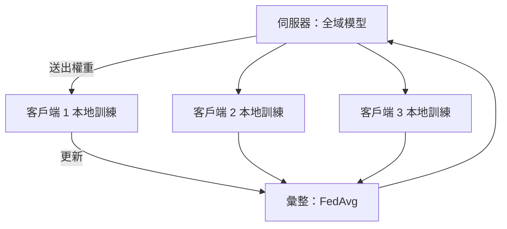

# 聯邦學習與隱私保護學習

## 聯邦學習

在**不集中資料**的情況下訓練共享模型。每個客戶端（手機、醫院、銀行）在本地訓練，只送出模型更新；伺服器負責彙整。

**FedAvg**（McMahan et al., 2017）：客戶端做數步本地 SGD，伺服器依資料量加權平均權重。

| 變體 | 情境 |
|---|---|
| 跨裝置 | 數百萬支手機，不定時在線（如鍵盤下一字預測） |
| 跨機構 | 少數擁有大量資料的機構（醫院、銀行） |
| 橫向 | 相同特徵、不同樣本 |
| 縱向 | 相同樣本、不同特徵（銀行與零售商有共同客戶） |
| 基礎模型的聯邦微調 | 跨站點訓練 LoRA adapter |

**挑戰**：客戶端之間資料非獨立同分布（FedProx、SCAFFOLD 處理漂移）、通訊成本、落後者、個人化，以及**更新本身會洩漏資料**（梯度反推攻擊）——光靠聯邦學習並不保證隱私。

## 隱私強化技術

| 技術 | 保證 | 代價 |
|---|---|---|
| 差分隱私（DP、DP-SGD） | 任何個人的影響有上界（ε, δ） | 準確率下降，小群體尤甚 |
| 安全彙整 | 伺服器只看到更新的總和 | 通訊／密碼學開銷 |
| 同態加密 | 在加密資料上運算 | 對大模型非常慢 |
| 安全多方計算 | 共同運算而不揭露輸入 | 複雜、慢 |
| 可信執行環境 | 硬體隔離的運算 | 需信任硬體廠商；旁路攻擊 |
| 合成資料 | 分享生成而非真實資料 | 效用與隱私都需驗證 |

差分隱私定義：機制 \(M\) 滿足 (ε, δ)-DP，若對相鄰資料集 \(D, D'\) 與任何輸出集合 \(S\)，
\(\Pr[M(D)\in S] \le e^\varepsilon \Pr[M(D')\in S] + \delta\)。

## 推動這個領域的攻擊

- **成員推論**：這個人在訓練集中嗎？
- **模型反推／訓練資料萃取**：LLM 可能吐出記住的文字，包括個資（Carlini et al., 2021）
- **屬性推論**與**梯度洩漏**

## 應用

- 手機鍵盤、語音助理
- 多醫院醫學影像模型（如聯邦腫瘤分割 FeTS）
- 跨銀行金融詐欺偵測
- 神經科學：在無法分享原始影像的聯盟中做聯邦式腦影像分析

## 延伸閱讀

- Kairouz et al. (2021)，《Advances and Open Problems in Federated Learning》，*Foundations and Trends in Machine Learning*。https://arxiv.org/abs/1912.04977
- Dwork & Roth，《The Algorithmic Foundations of Differential Privacy》，Foundations and Trends in Theoretical Computer Science, 9(3–4)。https://www.cis.upenn.edu/~aaroth/Papers/privacybook.pdf
- [Flower](https://flower.ai/)、[TensorFlow Federated](https://www.tensorflow.org/federated)、[Opacus](https://opacus.ai/)（PyTorch 的 DP）
