# 隱私保護與安全聚合（Privacy and Secure Aggregation）

聯邦學習雖讓資料留在裝置上，模型更新仍可能洩漏敏感資訊。**安全聚合（Secure Aggregation）**在特定密碼協定及威脅假設下，讓伺服器只取得參與者更新的合計值；**差分隱私（Differential Privacy）**則限制個別資料或客戶端對輸出的影響，兩者的防護目標並不相同。

## 概述

需要考慮的攻擊包含伺服器試圖還原個別更新，以及參與者推測別人的資料是否曾出現在訓練集中。安全聚合使用密碼學機制保護個別更新；差分隱私訓練使用裁剪和校準雜訊，提供形式化隱私界線。兩者可以結合，但都帶來成本與限制。

## 教學動畫：遮罩抵銷原理

*原創教學動畫，CC BY-SA 4.0。* 三位客戶端的**私有原始更新**分別為 `(+4, −1, +2)`。示意成對遮罩設定為 `m_AB = +3`、`m_AC = −2`、`m_BC = +1`，每位客戶端的淨遮罩依序為 `(+1, −2, +1)`，所以傳送的數值變成 `(+5, −3, +3)`。所有遮罩相互抵銷：

\[
\sum_i(u_i+m_i)=5-3+3=5=\sum_i u_i,
\qquad \sum_i m_i=0.
\]

所有整數和傳遞過程**都是人為示意，不是實際的密碼協定或模型實測資料**。動畫僅呈現抵銷不變量，並未實作有限體編碼、金鑰交換、祕密分享、掉線復原、合謀假設，以及 [Bonawitz 等人（2017）](https://doi.org/10.1145/3133956.3133982)的完整協定。安全聚合本身**不提供差分隱私**，也不會隱藏最終總和。MkDocs 網站可播放／暫停，GitHub 有[靜態回退預覽](../../../../assets/concept-animations/secagg-mask-cancellation-still.svg)。

## 主要技術

- **安全聚合：** 使用遮罩及密碼協定，讓伺服器取得總和，而不是各客戶端原始更新；實際協定還需處理裝置掉線。
- **差分隱私 SGD：** 對逐樣本梯度裁剪並加入校準雜訊，以形式化參數衡量隱私損失。
- **客戶端層級隱私：** 對整個客戶端貢獻定義相鄰資料集，適合跨裝置訓練。
- **跨機構協作：** 各機構可共享部分模型更新而不集中原始資料，但仍需評估更新外洩風險。

## 相關連結

隱私取捨與[倫理與社會](../../../../society/ethics/index.md)有關；安全聚合也必須搭配[聯邦平均](../federated-averaging/index.md)及[監督式學習](../../supervised/loss-functions-and-optimization/index.md)的最佳化流程。

## 應用

包括跨醫院醫療模型、手機輸入法，以及不能集中客戶資料的跨金融機構風險模型。

## 開放問題

差分隱私的形式化保證往往需付出準確率成本。協定安全性取決於威脅模型，部署後的隱私稽核也仍具挑戰。

## References

### 原始論文

- Bonawitz et al.（2017），*Practical Secure Aggregation for Privacy-Preserving Machine Learning*，CCS。https://doi.org/10.1145/3133956.3133982 — 提出可處理裝置掉線的安全聚合協定。
- Abadi et al.（2016），*Deep Learning with Differential Privacy*，CCS。https://arxiv.org/abs/1607.00133 — 以梯度裁剪及雜訊實作 DP-SGD。
- Geyer, Klein & Nabi（2017），*Differentially Private Federated Learning: A Client Level Perspective*。https://arxiv.org/abs/1712.07557 — 將客戶端作為隱私保護單位。
- Shokri & Shmatikov（2015），*Privacy-Preserving Deep Learning*，CCS。https://www.comp.nus.edu.sg/~reza/files/Shokri-CCS2015.pdf — 探討以部分參數共享進行協同學習。

### 綜述與教科書

- Kairouz et al.（2021），*Advances and Open Problems in Federated Learning*。https://arxiv.org/abs/1912.04977 — 彙整聯邦學習的隱私、最佳化與工程問題。

## Further learning

- McMahan et al.（2018），*Learning Differentially Private Recurrent Language Models*。https://arxiv.org/abs/1710.06963 — 使用加雜訊的客戶端更新訓練語言模型。
