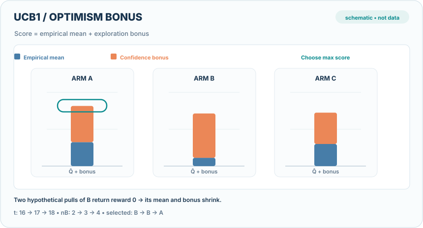
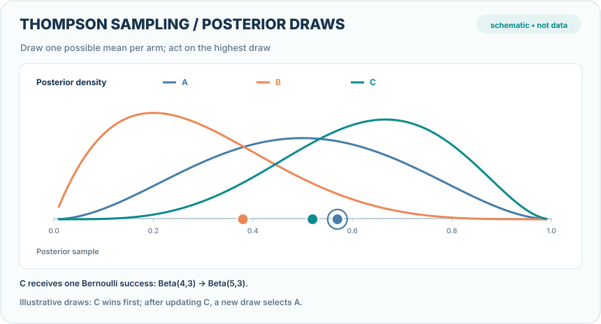

---
related:
- theory/paradigms/reinforcement-learning/index.md
tags:
  - bandits
  - UCB
  - Thompson sampling
---

# Stochastic Bandits

The stochastic bandit problem assumes each arm has a fixed unknown reward distribution. The learner must balance exploring arms to learn their means and exploiting the best arm found so far. Upper confidence bound and Thompson sampling methods are the two standard answers, and both achieve logarithmic regret under mild conditions.

## Overview

Regret compares the total reward with that of always playing the best arm. Lai and Robbins showed that logarithmic regret is the best possible, and UCB methods achieve it by playing the arm with the highest optimistic estimate of its mean. Thompson sampling keeps a posterior over the means, samples from it, and plays the arm that is best under the sample.

## Key algorithms

- **Upper confidence bound (UCB1)**: add a confidence width to each arm's empirical mean and play the largest total.
- **Thompson sampling**: sample each arm's mean from its posterior and play the best sample, which is simple and often works well in practice.
- **Explore-then-commit and epsilon-greedy**: simpler schemes with weaker guarantees, still common as baselines.

## Visual walkthrough: uncertainty and posterior sampling

### UCB1 — optimism can change the selected arm

  

*Original continuous teaching animation (CC BY-SA 4.0).* For each arm $i$, UCB1 scores $\bar X_i+\sqrt{2\ln(t)/n_i}$ and selects the largest value. The illustrated snapshot starts at $t=16$ with counts $(6,2,8)$ and empirical means $(0.65,0.45,0.60)$. Two **hypothetical zero rewards** after selecting B raise its sample count from 2 to 4 and lower its mean from 0.45 to 0.225; the winning score switches from B to A. Bars show the mean (blue) plus confidence bonus (orange), while the green ring identifies the optimistic winner. Intermediate motion interpolates between discrete decision snapshots, **not a continuous training trajectory or measured experiment**. No reward is inferred for unplayed arms. In MkDocs, use **Play/Pause** (keyboard **Enter/Space**); on narrow screens, scroll the focusable illustration horizontally. GitHub shows a [static fallback](../../../../assets/concept-animations/ucb1-optimism-switch-still.svg). See Auer, Cesa-Bianchi & Fischer (2002) in References.

### Thompson sampling — posterior draws and a local update

  

*Original continuous teaching animation (CC BY-SA 4.0).* In the **Bernoulli** reward example, independent posterior models are $A\sim\operatorname{Beta}(3,3)$, $B\sim\operatorname{Beta}(2,5)$ and $C\sim\operatorname{Beta}(4,3)$. One **constructed draw per arm**, $(0.47,0.22,0.71)$, chooses C. A hypothetical successful observation for **C only** updates $C$ to $\operatorname{Beta}(5,3)$; new illustrative draws $(0.57,0.38,0.52)$ choose A. The moving dots are **example posterior draws**, not inferred means, predicted confidence scores, a recorded random seed or empirical algorithm output. The shape change is an interpolation between distinct Bayesian posteriors. MkDocs supports **Play/Pause** and keyboard **Enter/Space**; use the [GitHub static fallback](../../../../assets/concept-animations/thompson-beta-posterior-draws-still.svg) when motion is unavailable. See Agrawal & Goyal (2012) and Russo et al. (2018) in References.
## Connections

Bandits are the one-step case of [reinforcement learning](../../reinforcement-learning/index.md), with no state transitions. The posterior sampling of Thompson sampling is the same Bayesian reasoning used in [probabilistic models](../../supervised/instance-based-and-probabilistic/index.md). The contextual extension is covered in [contextual bandits](../contextual-bandits/index.md).

## Applications

A/B testing that shifts traffic toward better variants, dose-finding in clinical trials, and choosing among a fixed set of prompts or models.

## Open questions

Heavy-tailed rewards, delayed feedback and non-stationary arms break the standard guarantees. In practice, the choice between UCB and Thompson sampling often depends on how reward models are updated.

## References

### Seminal papers

- Lai & Robbins (1985), "Asymptotically efficient adaptive allocation rules", Advances in Applied Mathematics. https://doi.org/10.1016/0196-8858(85)90002-8 — Proves the logarithmic lower bound on regret that good bandit algorithms must match.
- Auer, Cesa-Bianchi & Fischer (2002), "Finite-time analysis of the multiarmed bandit problem", Machine Learning. https://homes.di.unimi.it/~cesabian/Pubblicazioni/ml-02.pdf — UCB1, with finite-time regret bounds that are simple to apply.
- Agrawal & Goyal (2012), "Analysis of Thompson sampling for the multi-armed bandit problem", COLT, [arXiv:1111.1797](https://arxiv.org/abs/1111.1797) — The first regret analysis of Thompson sampling, showing that it matches the logarithmic lower bound.

### Surveys and textbooks

- Bubeck & Cesa-Bianchi (2012), "Regret analysis of stochastic and nonstochastic multi-armed bandit problems", Foundations and Trends in Machine Learning, [arXiv:1204.5721](https://arxiv.org/abs/1204.5721) — Survey that treats stochastic and adversarial bandits side by side.
- Lattimore & Szepesvári (2020), *Bandit Algorithms*, Cambridge University Press. https://cambridge.org/core/books/bandit-algorithms/introduction/022B0BDCFDC5B66E5EF2C2690467D928 — Comprehensive textbook covering UCB, Thompson sampling and lower bounds.

### Lectures and videos

No further entries for this page.

### Articles and documentation

No further entries for this page.

## Further reading

- Slivkins (2019), "Introduction to multi-armed bandits", [arXiv:1904.07272](https://arxiv.org/abs/1904.07272) — Accessible introduction to the bandit literature, including Bayesian and contextual settings.
