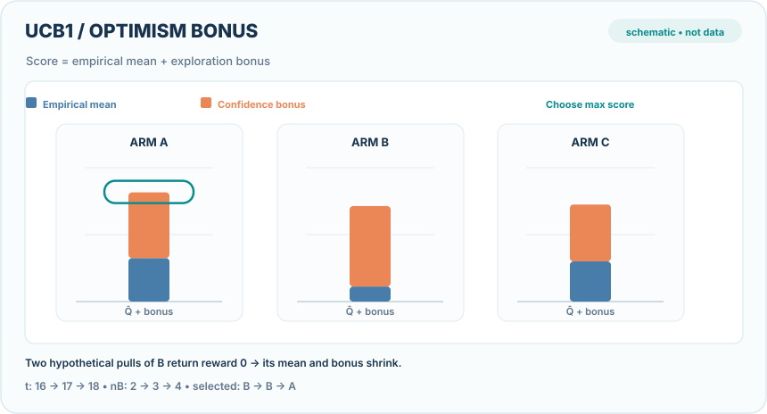
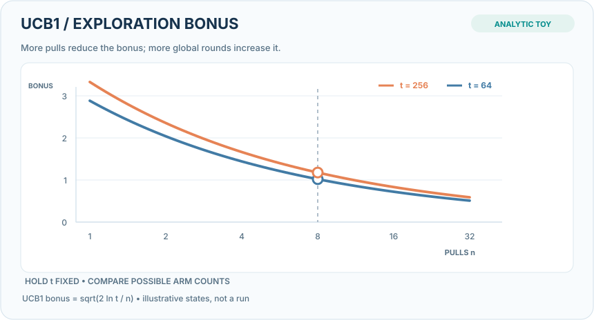
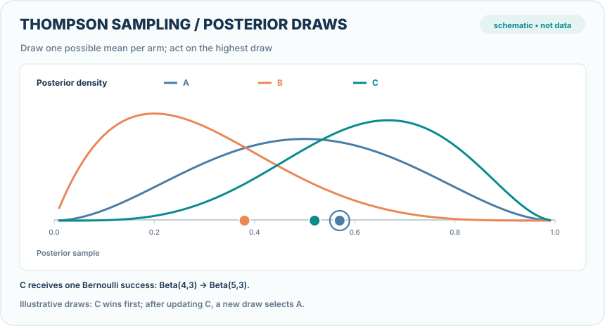
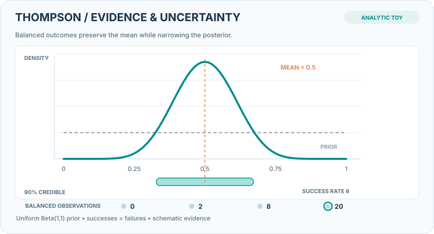

---
related:
- theory/paradigms/reinforcement-learning/index.md
tags:
  - bandits
  - UCB
  - Thompson sampling
---

# Stochastic Bandits

The stochastic bandit problem assumes each arm has a fixed unknown reward distribution. The learner must balance exploring arms to learn their means and exploiting the best arm found so far. Upper confidence bound and Thompson sampling methods are the two standard answers, and admit problem-dependent logarithmic expected-regret bounds under specified stationary reward, gap and model assumptions. This is not a guarantee for every realised run or every prior/reward model.

## Overview

Regret compares the total reward with that of always playing the best arm. For suitable uniformly efficient policies on regular fixed-gap stochastic instances, Lai and Robbins established an asymptotic logarithmic lower bound; this is not a gap-free minimax statement, and UCB methods achieve it by playing the arm with the highest optimistic estimate of its mean. Thompson sampling keeps a posterior over the means, samples from it, and plays the arm that is best under the sample.

## Key algorithms

- **Upper confidence bound (UCB1)**: add a confidence width to each arm's empirical mean and play the largest total.
- **Thompson sampling**: sample each arm's mean from its posterior and play the best sample, which is simple and often works well in practice.
- **Explore-then-commit and epsilon-greedy**: simpler schemes with weaker guarantees, still common as baselines.

## Visual walkthrough: uncertainty and posterior sampling

### UCB1 — optimism can change the selected arm

  

*Original continuous teaching animation (CC BY-SA 4.0).* For each arm $i$, UCB1 scores $\bar X_i+\sqrt{2\ln(t)/n_i}$ and selects the largest value. The illustrated snapshot starts at $t=16$ with counts $(6,2,8)$ and empirical means $(0.65,0.45,0.60)$. Two **hypothetical zero rewards** after selecting B raise its sample count from 2 to 4 and lower its mean from 0.45 to 0.225; the winning score switches from B to A. Bars show the mean (blue) plus confidence bonus (orange), while the green ring identifies the optimistic winner. Intermediate motion interpolates between discrete decision snapshots, **not a continuous training trajectory or measured experiment**. No reward is inferred for unplayed arms. In MkDocs, use **Play/Pause** (keyboard **Enter/Space**); on narrow screens, scroll the focusable illustration horizontally. GitHub shows a [static fallback](../../../../assets/concept-animations/ucb1-optimism-switch-still.svg). See Auer, Cesa-Bianchi & Fischer (2002) in References.

### Exploration bonus sensitivity: counts versus time

  

*Original continuous teaching animation (CC BY-SA 4.0).* UCB1 uses the exploration term $b_i(t)=\sqrt{2\ln(t)/n_i}$. The two **analytical, counterfactual** curves fix the total round count separately at $t=64$ and $t=256$, and compare possible sample counts $n_i=1,2,4,8,16,32$ for one arm. At fixed $t$, sampling that arm more often shrinks its bonus: for $t=64$ it falls from about **2.884** to **0.510**. At the same $n_i$, larger $t$ raises the bonus because other arms could have been sampled while this arm was not: at $n_i=8$, the values are approximately **1.020** and **1.177**. These pairs are **not a sequential trace** (varying $n_i$ while holding $t$ constant is a sensitivity comparison), and the exploration bonus alone is neither a posterior standard deviation nor a measured reward. Each displayed combination has $1\le n_i\le t$. The complete UCB score still adds the empirical mean. See Auer, Cesa-Bianchi & Fischer (2002) in References

The MkDocs player uses **Play/Pause** (keyboard **Enter/Space**), and reduced-motion mode starts with a static still. The illustration scrolls horizontally on narrow screens. [Open the SVG motion](../../../../assets/concept-animations/ucb1-bonus-sensitivity-motion.svg) · [GitHub fallback](../../../../assets/concept-animations/ucb1-bonus-sensitivity-still.svg).

### Thompson sampling — posterior draws and a local update

  

*Original continuous teaching animation (CC BY-SA 4.0).* In the **Bernoulli** reward example, independent posterior models are $A\sim\operatorname{Beta}(3,3)$, $B\sim\operatorname{Beta}(2,5)$ and $C\sim\operatorname{Beta}(4,3)$. One **constructed draw per arm**, $(0.47,0.22,0.71)$, chooses C. A hypothetical successful observation for **C only** updates $C$ to $\operatorname{Beta}(5,3)$; new illustrative draws $(0.57,0.38,0.52)$ choose A. The moving dots are **example posterior draws**, not inferred means, predicted confidence scores, a recorded random seed or empirical algorithm output. The shape change is an interpolation between distinct Bayesian posteriors. MkDocs supports **Play/Pause** and keyboard **Enter/Space**; use the [GitHub static fallback](../../../../assets/concept-animations/thompson-beta-posterior-draws-still.svg) when motion is unavailable. See Agrawal & Goyal (2012) and Russo et al. (2018) in References.
### Posterior concentration without moving the mean

  

*Original analytical teaching animation (CC BY-SA 4.0).* Begin with a **Beta(1,1) prior**, then consider balanced hypothetical Bernoulli outcomes: $(s,f)=(0,0),(1,1),(4,4),(10,10)$. The corresponding posteriors are **Beta(1,1), Beta(2,2), Beta(5,5), Beta(11,11)**. Every posterior has mean $\alpha/(\alpha+\beta)=0.5$, but its variance

$$
\alpha\beta/[(\alpha+\beta)^2(\alpha+\beta+1)]
$$

 decreases with evidence. The green band is the exact **90% equal-tailed credible interval** for the unknown arm probability: it contracts from **[0.050, 0.950]** initially to about **[0.328, 0.672]** after 20 balanced outcomes. The interpolated shapes illustrate the transition between discrete posteriors, **not fractional observations**; these are constructed outcomes, not sampled trials, training measurements, predictive intervals or a claim that Thompson sampling always receives balanced feedback. A posterior draw does not update the distribution; only observing a reward does. See Agrawal & Goyal (2012) and Russo et al. (2018) in References

On MkDocs, **Play/Pause** (keyboard **Enter/Space**) controls the animation; reduced-motion readers receive the still, and mobile readers can scroll the region. [Open the SVG motion](../../../../assets/concept-animations/thompson-evidence-concentration-motion.svg) · [GitHub fallback](../../../../assets/concept-animations/thompson-evidence-concentration-still.svg).

### Interactive computation lab — UCB1 reward sensitivity

  
The non-script static illustration above remains available when this interactive MkDocs lab cannot load.

UCB1 assumes independent bounded rewards (here in [0,1]) and initializes by pulling each arm. This toy labels total completed pulls as $t$; the next decision uses the displayed $\ln t$ convention, rather than interpreting a counterfactual state as a real run.

The controls recompute **actual UCB1 arithmetic** at $t=16,17,18$ from counts $(6,2,8)$ and cumulative rewards $(3.9,0.9,4.8)$. Set **two independent hypothetical rewards**, $r_1,r_2\in[0,1]$, for B's first and second additional pulls. After the first and second updates, its empirical means are $(0.9+r_1)/3$ and $(0.9+r_1+r_2)/4$, respectively. In this bounded example, B is a UCB winner for the first two decisions regardless of the sliders; the third decision can switch to A. Both rewards zero give **B → B → A**, while a sufficiently large second reward can keep **B** ahead. The score margin is the largest UCB score minus the runner-up, and the **highest empirical mean** is shown separately: A has the highest initial observed mean even though B receives the optimistic UCB selection. The values are **analytically computed examples**, not experimental regret curves.

The additional **counterfactual decision map** is an exact analytical phase diagram for the **third** UCB1 choice at $t=18$, assuming both prospective B observations have already occurred. The first hypothetical reward $r_1$ runs horizontally and the second $r_2$ vertically; the dark marker follows the controls. For the fixed A and C statistics shown here, $\mathrm{UCB}(A)>\mathrm{UCB}(C)$ everywhere, and the third choice is **B when the reward sum exceeds the exact cutoff** (approximately $0.817599$), otherwise A. Blue and orange indicate the two decision regions; the dashed diagonal is the *continuous analytic* boundary, not a discretised or empirical heatmap. This is a counterfactual **policy decision surface**, not a real sequence of rewards or an estimate of regret. On mobile, focus the map and scroll horizontally to inspect the legend.

The phase diagram is also **directly clickable or tappable**: selecting a point sets both hypothetical rewards, rounded to increments of $0.05$, and immediately recalculates the UCB scores and future winner. The two native sliders provide the same operation by keyboard. Clicking an analytic region is not observing a real reward.

**Decision-by-decision score margin.** The additional three-point plot is computed directly from the discrete UCB1 formula at $t=16,17,18$ for the chosen hypothetical rewards. It shows $\mathrm{UCB}_B-\mathrm{UCB}_A$: positive favours B, negative favours A, and the dashed zero line is the tie boundary. For $r_1=r_2=0$, the margin changes from about $+0.504$ to $+0.053$ to $-0.204$; for $r_1=r_2=1$, the final margin is $+0.296$. The enlarged dot marks the selected step; the other dots represent counterfactual earlier or future states. C remains below A throughout this bounded example. The discrete score calculations are not measured regret or a continuous learning trajectory.

**Decomposing the UCB decision.** A second live SVG separates the score difference into *empirical-mean advantage* and *exploration-bonus advantage*, rather than displaying only their sum:

$$
\mathrm{UCB}_B-\mathrm{UCB}_A=(\bar X_B-\bar X_A)+\left[\sqrt{2\ln(t)/n_B}-\sqrt{2\ln(t)/6}\right].
$$

The zero line separates a B advantage from an A advantage; all three bars update exactly when the step or either hypothetical reward changes. At $t=16$, B has a **$-0.200$ empirical-mean gap**, outweighed by approximately **$+0.704$** in exploration bonus, for a net **$+0.504$**. With two zero rewards at $t=18$, these terms become approximately $-0.425$ and $+0.221$, producing a net **$-0.204$** and selecting A. These are counterfactual score calculations, *not* measured rewards or regret. On narrow screens the diagnostic strip scrolls horizontally and can be focused for keyboard scrolling.

### Interactive computation lab — Beta posterior update

  
The non-script static illustration above remains available when this interactive MkDocs lab cannot load.

Use **Previous/Next, Play/Pause, the step slider, speed, and Reset** to inspect an initial posterior, constructed sample draws, an observation, and a second set of draws. The first artificial samples select C. Toggle C's observed Bernoulli outcome $r\in\{0,1\}$ to compute $\operatorname{Beta}(4+r,4-r)$ exactly: a success gives Beta(5,3), while a failure gives Beta(4,4). The other two posteriors do not change. The second set of *constructed*, not randomly generated, samples is $(0.57,0.38,0.52)$, so A wins that illustrative comparison even though C's posterior depends on the outcome. **New posterior-optimality bars** separately compute

$$
P(i=\mathrm{best})=\int_0^1 f_i(x)\prod_{j\ne i}F_j(x)\,dx
$$

 using deterministic composite Simpson quadrature, where $f_i,F_i$ are each independent Beta density and CDF. Initially C is best with probability about **0.5734**; after a C success it rises to **0.6616**, while after a failure it falls to **0.4559**. These probabilities describe uncertainty *before a fresh draw*, not the winner of the fixed illustrative draw. At the **posterior-update-only** step, the earlier constructed sample dots disappear instead of being moved onto the newly updated Beta density; the second draw step displays a new set of constructed samples. The numeric integration is approximate and is not a Monte Carlo trial. These are **not** reproduced Thompson-sampling trials, and moving between discrete snapshots does not assert continuous Bayesian updating. All controls are native keyboard-operable; motion is disabled under `prefers-reduced-motion`, but manual stepping works. On mobile, focus and horizontally scroll the 720px diagram.

**Prediction versus parameter uncertainty:** the lab now distinguishes the posterior-predictive probability of C succeeding on its **next** Bernoulli trial,

$$
P(r_{\mathrm{next}}=1\mid\mathcal D)=a/(a+b),
$$

 from uncertainty about C's latent success rate,

$$
\operatorname{Var}(\theta_C\mid\mathcal D)=ab/[(a+b)^2(a+b+1)].
$$

 For $\operatorname{Beta}(4,3)$ these are $0.5714$ and $0.0306$; one synthetic success changes them to $0.6250$ and $0.0260$, while one failure gives $0.5000$ and $0.0278$. During the **posterior-update-only** phase, the panel hides the previous draw values and selected-arm readout along with the dots: a draw made under the old distribution is not a new draw from the updated posterior. These diagnostics use the illustrative conjugate Bernoulli–Beta model, not observed trial outcomes.

**Beta evidence transition.** The two-row strip below the density plot shows C's posterior shape parameters $\alpha,\beta$ as pseudocount blocks, initially $(4,3)$. Merely drawing a hypothesis leaves the parameters unchanged. Only a hypothetical observed success adds one outlined block to $\alpha$; a failure instead adds one to $\beta$. Earlier blocks include the prior shape parameters and existing evidence, so they are **not literal records of four observed successes and three observed failures**. The outlined block identifies the conjugate update; its meaning is also available to screen readers.

**A credible interval is not a prediction interval.** The new 90% *equal-tailed posterior credible interval* shows the 5th and 95th percentiles of C's **unknown Bernoulli success probability** $\theta_C$, alongside its posterior mean $a/(a+b)$. It inverts the integer-parameter Beta CDF by bisection, so the band represents posterior probability mass rather than a measurement of upcoming binary rewards. Starting from Beta(4,3), the interval is approximately **[0.2713, 0.8468]**. A hypothetical success moves it to **[0.3413, 0.8712]** under Beta(5,3), whereas a failure moves it to **[0.2253, 0.7747]** under Beta(4,4). The interval changes only at the posterior-update stage, **not when a sample is drawn**. This Bayesian credible region is not a frequentist confidence interval or evidence from a real experiment. The accompanying SVG is keyboard-scrollable on narrow screens.

## Connections

Bandits are the one-step case of [reinforcement learning](../../reinforcement-learning/index.md), with no state transitions. The posterior sampling of Thompson sampling is the same Bayesian reasoning used in [probabilistic models](../../supervised/instance-based-and-probabilistic/index.md). The contextual extension is covered in [contextual bandits](../contextual-bandits/index.md).

## Applications

A/B testing that shifts traffic toward better variants, dose-finding in clinical trials, and choosing among a fixed set of prompts or models.

## Open questions

Heavy-tailed rewards, delayed feedback and non-stationary arms break the standard guarantees. In practice, the choice between UCB and Thompson sampling often depends on how reward models are updated.

## References

### Seminal papers

- Lai & Robbins (1985), "Asymptotically efficient adaptive allocation rules", Advances in Applied Mathematics. https://doi.org/10.1016/0196-8858(85)90002-8 — Proves the logarithmic lower bound on regret that good bandit algorithms must match.
- Auer, Cesa-Bianchi & Fischer (2002), "Finite-time analysis of the multiarmed bandit problem", Machine Learning. https://homes.di.unimi.it/~cesabian/Pubblicazioni/ml-02.pdf — UCB1, with finite-time regret bounds that are simple to apply.
- Agrawal & Goyal (2012), "Analysis of Thompson sampling for the multi-armed bandit problem", COLT, [arXiv:1111.1797](https://arxiv.org/abs/1111.1797) — The first regret analysis of Thompson sampling, proving logarithmic expected regret; its gap dependence and constants are not generally asymptotically optimal.

### Surveys and textbooks

- Bubeck & Cesa-Bianchi (2012), "Regret analysis of stochastic and nonstochastic multi-armed bandit problems", Foundations and Trends in Machine Learning, [arXiv:1204.5721](https://arxiv.org/abs/1204.5721) — Survey that treats stochastic and adversarial bandits side by side.
- Lattimore & Szepesvári (2020), *Bandit Algorithms*, Cambridge University Press. https://cambridge.org/core/books/bandit-algorithms/introduction/022B0BDCFDC5B66E5EF2C2690467D928 — Comprehensive textbook covering UCB, Thompson sampling and lower bounds.

### Lectures and videos

No further entries for this page.

### Articles and documentation

No further entries for this page.

## Further reading

- Slivkins (2019), "Introduction to multi-armed bandits", [arXiv:1904.07272](https://arxiv.org/abs/1904.07272) — Accessible introduction to the bandit literature, including Bayesian and contextual settings.

The exact cutoff, with ties assigned to A, is:

$$
c=4\left(0.65+\sqrt{2\ln(18)/6}-\sqrt{2\ln(18)/4}\right)-0.9.
$$
