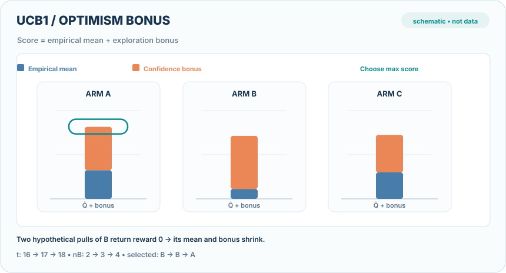
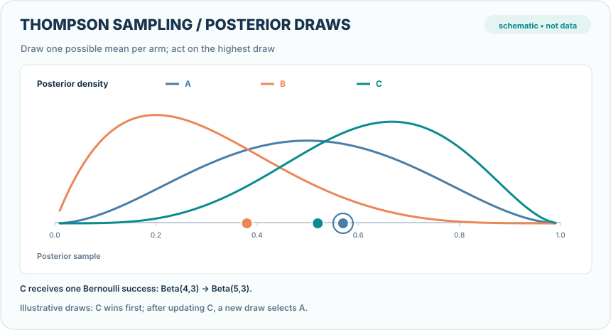

# 隨機多臂吃角子老虎（Stochastic Bandits）

隨機多臂吃角子老虎問題假設每個臂（arm）都有固定但未知的獎勵分布。學習者必須在**探索**各臂以估計期望獎勵，以及**利用**目前看起來最好的臂之間取得平衡。信賴上界（Upper Confidence Bound, UCB）與 Thompson 取樣是兩種代表性方法；在適當假設下，它們能達到對數級遺憾上界。

## 概述

遺憾（regret）比較學習者實際累積獎勵，與總是選擇最佳臂所能取得的期望累積獎勵。Lai 與 Robbins 證明，對典型的隨機多臂問題而言，對數級遺憾具有不可避免的下界。UCB 以**樂觀估計**選擇「經驗平均獎勵加上信賴寬度」最高的臂；Thompson 取樣則維持各臂獎勵參數的後驗分布，從中抽樣，選擇抽樣結果最佳的臂。

## 主要演算法

- **UCB1（信賴上界）**：在每個臂的經驗平均值上加入代表不確定性的信賴寬度，選擇總分最大的臂。
- **Thompson 取樣**：從各臂後驗分布抽取可能的期望獎勵，選擇抽樣結果最高的臂。此法在實務上經常有效，且容易應用於貝氏模型。
- **先探索再固定（explore-then-commit）與 ε-greedy**：較簡單的基準策略，但理論保證與適用條件不同。

## 教學動畫：樂觀探索與後驗抽樣

### UCB1：信賴寬度如何改變選擇

  

*原創連續教學動畫（CC BY-SA 4.0）。* UCB1 對每個臂 $i$ 使用 $\bar X_i+\sqrt{2\ln(t)/n_i}$ 計分，並選擇最大者。示例在 $t=16$ 開始，三臂的抽樣次數為 $(6,2,8)$，經驗平均值為 $(0.65,0.45,0.60)$。B 在兩次被選擇後，都得到**人為設定的零獎勵**，因此抽樣次數從 2 增至 4，平均值從 0.45 降至 0.225；樂觀分數最高的臂便由 B 轉為 A。藍色表示經驗平均值、橘色表示信賴寬度，綠色框表示目前分數最大的臂。動畫轉場只是不同離散決策狀態間的**視覺插值，並非模型實測或連續訓練軌跡**；未被選擇的臂不會在該步獲得回饋。在 MkDocs 網站可使用**播放／暫停**按鈕（鍵盤 **Enter／Space**）；手機畫面可聚焦後水平捲動。GitHub 也有可直接閱讀的[靜態預覽](../../../../assets/concept-animations/ucb1-optimism-switch-still.svg)。原始來源為 References 中的 Auer、Cesa-Bianchi 與 Fischer（2002）。

### Thompson 取樣：後驗抽樣及局部更新

  

*原創連續教學動畫（CC BY-SA 4.0）。* 在**伯努利獎勵**的示意中，三臂各自具有獨立的後驗分布：$A\sim\operatorname{Beta}(3,3)$、$B\sim\operatorname{Beta}(2,5)$、$C\sim\operatorname{Beta}(4,3)$。對每個臂各抽取一次所建構的樣本 $(0.47,0.22,0.71)$，第一輪選出 C。假設 C 收到一次成功回饋，**只有 C** 的後驗更新為 $\operatorname{Beta}(5,3)$；下一輪假設的抽樣 $(0.57,0.38,0.52)$ 則選出 A。移動的圓點是**人工指定的後驗抽樣結果**，不是後驗平均數、模型信心、可重現隨機種子或實測輸出；密度曲線的連續變化也只是兩個離散後驗之間的視覺轉場。在 MkDocs 網站可使用播放／暫停和 Enter／Space 操作；GitHub 提供[靜態回退預覽](../../../../assets/concept-animations/thompson-beta-posterior-draws-still.svg)。科學依據請參見 References 中的 Agrawal 與 Goyal（2012）以及 Russo 等人（2018）。

### 互動計算實驗：UCB1 對獎勵的敏感度

  
若 MkDocs 無法載入互動程式，仍可閱讀上方不需 JavaScript 的靜態教學圖。

本實驗根據抽取次數 $(6,2,8)$、累積獎勵 $(3.9,0.9,4.8)$，在 $t=16,17,18$ **重新計算 UCB1**。現在可以分別調整 B 接下來兩次抽取的假設獎勵 $r_1,r_2\in[0,1]$，而非假設兩次獎勵相同。第一次和第二次更新後，B 的經驗平均值依序為 $(0.9+r_1)/3$ 與 $(0.9+r_1+r_2)/4$。在此有界範例中，前兩次選擇 B 都符合當下的 UCB 最大分數，第三次則可能改選 A。兩次獎勵皆為 0 時的決策為 **B → B → A**；提高第二次獎勵，可以讓第三次仍選擇 **B**。介面另外顯示**經驗平均值最高的臂**與 UCB 第一、第二名的分數差，讓讀者比較利用與樂觀探索：初始平均值最高的是 A，但 UCB 選擇 B。全部數值均屬**解析式計算的人工示例**，不是實測遺憾或訓練曲線。

新增的**反事實決策平面**，以解析式呈現假設 B 已取得兩次回饋之後，在 $t=18$ 的**第三次 UCB1 決策**。橫軸 $r_1$ 為第一次假設獎勵、縱軸 $r_2$ 為第二次獎勵；深色標記隨滑桿移動。在本例固定的 A、C 統計量下，$\mathrm{UCB}(A)>\mathrm{UCB}(C)$ 始終成立，僅當 $r_1+r_2>0.817599$（邊界數值為四捨五入）時第三次會選 B，其他情況選 A。藍色與橘色表示不同的決策區域，虛線是**連續且精確的解析分界**，不是離散採樣的熱圖或實測結果。這是對尚未發生的回饋進行**反事實策略敏感度分析**，並非實際獎勵序列或遺憾估計。手機可聚焦後水平捲動圖面，以查看右側圖例。

此解析決策平面也可**直接點選或觸控**：選定座標後，兩次假設獎勵會以 $0.05$ 為間距取整，並立即重新計算 UCB 分數及未來的選擇。鍵盤使用者可透過兩個原生滑桿進行相同操作。點選決策區域**不是**實際觀察到獎勵。

**逐步決策分數差。**新增的三點折線以離散 UCB1 公式計算 $t=16,17,18$ 的 $\mathrm{UCB}_B-\mathrm{UCB}_A$：正值表示 B 領先，負值表示 A 領先，水平虛線為平手邊界。當 $r_1=r_2=0$，差值依序約為 $+0.504,+0.053,-0.204$；兩次獎勵皆為 1 時，最後的差值為 $+0.296$。較大的圓點對應目前步驟，其他圓點代表同一組假設回饋下的先前或未來反事實狀態。在這個有界示例中，C 的 UCB 分數始終低於 A。折線為離散分數計算，不是連續學習軌跡或實測遺憾。

**分解 UCB 決策分數。**新增的即時 SVG 將 B 與 A 的 UCB 分數差拆成**經驗平均獎勵差**與**探索加分差**，不只顯示最後總和：

$\mathrm{UCB}_B-\mathrm{UCB}_A=(\bar X_B-\bar X_A)+\left[\sqrt{2\ln(t)/n_B}-\sqrt{2\ln(t)/6}\right].$

零基準線區分 B 與 A 的優勢，三條長條會隨步驟及兩次假設獎勵即時計算。初始 $t=16$ 時，B 的平均值差為 **$-0.200$**，但探索加分差約為 **$+0.704$**，因此淨分數差約為 **$+0.504$**；兩次假設獎勵皆為零後，在 $t=18$ 變成 $-0.425$ 與 $+0.221$，淨差約為 **$-0.204$**，轉為選擇 A。這些是**反事實分數計算**，並非實測獎勵或遺憾。手機可聚焦診斷圖後水平捲動，鍵盤使用者亦可瀏覽完整圖形。

### 互動計算實驗：Beta 後驗更新

  
若 MkDocs 無法載入互動程式，仍可閱讀上方不需 JavaScript 的靜態教學圖。

透過**上一步／下一步、播放／暫停、步驟滑桿、速度調整與重設**，依序查看初始後驗、人工指定的首次抽樣、觀察結果與第二次抽樣。第一次抽樣選出 C；切換 C 的伯努利觀察獎勵 $r\in\{0,1\}$，可立即重新計算其後驗 $\operatorname{Beta}(4+r,4-r)$：成功時為 Beta(5,3)，失敗時為 Beta(4,4)，**其他兩臂的後驗維持不變**。第二組人工指定的抽樣 $(0.57,0.38,0.52)$ 在兩種假設結果下都會選 A，這不是實際亂數抽樣紀錄。新增的**最佳臂後驗機率長條**則獨立計算 $P(i=\mathrm{best})=\int_0^1 f_i(x)\prod_{j\ne i}F_j(x)\,dx$，其中 $f_i,F_i$ 分別為每個臂的 Beta 機率密度與累積分布函數，使用確定性的複合 Simpson 數值積分。C 初始成為最佳臂的機率約 **0.5734**；觀察成功後升至 **0.6616**，觀察失敗後降至 **0.4559**。這個機率是**重新抽樣之前的不確定性**，並不等同於固定示意抽樣的勝出臂；在**只更新後驗**的階段，舊抽樣點會隱藏，不會被移到新後驗密度曲線上；直到第二次抽樣階段才顯示新設定的抽樣點。數值積分具有近似誤差，且不是蒙地卡羅實測。請勿把離散後驗的切換視為連續貝氏更新。控制項可透過鍵盤操作；開啟減少動態效果時不會自動播放，仍可手動逐步檢視。手機可聚焦於 720px 圖面後水平捲動。

**預測機率與參數不確定性不同：**互動面板另外區分 C 在**下一次**伯努利抽取中成功的後驗預測機率 $P(r_{\mathrm{next}}=1\mid\mathcal D)=a/(a+b)$，以及未知成功率本身的後驗變異數 $\operatorname{Var}(\theta_C\mid\mathcal D)=ab/[(a+b)^2(a+b+1)]$。初始 $\operatorname{Beta}(4,3)$ 對應 $0.5714$ 與 $0.0306$；假設成功一次後變成 $0.6250$ 與 $0.0260$，假設失敗則為 $0.5000$ 與 $0.0278$。**只更新後驗**的階段會連同舊抽樣點一起隱藏舊抽樣數值與當前選擇，不會把舊後驗抽樣誤稱為新後驗抽樣。這些診斷均為人工伯努利–Beta 共軛模型計算，不是實際試驗回饋。

**Beta 證據更新。**密度圖下方的雙列小圖，以方塊呈現 C 的後驗形狀參數 $\alpha,\beta$（初始為 $(4,3)$）。從後驗抽取人工樣本**不會**改變參數；只有假設觀察到一次成功時，$\alpha$ 才增加一個有深色外框的方塊，失敗則由 $\beta$ 增加一個方塊。其餘方塊包含先驗形狀參數與既有證據，**不能解讀為確實觀察到四次成功、三次失敗**。外框標示發生哪一種共軛更新，螢幕閱讀器也有相應描述。

## 關聯

多臂吃角子老虎是沒有狀態轉移的[強化學習](../../reinforcement-learning/index.md)單步特例。Thompson 取樣使用的後驗推論，與[機率式模型](../../supervised/instance-based-and-probabilistic/index.md)的貝氏推論概念相通。若每個決策還可利用外部特徵，則延伸為[情境式多臂吃角子老虎](../contextual-bandits/index.md)。

## 應用

適應性分流的 A/B 測試、臨床試驗中的劑量探索，以及在固定的提示或模型候選之間進行選擇。

## 開放問題

重尾獎勵、延遲回饋、非平穩的獎勵分布可能破壞標準理論保證。在實際系統中，UCB 與 Thompson 取樣的適用性也取決於獎勵模型如何更新。

## 參考文獻

### 奠基性論文

- Lai & Robbins（1985），"Asymptotically efficient adaptive allocation rules"，*Advances in Applied Mathematics*。https://doi.org/10.1016/0196-8858(85)90002-8 — 建立遺憾的漸近對數下界。
- Auer, Cesa-Bianchi & Fischer（2002），"Finite-time analysis of the multiarmed bandit problem"，*Machine Learning*。https://homes.di.unimi.it/~cesabian/Pubblicazioni/ml-02.pdf — 提出 UCB1 及其有限時間遺憾上界。
- Agrawal & Goyal（2012），"Analysis of Thompson sampling for the multi-armed bandit problem"，COLT。[arXiv:1111.1797](https://arxiv.org/abs/1111.1797) — Thompson 取樣的對數級遺憾分析。

### 綜述及教科書

- Bubeck & Cesa-Bianchi（2012），"Regret analysis of stochastic and nonstochastic multi-armed bandit problems"，*Foundations and Trends in Machine Learning*。[arXiv:1204.5721](https://arxiv.org/abs/1204.5721) — 同時整理隨機式與對抗式多臂問題。
- Lattimore & Szepesvári（2020），*Bandit Algorithms*，Cambridge University Press。https://cambridge.org/core/books/bandit-algorithms/introduction/022B0BDCFDC5B66E5EF2C2690467D928 — 完整介紹 UCB、Thompson 取樣及理論下界。

### 更多正式教學資源

- Russo, Van Roy, Kazerouni, Osband & Wen（2018），"A tutorial on Thompson sampling"，*Foundations and Trends in Machine Learning*。[arXiv:1707.02038](https://arxiv.org/abs/1707.02038) — 從貝氏推論說明後驗抽樣與探索。

## 延伸學習

- Slivkins（2019），"Introduction to multi-armed bandits"。[arXiv:1904.07272](https://arxiv.org/abs/1904.07272) — 多臂問題與情境式擴充的入門整理。