# 信念傳播

信念傳播（BP）透過在相鄰節點之間傳遞訊息，計算圖模型中的邊際分布。在樹上，結果是精確的。在有迴路的圖上，同樣的更新式被當作近似使用，稱為迴路信念傳播。本頁是[機率圖模型](index.md)的一部分。

## 概述

以對其他所有變數求和的方式計算邊際分布 \(p(x_i)\)，成本隨變數數量呈指數成長。BP 利用圖的結構避開這個問題：每個因子把它對某變數所知的摘要送給該變數，每個變數再把綜合後的資訊送回去。這些摘要就是訊息。

## 關鍵概念

- **訊息**：關於變數的函數，摘要了透過某條邊看到的圖其餘部分的資訊。
- **信念**：節點上所有傳入訊息的乘積，經正規化後的結果。在樹上收斂時，它就是精確的邊際分布。
- **和積規則**：從因子 \(f\) 送往變數 \(x\) 的訊息，先乘上來自其他變數的傳入訊息，再把 \(f\) 中除 \(x\) 以外的變數全部加總掉。
- **最大積規則**：把和換成最大值的同一套方案。它求的是最可能的組態，而非邊際分布。

## 運作方式

在因子圖上，令 \(\mu_{f\to x}\) 表示從因子 \(f\) 到變數 \(x\) 的訊息，\(\mu_{x\to f}\) 表示反方向的訊息。和積更新式為

\[
\mu_{f\to x}(x) = \sum_{\mathbf{x}_f\setminus x} f(\mathbf{x}_f)\prod_{y\in \mathrm{ne}(f)\setminus x}\mu_{y\to f}(y),
\qquad
\mu_{x\to f}(x)=\prod_{g\in \mathrm{ne}(x)\setminus f}\mu_{g\to x}(x),
\]

其中 \(\mathrm{ne}(\cdot)\) 表示在因子圖中的鄰居。在樹上，由葉節點到根、再由根回到葉節點的兩次掃描，就能算出每個訊息一次，使每個信念都精確（Kschischang 等人，2001）。成本與邊數成線性關係，遠低於直接對聯合分布求和。

在有迴路的圖上，訊息會不斷變動，BP 不再保證停止。把同樣的更新式執行到穩定為止，稱為迴路 BP。其不動點對應於 Bethe 自由能的駐點，這是模型真實自由能的一種近似。Yedidia 等人（2005）說明了這個連結，並提出以較大變數群為單位傳遞訊息的廣義 BP。

### 教學動畫：樹狀圖上的精確訊息傳遞

*原創教學動畫，CC BY-SA 4.0。* [GitHub 靜態預覽](../../../../assets/concept-animations/tree-belief-propagation-still.svg)。MkDocs 網站的**播放／暫停**按鈕支援 Tab 與 Enter 鍵盤操作；啟用減少動態效果時改顯示靜態邊際分布圖。

範例是二元變數的因子樹 \(X_1-f_{12}-X_2-f_{23}-X_3\)。**可精確計算的教學示意**中，狀態 (0,1) 的單點權重分別為 \(\phi_1=(0.9,0.1)\)、\(\phi_2=(0.5,0.5)\)、\(\phi_3=(0.2,0.8)\)；兩個成對因子對相同狀態給予權重 2、不同狀態給予權重 1。首先輸入葉節點證據，再沿因子節點向內將訊息收集至根節點 \(X_2\)，最後向外分發。**傳給某個鄰居的訊息，不能再乘入來自該鄰居的訊息**，以避免在樹上重複計算。正規化傳入訊息的乘積後，可得 \(P(X_1=0)\approx0.887\)、\(P(X_2=0)\approx0.535\)、\(P(X_3=0)\approx0.230\)，與直接枚舉一致。長條圖依示意勢函數計算，**並非實測資料**。精確性適用於樹狀圖，不能直接推廣至有迴路的信念傳播（Kschischang 等人，2001）。

## 變體

- **最大積**及其對數空間版本**最小和**，在樹上計算最可能的組態，常用於解碼。
- **廣義信念傳播**在變數群之間而非單一變數之間傳遞訊息，在有短迴路的圖上可提高精確度（Yedidia 等人，2005）。
- **阻尼更新**把新訊息與舊訊息平均，使迴路 BP 更容易收斂。

## 結果與限制

- 在樹上，BP 是精確的，且執行時間與圖的大小成線性關係。這是它實用的主要原因。
- 在有迴路的圖上，BP 在實務中常能收斂到準確的近似，但也可能振盪，或收斂到不佳的不動點。沒有一般性保證。
- 圖很密或勢函數很強時，Bethe 近似可能不準確。
- 因子圖上的訊息傳遞，是錯誤更正碼迭代解碼的共同基礎（Kschischang 等人，2001）。

## 應用

- **錯誤更正碼**：迭代訊息傳遞用於解碼渦輪碼與低密度同位元檢查碼。
- **序列模型**：[隱馬可夫模型](hidden-markov-models.md)的前向–後向演算法，就是鏈上的 BP。

## 開放問題

- 迴路 BP 的收斂條件，目前只對受限的圖與勢函數類別已知。
- 廣義 BP 中如何選擇變數群，以在精確度與成本之間取捨，沒有通用方法。
- 在具有密集、異質因子的大型模型中，以 BP 做學習與推論仍是活躍的研究方向。

## 參考文獻

### 奠基性論文

- Kschischang, F. R., Frey, B. J. & Loeliger, H.-A. (2001). Factor graphs and the sum-product algorithm. *IEEE Transactions on Information Theory* 47(2), 498–519. https://doi.org/10.1109/18.910572 — 把信念傳播統一為因子圖上的和積演算法，並說明在樹上的精確性。
- Yedidia, J. S., Freeman, W. T. & Weiss, Y. (2005). Constructing free-energy approximations and generalized belief propagation algorithms. *IEEE Transactions on Information Theory* 51(7), 2282–2312. https://doi.org/10.1109/tit.2005.850085 — 說明迴路 BP 的不動點對應於 Bethe 自由能的駐點，並提出廣義 BP。

### 綜述與教科書

- Wainwright, M. J. & Jordan, M. I. (2008). Graphical models, exponential families, and variational inference. *Foundations and Trends in Machine Learning*. https://nowpublishers.com/article/Details/MAL-001 — 把訊息傳遞與變分近似連結起來。
- Murphy, K. P. (2022). *Probabilistic Machine Learning: An Introduction*. MIT Press. https://github.com/probml/pml-book — 免費教科書；涵蓋樹與迴路圖上的信念傳播。
- Lauritzen, S. L. & Spiegelhalter, D. J. (1988). Local computations with probabilities on graphical structures and their application to expert systems. *Journal of the Royal Statistical Society, Series B* 50(2), 157–194. https://doi.org/10.1111/j.2517-6161.1988.tb01721.x — 在接合樹上的局部計算，是訊息傳遞精確推論的對應方法。
