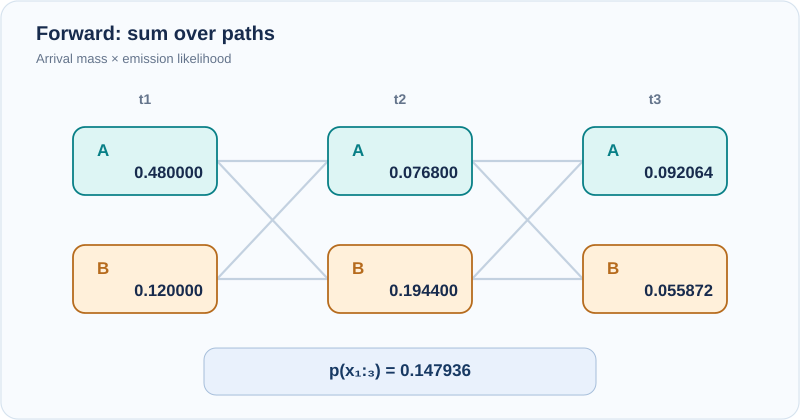
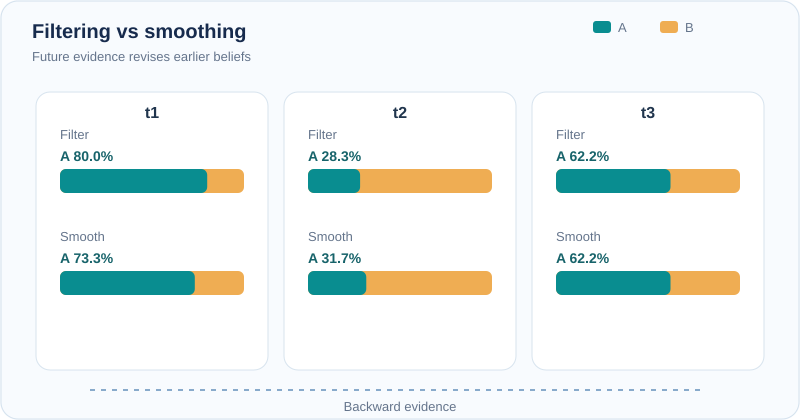
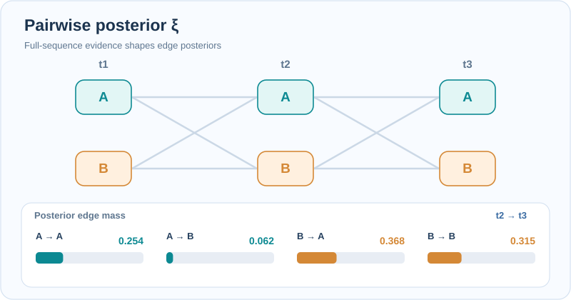
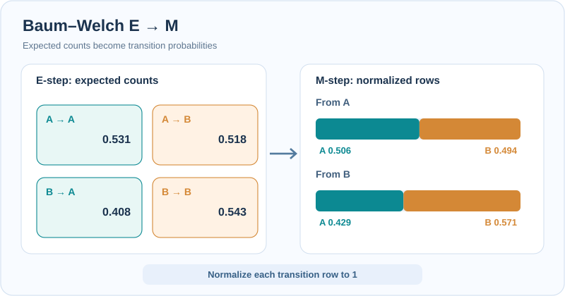

# Hidden Markov Models

A hidden Markov model (HMM) is a directed graphical model in which a sequence of hidden states follows a Markov chain and each state emits an observation. The observations are the only data seen, and the states must be inferred. Part of [Probabilistic graphical models](index.md).

## Overview

Many sequences have an underlying state that is not measured directly: the phoneme being spoken, the gene region in a DNA sequence, the weather behind a series of sensor readings. An HMM models this with two layers. The hidden chain \(z_1,\dots,z_T\) carries the state, and the observations \(x_1,\dots,x_T\) are emitted from it. The model is simple, its inference is exact, and it was the standard tool for speech recognition for decades (Rabiner, 1989).

## Key concepts

- **Transition matrix** \(A\): \(A_{ij}=p(z_t=j\mid z_{t-1}=i)\).
- **Emission model** \(B\): the distribution \(p(x_t\mid z_t)\), discrete or continuous.
- **Initial distribution** \(\pi\): \(p(z_1)\).
- **Markov property**: the hidden state at time \(t\) depends only on the state at time \(t-1\).

## How it works

The joint distribution factorises along the chain:

\[
p(x_{1:T},z_{1:T}) = \pi(z_1)\prod_{t=2}^{T}A_{z_{t-1}z_t}\prod_{t=1}^{T}B_{z_t}(x_t).
\]

Rabiner (1989) organises the standard problems into three:

1. **Evaluation**: compute \(p(x_{1:T})\). The forward recursion \(\alpha_t(j)=B_j(x_t)\sum_i \alpha_{t-1}(i)A_{ij}\) gives it in time \(O(TK^2)\) for \(K\) states, where \(p(x_{1:T})=\sum_j\alpha_T(j)\).
2. **Decoding**: find the most likely state sequence. The Viterbi algorithm replaces the sum in the forward recursion by a maximum and keeps back-pointers. Viterbi (1967) introduced the algorithm for decoding convolutional codes.
3. **Learning**: estimate \(A\), \(B\) and \(\pi\). The Baum–Welch procedure is an instance of expectation–maximisation. It uses the forward and backward recursions to compute posterior state probabilities. Baum et al. (1970) gave the original statistical analysis of the method.

The **forward–backward** algorithm combines the forward pass with a backward pass, \(\beta_t\), to give the posterior \(p(z_t\mid x_{1:T})\) for every time step. It is an instance of [belief propagation](belief-propagation.md) on a chain.

### Animated walkthrough: Forward sum-product inference

*Original instructional SVG animation, CC BY-SA 4.0.* GitHub displays the static final result; the MkDocs site provides **Play/Pause** (keyboard Tab/Enter), with a static fallback for reduced-motion preferences. At narrow widths, focus the figure and use the left/right arrow keys to scroll.

The moving dots represent **sum-product message flow**, not separately sampled state sequences. For the same synthetic two-state example used in the Viterbi animation below, use $\pi=(0.6,0.4)$, transition rows $(0.7,0.3)$ and $(0.4,0.6)$, and A/B emission likelihoods $(0.8,0.3)$, $(0.2,0.9)$, $(0.7,0.4)$. The forward recursion is

$
\alpha_t(j)=B_j(x_t)\sum_i \alpha_{t-1}(i)A_{ij},\qquad
p(x_{1:3})=\sum_j\alpha_3(j).
$

The exact forward messages are $\alpha_1=(0.48,0.12)$, $\alpha_2=(0.0768,0.1944)$ and $\alpha_3=(0.092064,0.055872)$. Consequently $p(x_{1:3})=0.147936$. Unlike the **max-product** Viterbi path below, these scores **sum probability mass across all hidden paths**. Values are hand-calculated teaching probabilities, **not model measurements** (Rabiner, 1989; Kschischang et al., 2001).

### Animated walkthrough: Filtering versus smoothing

*Original instructional SVG animation, CC BY-SA 4.0.* GitHub shows the final static comparison. The site's **Play/Pause** control and reduced-motion fallback use the same shared visual; the figure can be scrolled with the keyboard on small screens.

Filtering estimates $p(z_t\mid x_{1:t})$ using only observations seen **up to** time $t$. Smoothing instead uses **all** observations, including future ones:

$
\beta_t(i)=\sum_j A_{ij}B_j(x_{t+1})\beta_{t+1}(j),\quad
p(z_t=i\mid x_{1:T})=\frac{\alpha_t(i)\beta_t(i)}{p(x_{1:T})}.
$

For the synthetic example, the filtered probabilities of state A at $t=1,2,3$ are approximately **80.0%, 28.3%, 62.2%**. After the backward pass, the smoothed values become **73.3%, 31.7%, 62.2%**. No later observation exists after $t=3$, so the two estimates coincide at the final step. The continuous bar interpolation depicts the arrival of backward information, **not additional inference iterations or model training** (Rabiner, 1989).

### Animated walkthrough: Pairwise posterior state transitions

*Original 12-second instructional SVG animation, CC BY-SA 4.0.* GitHub renders the **final static state**. On MkDocs use **Play/Pause** with Tab/Enter; reduced-motion preferences show the static fallback. Focus and horizontally scroll the figure with arrow keys on smaller screens.

A state **pairwise posterior** differs from a transition probability: it conditions on the entire observed sequence and includes uncertainty about both endpoint states. With forward and backward messages computed using the same *fixed* example HMM parameters,

\[
\xi_t(i,j)=p(z_t=i,z_{t+1}=j\mid x_{1:T})
=\frac{\alpha_t(i)A_{ij}B_j(x_{t+1})\beta_{t+1}(j)}{p(x_{1:T})}.
\]

In the example the two 2-by-2 posterior tables, in row order **A,B** and column order **A,B**, are

\[
\xi_1\approx
\begin{bmatrix}0.277093&0.455548\\0.039585&0.227774\end{bmatrix},
\qquad
\xi_2\approx
\begin{bmatrix}0.254380&0.062297\\0.367943&0.315380\end{bmatrix}.
\]

Each entire table sums to one; each **row sum** equals the corresponding smoothed state posterior \(\gamma_t(i)=p(z_t=i\mid x_{1:T})\), **not** one. The animated particles indicate which adjacent-time transitions contribute to the displayed posterior masses. Bar interpolation is a visual transition between two exact tables, not an additional inference step. Values are **synthetic arithmetic, not measured model outputs** (Rabiner, 1989).

### Animated walkthrough: Baum–Welch transition M-step

*Original 12-second instructional SVG animation, CC BY-SA 4.0.* GitHub shows the static updated transition matrix; MkDocs adds keyboard-accessible **Play/Pause** and a reduced-motion fallback. On narrow viewports, focus the diagram and use the arrow keys to scroll.

Baum–Welch is **expectation–maximisation (EM)**. After the E-step computes the pairwise posterior tables above using the *old* parameters, the transition part of the M-step sums expected transition counts and normalizes **each source-state row**:

\[
N_{ij}=\sum_{t=1}^{T-1}\xi_t(i,j),\qquad
A_{ij}^{\mathrm{new}}=\frac{N_{ij}}{\sum_kN_{ik}}.
\]

The synthetic expected counts are \(N\approx\begin{bmatrix}0.531473&0.517846\\0.407528&0.543154\end{bmatrix}\). For this three-observation example, the updated transition rows are approximately **(0.5065, 0.4935)** from state A and **(0.4287, 0.5713)** from state B, compared with the original **(0.7, 0.3)** and **(0.4, 0.6)**. Counts are *expected*, not hard-counted Viterbi transitions. This animation illustrates **only the transition-parameter M-step of one EM iteration**; a complete HMM update also re-estimates initial-state and emission parameters where applicable. The gradual bar fill is presentation, not iterative optimisation or an empirical likelihood curve (Baum et al., 1970; Rabiner, 1989).

### Animated walkthrough: Viterbi decoding

*Original teaching animation, CC BY-SA 4.0.* [Static GitHub preview](../../../../assets/concept-animations/viterbi-trellis-still.svg). On the MkDocs site, use **Play/Pause** (also accessible with Tab and Enter); reduced-motion settings show the final static path.

The example has two hidden states, A and B, and three observations. Its **illustrative** initial distribution is \(\pi=(0.6,0.4)\), transition rows are \(A=(0.7,0.3)\) and \(B=(0.4,0.6)\), and the emission likelihoods for A/B are \((0.8,0.3)\), \((0.2,0.9)\), and \((0.7,0.4)\) at \(t=1,2,3\). Viterbi computes \(\delta_t(j)=p(x_t\mid z_t=j)\max_i[\delta_{t-1}(i)A_{ij}]\) and stores the maximising predecessor, rather than summing paths as in the forward algorithm. The scores shown in the nodes are rounded: at the last step, \(\delta_3(A)=0.036288\) and \(\delta_3(B)=0.031104\). Backtracking therefore gives **A → B → A**, the most probable *joint state path*, not a sequence of separately maximised marginal states. These are hand-calculated teaching values, **not measured model outputs** (Viterbi, 1967; Rabiner, 1989).

## Variants

- **Discrete HMMs** emit from a finite alphabet, and **Gaussian HMMs** emit continuous vectors, usually from a mixture of Gaussians per state.
- **Input–output HMMs** and **hidden semi-Markov models** extend the basic form with input-dependent transitions and explicit state durations.
- The linear-Gaussian version of a state-space model with continuous states leads to the Kalman filter (Kalman, 1960).

## Results and limits

- The three algorithms are exact and efficient for a chain. The cost grows with the square of the number of states.
- The Markov assumption is strong. The state at time \(t\) has no memory beyond its predecessor, so long-range dependence must be encoded in the state space.
- Discriminative and neural sequence models have replaced HMMs in many tasks, but the HMM remains a clear baseline for inference and interpretable probabilistic structure.
- Learning by Baum–Welch finds a local maximum of the likelihood, and the result depends on the initialisation.

## Applications

- **Speech recognition**: states model phonemes or sub-phoneme units, and observations are acoustic feature vectors (Rabiner, 1989).
- **Decoding**: Viterbi decoding of convolutional codes, from which the algorithm takes its name (Viterbi, 1967).
- **Bioinformatics**: gene and protein-domain detection from sequences, where hidden states mark functional regions.

## Open questions

- Choosing the number of hidden states is largely empirical, and model selection criteria for it are imperfect.
- Long-range structure in sequences needs more states or richer models, which increases the cost of inference.
- The gap between HMMs and neural sequence models on tasks with abundant data is well documented, but the reasons for it are only partly understood.

## References

### Seminal papers

- Baum, L. E., Petrie, T., Soules, G. & Weiss, N. (1970). A maximization technique occurring in the statistical analysis of probabilistic functions of Markov chains. *The Annals of Mathematical Statistics* 41(1), 164–171. https://doi.org/10.1214/aoms/1177697196 — Gives the expectation-maximisation style procedure for estimating hidden Markov model parameters.
- Viterbi, A. J. (1967). Error bounds for convolutional codes and an asymptotically optimum decoding algorithm. *IEEE Transactions on Information Theory* 13(2), 260–269. https://doi.org/10.1109/TIT.1967.1054010 — Introduces the Viterbi algorithm for most-likely state-sequence decoding.
- Rabiner, L. R. (1989). A tutorial on hidden Markov models and selected applications in speech recognition. *Proceedings of the IEEE* 77(2), 257–286. https://doi.org/10.1109/5.18626 — Tutorial on evaluation, decoding and learning for HMMs, with speech applications.
- Kalman, R. E. (1960). A new approach to linear filtering and prediction problems. *Journal of Basic Engineering* 82(1), 35–45. https://doi.org/10.1115/1.3662552 — Recursive estimator for the linear-Gaussian analogue of the HMM.

### Surveys and textbooks

- Murphy, K. P. (2022). *Probabilistic Machine Learning: An Introduction*. MIT Press. https://github.com/probml/pml-book — Repository for Murphy's textbook series; chapters on HMM inference and learning.
- Kschischang, F. R., Frey, B. J. & Loeliger, H.-A. (2001). Factor graphs and the sum-product algorithm. *IEEE Transactions on Information Theory* 47(2), 498–519. https://doi.org/10.1109/18.910572 — Shows the forward–backward algorithm as sum-product message passing on a chain.
