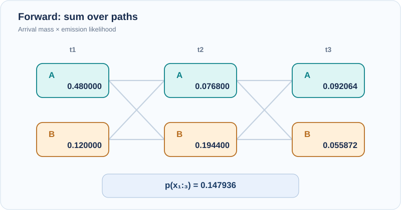
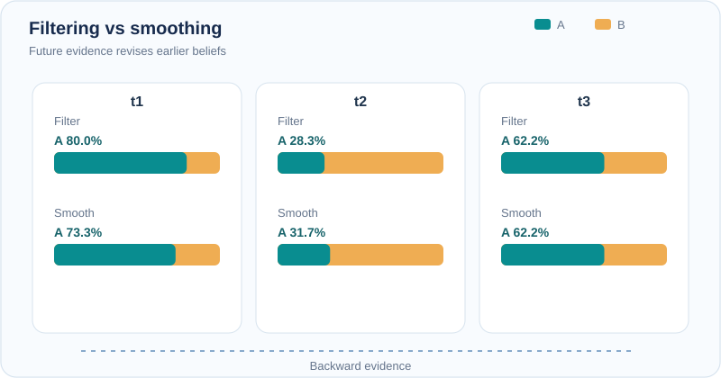
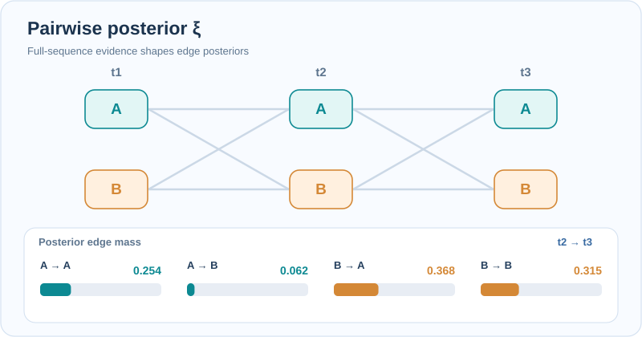
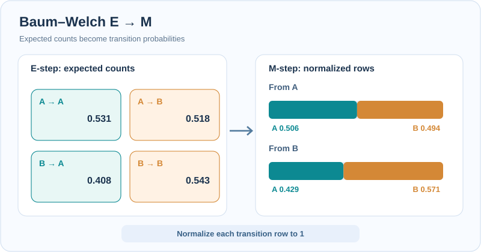

# 隱馬可夫模型

隱馬可夫模型（HMM）是一種有向圖模型：隱藏狀態序列依循馬可夫鏈變動，每個狀態再發出一個觀測值。我們只看得到觀測值，必須從中推斷狀態。本頁是[機率圖模型](index.md)的一部分。

## 概述

許多序列背後都有一個沒有直接測量的狀態，例如正在說的音素、DNA 序列中的基因區段，或一連串感測器讀數背後的天氣。HMM 以兩層結構來描述這件事：隱藏鏈 \(z_1,\dots,z_T\) 承載狀態，觀測值 \(x_1,\dots,x_T\) 則由狀態發出。模型簡單，推論是精確的，並且曾長期是語音辨識的標準工具（Rabiner，1989）。

## 關鍵概念

- **轉移矩陣** \(A\)：\(A_{ij}=p(z_t=j\mid z_{t-1}=i)\)。
- **發射模型** \(B\)：分布 \(p(x_t\mid z_t)\)，可為離散或連續的。
- **初始分布** \(\pi\)：\(p(z_1)\)。
- **馬可夫性質**：時刻 \(t\) 的隱藏狀態只依賴時刻 \(t-1\) 的狀態。

## 運作方式

聯合分布沿著鏈分解：

\[
p(x_{1:T},z_{1:T}) = \pi(z_1)\prod_{t=2}^{T}A_{z_{t-1}z_t}\prod_{t=1}^{T}B_{z_t}(x_t).
\]

Rabiner（1989）把標準問題整理為三項：

1. **評估**：計算 \(p(x_{1:T})\)。前向遞迴 \(\alpha_t(j)=B_j(x_t)\sum_i \alpha_{t-1}(i)A_{ij}\) 可在 \(K\) 個狀態下以 \(O(TK^2)\) 的時間求得，且 \(p(x_{1:T})=\sum_j\alpha_T(j)\)。
2. **解碼**：找出最可能的狀態序列。Viterbi 演算法把前向遞迴中的求和換成求最大值，並保留回溯指標。Viterbi（1967）提出此演算法，用於解碼迴旋碼。
3. **學習**：估計 \(A\)、\(B\) 與 \(\pi\)。Baum–Welch 程序是期望最大化的一個實例，它利用前向與後向遞迴計算各狀態的後驗機率。Baum 等人（1970）給出此方法最早的統計分析。

**前向–後向**演算法把前向掃描與後向掃描 \(\beta_t\) 合併，得到每個時間點的後驗 \(p(z_t\mid x_{1:T})\)。它就是鏈上的[信念傳播](belief-propagation.md)。

### 教學動畫：前向和積遞迴

*原創 SVG 教學動畫，CC BY-SA 4.0。* GitHub 直接顯示最終狀態的靜態圖；MkDocs 網站提供**播放／暫停**控制（可用 Tab 與 Enter 操作），偏好減少動態效果的使用者會看到靜態回退圖。手機版可聚焦圖面並使用左右方向鍵水平捲動。

移動的圓點代表**和積訊息傳遞**，不是另外抽樣的狀態路徑。沿用下方 Viterbi 示範的兩狀態人工數值：初始分布 $\pi=(0.6,0.4)$，轉移矩陣的兩列為 $(0.7,0.3)$ 與 $(0.4,0.6)$，三次觀測在 A/B 狀態下的發射概似為 $(0.8,0.3)$、$(0.2,0.9)$、$(0.7,0.4)$。前向遞迴為：

\[
\alpha_t(j)=B_j(x_t)\sum_i \alpha_{t-1}(i)A_{ij},\qquad
p(x_{1:3})=\sum_j\alpha_3(j).
\]

精確的前向訊息依次為 $\alpha_1=(0.48,0.12)$、$\alpha_2=(0.0768,0.1944)$、$\alpha_3=(0.092064,0.055872)$，因此整段觀測序列的概似為 **0.147936**。與下方 Viterbi 的**最大乘積**路徑不同，前向演算法會對**所有隱藏路徑的機率質量求和**。這些皆為手算教學數值，**不是模型實測輸出**（Rabiner，1989；Kschischang 等人，2001）。

### 教學動畫：過濾與平滑的差異

*原創 SVG 教學動畫，CC BY-SA 4.0。* GitHub 顯示最終靜態比較；網站使用共用的**播放／暫停**控制與減少動態效果回退圖，窄螢幕可用鍵盤水平捲動。

**過濾（filtering）**只利用時間 $t$ 以前（含當下）的觀測，估計 $p(z_t\mid x_{1:t})$。**平滑（smoothing）**則使用包含後續觀測的**完整序列**，藉由後向訊息更新較早的狀態後驗：

\[
\beta_t(i)=\sum_j A_{ij}B_j(x_{t+1})\beta_{t+1}(j),\quad
p(z_t=i\mid x_{1:T})=\frac{\alpha_t(i)\beta_t(i)}{p(x_{1:T})}.
\]

示例中，時間 $t=1,2,3$ 的 A 狀態過濾機率依序約為 **80.0%、28.3%、62.2%**；加入後續觀測後，平滑機率變為 **73.3%、31.7%、62.2%**。在最後一個時間點沒有未來觀測，所以兩者相同。長條的連續變化僅用來表達後向資訊抵達的過程，**不是額外推論迭代，也不是模型訓練**（Rabiner，1989）。

### 教學動畫：相鄰狀態的聯合後驗機率

*原創 12 秒 SVG 教學動畫，CC BY-SA 4.0。* GitHub 顯示**最後狀態的靜態圖**；MkDocs 提供可用 Tab／Enter 操作的**播放／暫停**，偏好減少動態效果時顯示靜態回退圖。窄螢幕可聚焦圖面後使用左右方向鍵捲動。

**相鄰狀態的聯合後驗機率**不是轉移矩陣的一列：它已對整段觀測序列進行條件化，包含兩端隱藏狀態的不確定性。以同一組**固定模型參數**執行前向及後向遞迴：

\[
\xi_t(i,j)=p(z_t=i,z_{t+1}=j\mid x_{1:T})
=\frac{\alpha_t(i)A_{ij}B_j(x_{t+1})\beta_{t+1}(j)}{p(x_{1:T})}.
\]

此人工範例的兩個 2×2 後驗矩陣，列與欄均依 **A、B** 排列：

\[
\xi_1\approx
\begin{bmatrix}0.277093&0.455548\\0.039585&0.227774\end{bmatrix},
\qquad
\xi_2\approx
\begin{bmatrix}0.254380&0.062297\\0.367943&0.315380\end{bmatrix}.
\]

**整個**後驗矩陣的元素總和為 1；各**列的總和**是對應時間點的平滑狀態後驗 \(\gamma_t(i)=p(z_t=i\mid x_{1:T})\)，而**不是**每列都等於 1。移動圓點標示相鄰狀態轉移，長條的連續變化只是切換兩組精確結果的視覺插值，並非額外的推論步驟。所有機率均為**人工數學計算，非模型實測值**（Rabiner，1989）。

### 教學動畫：Baum–Welch 轉移機率更新

*原創 12 秒 SVG 教學動畫，CC BY-SA 4.0。* GitHub 顯示完成後轉移機率的靜態圖；MkDocs 提供鍵盤可操作的**播放／暫停**及減少動態效果回退圖。小螢幕可聚焦圖面，再以左右方向鍵捲動。

Baum–Welch 屬於**期望最大化（EM）**。E 步驟以**舊參數**計算上述相鄰狀態的後驗矩陣，M 步驟的轉移矩陣部分則將期望轉移次數加總，再以**每個來源狀態的列**為單位正規化：

\[
N_{ij}=\sum_{t=1}^{T-1}\xi_t(i,j),\qquad
A_{ij}^{\mathrm{new}}=\frac{N_{ij}}{\sum_kN_{ik}}.
\]

本例的期望次數為 \(N\approx\begin{bmatrix}0.531473&0.517846\\0.407528&0.543154\end{bmatrix}\)。更新後，從 A 出發的轉移機率約為 **(0.5065, 0.4935)**，從 B 出發約為 **(0.4287, 0.5713)**；原先兩列分別為 **(0.7, 0.3)** 與 **(0.4, 0.6)**。這些是**後驗期望次數**，而不是以 Viterbi 最佳路徑硬計數。動畫只展示**一次 EM 迭代中的轉移參數 M 步驟**，完整的 HMM 更新也需依模型設定更新初始分布及發射參數。長條逐漸填入僅為呈現方式，**不是最佳化軌跡，也非效能實測**（Baum 等人，1970；Rabiner，1989）。

### 教學動畫：Viterbi 解碼與回溯

*原創教學動畫，CC BY-SA 4.0。* [GitHub 靜態預覽](../../../../assets/concept-animations/viterbi-trellis-still.svg)。在 MkDocs 網站可使用**播放／暫停**按鈕，也可用 Tab 與 Enter 操作；啟用減少動態效果時，顯示最終路徑的靜態圖。

範例包含 A、B 兩個隱藏狀態與三個觀測值。**教學示意**的初始分布為 \(\pi=(0.6,0.4)\)，轉移矩陣的 A、B 列分別為 \((0.7,0.3)\)、\((0.4,0.6)\)，三個時間點的 A/B 發射概似依序為 \((0.8,0.3)\)、\((0.2,0.9)\)、\((0.7,0.4)\)。Viterbi 遞迴 \(\delta_t(j)=p(x_t\mid z_t=j)\max_i[\delta_{t-1}(i)A_{ij}]\) 對每個狀態保留最佳前驅，而不是像前向演算法那樣對所有路徑求和。節點上的分數經過四捨五入；最後一步 \(\delta_3(A)=0.036288\)、\(\delta_3(B)=0.031104\)，回溯得到 **A → B → A**。這是最可能的**聯合狀態序列**，不是逐時間點獨立最大化邊際機率的結果。所有數值均為手算示意，**不是模型實測輸出**（Viterbi，1967；Rabiner，1989）。

## 變體

- **離散 HMM** 從有限字母表發出觀測值，**高斯 HMM** 則發出連續向量，通常每個狀態使用一個高斯混合。
- **輸入–輸出 HMM** 與**隱半馬可夫模型**，分別以依輸入而變的轉移及明確的狀態持續時間，擴充基本形式。
- 具連續狀態的線性高斯狀態空間模型，其推論導向卡爾曼濾波器（Kalman，1960）。

## 結果與限制

- 三種演算法對鏈狀結構都是精確且有效率的。成本隨狀態數的平方成長。
- 馬可夫假設很強。時刻 \(t\) 的狀態不記得更早的歷史，因此長程依賴必須靠擴大狀態空間來編碼。
- 在許多任務中，判別式與神經序列模型已取代 HMM，但 HMM 仍是推論與可解釋機率結構的清楚基準。
- 以 Baum–Welch 學習得到的是概似的局部最大值，結果取決於初始化。

## 應用

- **語音辨識**：狀態對應音素或次音素單位，觀測值為聲學特徵向量（Rabiner，1989）。
- **解碼**：Viterbi 解碼迴旋碼，演算法之名即由此而來（Viterbi，1967）。
- **生物資訊學**：從序列偵測基因與蛋白質功能域，隱藏狀態標記功能區段。

## 開放問題

- 隱藏狀態的數量大多仰賴經驗決定，而用於模型選擇的準則並不完善。
- 序列中的長程結構需要更多狀態或更豐富的模型，也使推論成本上升。
- 在資料充足的任務上，HMM 與神經序列模型之間的差距已有大量記錄，但其原因只得到部分理解。

## 參考文獻

### 奠基性論文

- Baum, L. E., Petrie, T., Soules, G. & Weiss, N. (1970). A maximization technique occurring in the statistical analysis of probabilistic functions of Markov chains. *The Annals of Mathematical Statistics* 41(1), 164–171. https://doi.org/10.1214/aoms/1177697196 — 提出估計隱馬可夫模型參數的期望最大化式程序。
- Viterbi, A. J. (1967). Error bounds for convolutional codes and an asymptotically optimum decoding algorithm. *IEEE Transactions on Information Theory* 13(2), 260–269. https://doi.org/10.1109/TIT.1967.1054010 — 提出 Viterbi 演算法，用以解碼最可能的狀態序列。
- Rabiner, L. R. (1989). A tutorial on hidden Markov models and selected applications in speech recognition. *Proceedings of the IEEE* 77(2), 257–286. https://doi.org/10.1109/5.18626 — 針對評估、解碼與學習三大問題的 HMM 教學綜述，並含語音應用。
- Kalman, R. E. (1960). A new approach to linear filtering and prediction problems. *Journal of Basic Engineering* 82(1), 35–45. https://doi.org/10.1115/1.3662552 — 線性高斯模型（HMM 的連續狀態對應）的遞迴估計器。

### 綜述與教科書

- Murphy, K. P. (2022). *Probabilistic Machine Learning: An Introduction*. MIT Press. https://github.com/probml/pml-book — Murphy 教科書系列的儲存庫；有 HMM 推論與學習的章節。
- Kschischang, F. R., Frey, B. J. & Loeliger, H.-A. (2001). Factor graphs and the sum-product algorithm. *IEEE Transactions on Information Theory* 47(2), 498–519. https://doi.org/10.1109/18.910572 — 說明前向–後向演算法即因子圖上的和積訊息傳遞。
