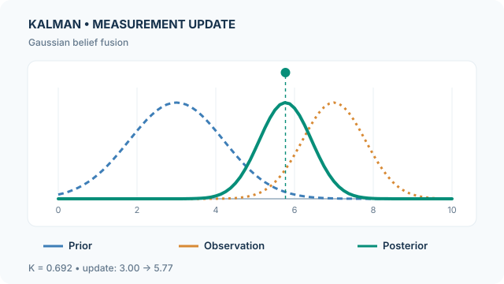

# Kalman Filter

The Kalman filter recursively estimates a hidden state from a linear dynamical model and noisy observations. For Gaussian initial beliefs and additive Gaussian noise, it maintains the exact filtering posterior using a mean and a covariance, instead of storing the full observation history. This is a continuous-state instance of [probabilistic graphical-model inference](index.md).

## Problem and assumptions

The model has a transition and a measurement equation:

$$
x_t=F_tx_{t-1}+B_tu_t+w_t,\quad w_t\sim\mathcal N(0,Q_t),
$$

$$
y_t=H_tx_t+v_t,\quad v_t\sim\mathcal N(0,R_t).
$$

Assume independent process and measurement noise, known model matrices, and a Gaussian prior. The estimator alternates **prediction** and **measurement correction**; its covariance describes estimation uncertainty, not the absolute error on one particular trajectory. [Kalman (1960)](https://doi.org/10.1115/1.3662552) developed this recursive approach.

## How the update works

**Predict:**

$$
\hat x_t^-=F_t\hat x_{t-1}^++B_tu_t,\qquad
P_t^-=F_tP_{t-1}^+F_t^\top+Q_t.
$$

**Correct:**

$$
S_t=H_tP_t^-H_t^\top+R_t,\qquad
K_t=P_t^-H_t^\top S_t^{-1},
$$

$$
\hat x_t^+=\hat x_t^-+K_t(y_t-H_t\hat x_t^-).
$$

In exact arithmetic the covariance update is $P_t^+=(I-K_tH_t)P_t^-$. The Joseph form $(I-KH)P^-(I-KH)^\top+KRK^\top$ is preferred when numerical symmetry and positive semidefiniteness matter. The gain weights the **innovation** according to relative uncertainty.

## Animated example: gain-weighted Gaussian fusion

{: data-motion-src="../../../../assets/concept-animations/kalman-gain-fusion-motion.svg" }

*Original educational animation, CC BY-SA 4.0.* [GitHub-readable final-state SVG](../../../../assets/concept-animations/kalman-gain-fusion-still.svg). The MkDocs site adds **Play/Pause** controls; Tab and Enter/Space operate the button, and reduced-motion preference selects the final state. On narrow screens, scroll the figure horizontally.

For an **invented scalar example** with $H=1$, prior $\hat x^-=3$, $P^-=1.44$, observation $y=7$, and measurement variance $R=0.64$:

$$
K=\frac{1.44}{1.44+0.64}=0.6923,\quad
\hat x^+=3+K(7-3)\approx5.769,
$$

$$
P^+=(1-K)1.44\approx0.443.
$$

The dashed curves show the prior and a likelihood-shaped observation profile; the solid curve morphs toward the corrected Gaussian belief. **All curves are peak-normalised for visual comparison, not drawn to a common probability-density area scale.** The intermediate morph is visual interpolation, **not extra filtering iterations or measured model behaviour**. In particular, the observation curve is a likelihood in the latent state, not a second posterior.

## Interactive calculation: Kalman gain and Gaussian correction

Change the **predicted variance** $P^-$, **measurement variance** $R$, or synthetic observation $y$. Use Previous/Next or the seek control to inspect prediction, innovation and correction. The graphic recomputes $K=P^-/(P^-+R)$, $\hat x^+=3+K(y-3)$ and $P^+=(1-K)P^-$ from the chosen inputs; the predicted mean is fixed at 3. **All three curves are peak-normalised** to compare shapes rather than absolute probability densities. Increasing $R$ makes the update trust the prior more; increasing $P^-$ increases its reliance on the observation.

Interactive numerical experiment requires JavaScript. The static preview and worked example above remain available.

The values and transitions are an **independently computed scalar illustration**, not measured filtering accuracy or a sequence of actual observations.

## Strengths and limits

- The recursion is computationally economical and exact under the stated linear-Gaussian assumptions; Kalman–Bucy filtering extends related ideas to continuous time.
- Wrong noise covariances can make the gain overconfident or slow to respond. Numerical implementations should check covariance conditioning.
- Nonlinear, multimodal or strongly non-Gaussian posteriors cannot generally be represented by one Gaussian. Compare [particle filtering](particle-filter.md) for a sample-based alternative.
- Filtering uses observations up to time $t$; *smoothing* may also use later measurements and answers a different question.

## References

### Seminal papers

- Kalman, R. E. (1960). *A New Approach to Linear Filtering and Prediction Problems*. Journal of Basic Engineering. https://doi.org/10.1115/1.3662552 — Derives recursive state-space filtering from dynamic models and covariance propagation.
- Kalman, R. E. & Bucy, R. S. (1961). *New Results in Linear Filtering and Prediction Theory*. Journal of Basic Engineering. https://doi.org/10.1115/1.3658902 — Derives the continuous-time covariance equation for optimal linear filters.
- Gordon, N. J., Salmond, D. J. & Smith, A. F. M. (1993). *Novel approach to nonlinear/non-Gaussian Bayesian state estimation*. IEE Proceedings F. https://doi.org/10.1049/ip-f-2.1993.0015 — Introduces a sampling alternative for non-Gaussian filtering.

### Surveys and textbooks

- Wainwright, M. J. & Jordan, M. I. (2008). *Graphical Models, Exponential Families, and Variational Inference*. Foundations and Trends in Machine Learning. https://doi.org/10.1561/2200000001 — Places state-space inference in the wider graphical-model framework.
- Murphy, K. P. (2022). *Probabilistic Machine Learning: An Introduction*. MIT Press. https://github.com/probml/pml-book — Textbook treatment of Gaussian inference and state-space models.
