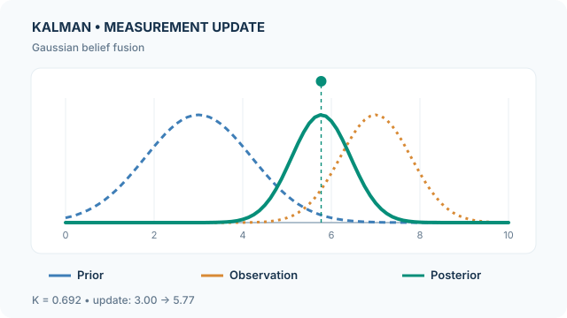

# 卡爾曼濾波器

卡爾曼濾波器（Kalman filter）結合線性動態模型與有雜訊的觀測，遞迴估計隱藏狀態。在高斯初始分布與加性高斯雜訊的假設下，僅需維護平均向量與共變異數矩陣，就能精確表示每一步的濾波後驗分布。這是[機率圖模型](index.md)在連續狀態空間中的特例。

## 問題與假設

狀態轉移與量測模型：

$$
x_t=F_tx_{t-1}+B_tu_t+w_t,\quad w_t\sim\mathcal N(0,Q_t),
$$

$$
y_t=H_tx_t+v_t,\quad v_t\sim\mathcal N(0,R_t).
$$

假設程序雜訊與量測雜訊獨立、模型矩陣已知，而且先驗為高斯分布。濾波器交替執行**預測**與**量測修正**；共變異數表示估計的不確定性，並非單條實現軌跡的實際誤差。[Kalman（1960）](https://doi.org/10.1115/1.3662552)提出這套遞迴估計方法。

## 遞迴更新

**預測：**

$$
\hat x_t^-=F_t\hat x_{t-1}^++B_tu_t,\qquad
P_t^-=F_tP_{t-1}^+F_t^\top+Q_t.
$$

**修正：**

$$
S_t=H_tP_t^-H_t^\top+R_t,\qquad
K_t=P_t^-H_t^\top S_t^{-1},
$$

$$
\hat x_t^+=\hat x_t^-+K_t(y_t-H_t\hat x_t^-).
$$

在精確運算下，共變異數可寫成 $P_t^+=(I-K_tH_t)P_t^-$。若考慮浮點數精度，常採用 Joseph form：$(I-KH)P^-(I-KH)^\top+KRK^\top$，以改善對稱性與半正定性。卡爾曼增益依據相對不確定性，決定創新量（innovation）應修正多少預測。

## 教學動畫：增益加權的高斯融合

{: data-motion-src="../../../../assets/concept-animations/kalman-gain-fusion-motion.svg" }

*原創教學動畫，CC BY-SA 4.0。* [GitHub 可讀的最終靜態圖](../../../../assets/concept-animations/kalman-gain-fusion-still.svg)。MkDocs 網站提供**播放／暫停**；可用 Tab 與 Enter／Space 操作按鈕，偏好減少動態效果時顯示靜態圖。手機請水平捲動圖面。

在**人工建構的一維示例**中，設定 $H=1$、預測均值 $\hat x^-=3$、預測變異數 $P^-=1.44$、觀測 $y=7$、量測變異數 $R=0.64$：

$$
K=\frac{1.44}{1.44+0.64}=0.6923,\quad
\hat x^+=3+K(7-3)\approx5.769,
$$

$$
P^+=(1-K)1.44\approx0.443.
$$

虛線分別表示先驗與形似概似函數的觀測資訊，實線則逐漸變成修正後的高斯信念。**為了比較形狀，三條曲線都將峰值正規化，而非以相同機率密度面積比例繪製。** 轉場是視覺插值，**不是額外的濾波迭代，也不是模型實測結果**；觀測曲線是以隱藏狀態為變數的概似，不是另一個後驗分布。

## 互動計算：卡爾曼增益與高斯修正

調整**預測變異數** $P^-$、**量測變異數** $R$，或人工觀測值 $y$，並使用「上一步／下一步」與進度滑桿檢視預測、創新量和修正。圖表即時計算 $K=P^-/(P^-+R)$、$\hat x^+=3+K(y-3)$ 及 $P^+=(1-K)P^-$；預測平均值固定為 3。**三條曲線皆正規化至相同峰值**，用於比較形狀，不代表相同面積尺度的機率密度。提高 $R$ 會讓修正更偏向先驗；提高 $P^-$ 則讓修正更仰賴觀測。

互動數值實驗需要 JavaScript；上方靜態預覽與手算範例仍可閱讀。

這些數值及轉換是**獨立計算的一維人工示意**，不是實測估計誤差，也不是連續多次量測的結果。

## 優點與限制

- 在所述線性高斯條件下，遞迴更新計算效率高且具有精確性；Kalman–Bucy 濾波則延伸相關思想至連續時間。
- 雜訊共變異數設定不準確，可能造成增益過度自信或反應遲緩；數值實作還須留意矩陣條件數。
- 非線性、多峰或強烈非高斯後驗通常無法由單一高斯分布表達。可比較採樣式的[粒子濾波器](particle-filter.md)。
- 濾波只使用截至時間 $t$ 的觀測；*平滑*（smoothing）可另外使用未來的觀測，兩者解決的問題不同。

## 參考文獻

### 奠基性論文

- Kalman, R. E. (1960). *A New Approach to Linear Filtering and Prediction Problems*. Journal of Basic Engineering. https://doi.org/10.1115/1.3662552 — 提出狀態空間中的濾波遞迴。
- Kalman, R. E. & Bucy, R. S. (1961). *New Results in Linear Filtering and Prediction Theory*. Journal of Basic Engineering. https://doi.org/10.1115/1.3658902 — 推導連續時間的共變異數方程式。
- Gordon, N. J., Salmond, D. J. & Smith, A. F. M. (1993). *Novel approach to nonlinear/non-Gaussian Bayesian state estimation*. IEE Proceedings F. https://doi.org/10.1049/ip-f-2.1993.0015 — 提出非高斯濾波的抽樣替代方法。

### 綜述與教科書

- Wainwright, M. J. & Jordan, M. I. (2008). *Graphical Models, Exponential Families, and Variational Inference*. Foundations and Trends in Machine Learning. https://doi.org/10.1561/2200000001 — 從機率圖模型觀點說明推論問題。
- Murphy, K. P. (2022). *Probabilistic Machine Learning: An Introduction*. MIT Press. https://github.com/probml/pml-book — 包含高斯推論與狀態空間模型的教科書。
