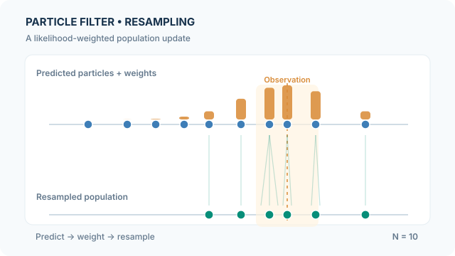

# Particle Filter

A particle filter approximates a sequential Bayesian filtering distribution by a weighted set of samples. Unlike a single-Gaussian [Kalman filter](kalman-filter.md), it can represent non-Gaussian and potentially multimodal beliefs, subject to finite-sample error. The bootstrap or sampling-importance-resampling (SIR) filter is the canonical example introduced by [Gordon et al. (1993)](https://doi.org/10.1049/ip-f-2.1993.0015).

## Core idea

For a state-space model with transition $p(x_t\mid x_{t-1})$ and observation likelihood $p(y_t\mid x_t)$, the Bayesian filtering recursion predicts from the previous posterior and reweights using the new measurement. The particle approximation is

$$
p(x_t\mid y_{1:t})\approx\sum_{i=1}^{N}w_t^{(i)}\delta(x_t-x_t^{(i)}),\qquad \sum_iw_t^{(i)}=1.
$$

For the bootstrap proposal, each predicted particle is sampled from the transition model. Its unnormalised importance weight is simply the observation likelihood:

$$
\tilde w_t^{(i)}=p(y_t\mid x_t^{(i)}),\qquad
w_t^{(i)}=\frac{\tilde w_t^{(i)}}{\sum_j\tilde w_t^{(j)}}.
$$

A subsequent **resampling** step selects ancestors with probabilities proportional to their weights and returns an equal-weight particle population. Resampling does not create new posterior information; it reallocates finite computational effort toward plausible states.

## Animated example: weighting and ancestor resampling

{: data-motion-src="../../../../assets/concept-animations/particle-weight-resampling-motion.svg" }

*Original educational animation, CC BY-SA 4.0.* [GitHub-readable final-state SVG](../../../../assets/concept-animations/particle-weight-resampling-still.svg). MkDocs provides **Play/Pause** using keyboard-operable controls; reduced-motion users see the static descendant population. On a narrow screen, scroll horizontally.

The ten **illustrative** predicted scalar states are

$$
x=(1.0,2.1,2.9,3.7,4.4,5.3,6.1,6.6,7.4,8.8).
$$

The synthetic observation is $y=6.6$, with likelihood $p(y\mid x)\propto\exp(-(x-y)^2/(2\cdot1.3^2))$. Normalising these likelihoods gives the bar heights. A fixed-offset **systematic resampling** example with thresholds $(0.045,0.145,\ldots,0.945)$ selects the **zero-based ancestor indices** $(4,5,6,6,6,7,7,8,8,9)$.

The animation moves each selected descendant from its ancestor to the lower row; tiny horizontal offsets separate identical descendants **only for visibility** and are **not process noise or sample mutation**. The ten positions, measurement, and selected indices are artificial teaching values, **not real observations, an empirical posterior, or a stochastic trajectory measurement**.

## Interactive calculation: likelihoods, ESS and systematic resampling

Adjust the **observation** $y$, likelihood standard deviation $\sigma$, and systematic offset $u_0\in[0,0.1)$. Step through predicted samples, likelihood weights, cumulative weights and selected descendants. The display computes $\mathrm{ESS}=1/\sum_i w_i^2$ before resampling. Changing $u_0$ can alter the selected ancestors **without altering the normalised importance weights**. A repeated descendant is a selected ancestor copy, not a new transition or added noise.

Interactive numerical experiment requires JavaScript. The static preview and worked example above remain available.

These ten states and observations are **synthetic teaching values**, not empirical state estimates. Each step is a display phase of one update, not an additional particle-filter iteration.

## Interpretation and limits

- Large likelihood weights produce more descendants in this particular resampling realisation. Small-weight ancestors can disappear; the filtering distribution is only approximated.
- The effective sample size $\mathrm{ESS}=1/\sum_i(w_t^{(i)})^2$ is commonly used to decide whether resampling is warranted; doing it every step may accelerate sample impoverishment.
- A small or poorly placed particle population may entirely miss an important mode. Increasing the number of samples raises computational cost.
- After resampling, a *new* prediction uses the transition kernel; resampling itself is selection with replacement, not a diffusion step.
- The bootstrap proposal can be inefficient when observations are very informative relative to the transition dynamics. More advanced proposals and auxiliary filters can help.

## References

### Seminal papers

- Gordon, N. J., Salmond, D. J. & Smith, A. F. M. (1993). *Novel approach to nonlinear/non-Gaussian Bayesian state estimation*. IEE Proceedings F. https://doi.org/10.1049/ip-f-2.1993.0015 — Introduces the bootstrap particle filter for sequential Bayesian state estimation.
- Kitagawa, G. (1996). *Monte Carlo Filter and Smoother for Non-Gaussian Nonlinear State Space Models*. Journal of Computational and Graphical Statistics. https://doi.org/10.1080/10618600.1996.10474692 — Develops Monte Carlo filtering and smoothing of nonlinear systems.

### Surveys and textbooks

- Arulampalam, M. S., Maskell, S., Gordon, N. & Clapp, T. (2002). *A Tutorial on Particle Filters for Online Nonlinear/Non-Gaussian Bayesian Tracking*. IEEE Transactions on Signal Processing. https://doi.org/10.1109/78.978374 — Explains SIS, SIR, degeneracy, and practical variants.
- Doucet, A. (2006). *Sequential Monte Carlo Methods*. Encyclopedia of Statistical Sciences. https://doi.org/10.1002/0471667196.ess5089 — Reviews sequential importance sampling and resampling.
- Murphy, K. P. (2022). *Probabilistic Machine Learning: An Introduction*. MIT Press. https://github.com/probml/pml-book — Broader introduction to Bayesian filtering and inference.
