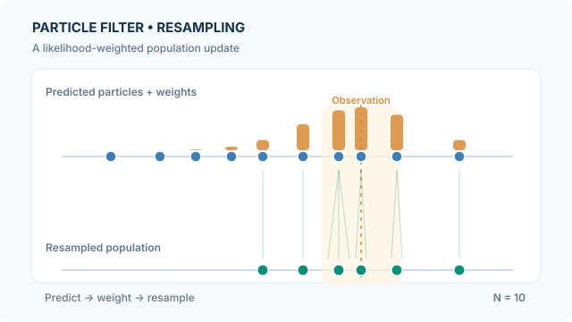
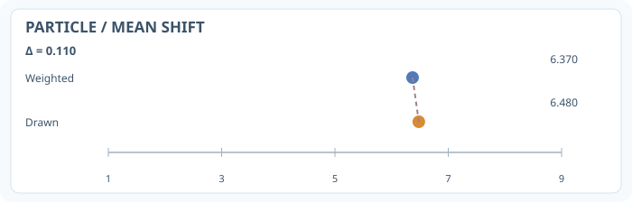
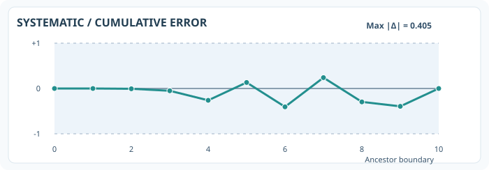
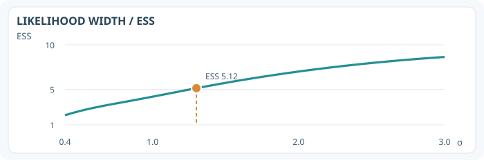

# Particle Filter

A particle filter approximates a sequential Bayesian filtering distribution by a weighted set of samples. Unlike a single-Gaussian [Kalman filter](kalman-filter.md), it can represent non-Gaussian and potentially multimodal beliefs, subject to finite-sample error. The bootstrap or sampling-importance-resampling (SIR) filter is the canonical example introduced by [Gordon et al. (1993)](https://doi.org/10.1049/ip-f-2.1993.0015).

## Core idea

For a state-space model with transition $p(x_t\mid x_{t-1})$ and observation likelihood $p(y_t\mid x_t)$, the Bayesian filtering recursion predicts from the previous posterior and reweights using the new measurement. The particle approximation is

$$
p(x_t\mid y_{1:t})\approx\sum_{i=1}^{N}w_t^{(i)}\delta(x_t-x_t^{(i)}),\qquad \sum_iw_t^{(i)}=1.
$$

For the bootstrap proposal, each predicted particle is sampled from the transition model. If the previous population was resampled to equal weights, its unnormalised importance weight is simply the observation likelihood (otherwise multiply by its previous weight):

$$
\tilde w_t^{(i)}=p(y_t\mid x_t^{(i)}),\qquad
w_t^{(i)}=\frac{\tilde w_t^{(i)}}{\sum_j\tilde w_t^{(j)}}.
$$

A subsequent **resampling** step selects ancestors with probabilities proportional to their weights and returns an equal-weight particle population. Resampling does not create new posterior information; it reallocates finite computational effort toward plausible states.

## Animated example: weighting and ancestor resampling

*Original educational animation, CC BY-SA 4.0.* [GitHub-readable final-state SVG](../../../../assets/concept-animations/particle-weight-resampling-still.svg). MkDocs provides **Play/Pause** using keyboard-operable controls; reduced-motion users see the static descendant population. On a narrow screen, scroll horizontally.

The ten **illustrative** predicted scalar states are

$$
x=(1.0,2.1,2.9,3.7,4.4,5.3,6.1,6.6,7.4,8.8).
$$

The synthetic observation is $y=6.6$, with likelihood

$$
p(y\mid x)\propto\exp(-(x-y)^2/(2\cdot1.3^2)).
$$

 Normalising these likelihoods gives the bar heights. A fixed-offset **systematic resampling** example with thresholds $(0.045,0.145,\ldots,0.945)$ selects the **zero-based ancestor indices** $(4,5,6,6,6,7,7,8,8,9)$.

The animation moves each selected descendant from its ancestor to the lower row; tiny horizontal offsets separate identical descendants **only for visibility** and are **not process noise or sample mutation**. The ten positions, measurement, and selected indices are artificial teaching values, **not real observations, an empirical posterior, or a stochastic trajectory measurement**.

## Interactive calculation: likelihoods, ESS and systematic resampling

Adjust the **observation** $y$, likelihood standard deviation $\sigma$, and systematic offset $u_0\in[0,0.1)$. Step through predicted samples, likelihood weights, cumulative weights and selected descendants. The display computes $\mathrm{ESS}=1/\sum_i w_i^2$ before resampling. Changing $u_0$ can alter the selected ancestors **without altering the normalised importance weights**. A repeated descendant is a selected ancestor copy, not a new transition or added noise.

**New calculated view — inverse CDF resampling.** The second SVG partitions the interval $[0,1]$ into segments of length $w_i$ and places ten equally spaced thresholds $u_j=u_0+j/10$. Each threshold selects the first cumulative weight strictly greater than it (half-open intervals); only the fourth display stage reveals the chosen zero-based ancestor indices. Changing $u_0$ moves the thresholds but leaves the interval widths and the *pre-resampling* ESS unchanged. The GitHub snapshot below shows the invented default inputs; it is not empirical resampling performance.

**Expected versus realised offspring.** A third recomputed SVG compares $Nw_i$ with the **integer number of selected ancestor copies** after systematic resampling. Blue expected mass appears after weighting; orange realised copies appear only at resampling. Changing the offset can change multiplicities and distinct ancestors without changing the weights or **pre-resampling** ESS. Both totals equal ten. This is one deterministic toy selection, not a model measurement or a Monte Carlo performance estimate.

**Calculated comparison — resampling-induced mean shift.** A fourth synchronized SVG compares the weighted mean $\bar x_w=\sum_iw_ix_i$ before resampling with the equal-weight descendant mean $\bar x_r=N^{-1}\sum_jx_{a_j}$. Changing the systematic offset can change this **signed finite-sample difference**, but not the original weights or pre-resampling ESS. The descendant marker is shown only at the resampling step. This deterministic toy draw is **not evidence of improved filtering accuracy or measured uncertainty**.

**Additional computed diagnostic — cumulative-count discrepancy.** Systematic resampling uses equally spaced thresholds; for each ancestor boundary $i$, the new chart recomputes the signed difference between *realised cumulative descendants* and *expected cumulative mass*:

$$
D_i=\sum_{j=1}^{i}N_j-N\sum_{j=1}^{i}w_j,\qquad |D_i|<1 \quad (u_0\in[0,1/N),\;i=1,\dots,N).
$$

This strict bound follows from the single uniformly shifted threshold lattice, **not** from assuming independently sampled ancestors. It holds for cumulative prefixes, not for the sum of absolute errors across all individual ancestors. The trajectory is revealed only at resampling; moving $u_0$ changes the realised counts while leaving weight-derived expectations unchanged. The ten-particle figure is one deterministic teaching draw, not a performance benchmark.

**New sensitivity experiment — likelihood width versus weight degeneracy.** A fifth computed SVG sweeps the synthetic likelihood standard deviation $\sigma$ from $0.4$ to $3.0$ while holding the ten predicted positions and the current artificial observation $y$ fixed. At each width it recomputes

$$
w_i(\sigma)\propto\exp(-(x_i-y)^2/(2\sigma^2))
$$

 and

$$
\mathrm{ESS}(\sigma)=1/\sum_iw_i(\sigma)^2.
$$

 The orange point marks the current slider value. Narrowing the likelihood concentrates importance weights and typically lowers ESS; this particular fixed-particle Gaussian example yields a nondecreasing ESS as $\sigma$ increases. The curve appears only **after likelihood weighting** and does not depend on the resampling offset $u_0$. This is a deterministic sensitivity scan, **not an empirical accuracy or Monte Carlo convergence curve**.

Interactive numerical experiment requires JavaScript. The static preview and worked example above remain available.

These ten states and observations are **synthetic teaching values**, not empirical state estimates. Each step is a display phase of one update, not an additional particle-filter iteration.

## Interpretation and limits

- Large likelihood weights produce more descendants in this particular resampling realisation. Small-weight ancestors can disappear; the filtering distribution is only approximated.
- The effective sample size $\mathrm{ESS}=1/\sum_i(w_t^{(i)})^2$ is commonly used to decide whether resampling is warranted; doing it every step may accelerate sample impoverishment.
- A small or poorly placed particle population may entirely miss an important mode. Increasing the number of samples raises computational cost.
- After resampling, a *new* prediction uses the transition kernel; resampling itself is selection with replacement, not a diffusion step.
- The bootstrap proposal can be inefficient when observations are very informative relative to the transition dynamics. More advanced proposals and auxiliary filters can help.

## References

### Seminal papers

- Gordon, N. J., Salmond, D. J. & Smith, A. F. M. (1993). *Novel approach to nonlinear/non-Gaussian Bayesian state estimation*. IEE Proceedings F. https://doi.org/10.1049/ip-f-2.1993.0015 — Introduces the bootstrap particle filter for sequential Bayesian state estimation.
- Kitagawa, G. (1996). *Monte Carlo Filter and Smoother for Non-Gaussian Nonlinear State Space Models*. Journal of Computational and Graphical Statistics. https://doi.org/10.1080/10618600.1996.10474692 — Develops Monte Carlo filtering and smoothing of nonlinear systems.

### Surveys and textbooks

- Arulampalam, M. S., Maskell, S., Gordon, N. & Clapp, T. (2002). *A Tutorial on Particle Filters for Online Nonlinear/Non-Gaussian Bayesian Tracking*. IEEE Transactions on Signal Processing. https://doi.org/10.1109/78.978374 — Explains SIS, SIR, degeneracy, and practical variants.
- Doucet, A. (2006). *Sequential Monte Carlo Methods*. Encyclopedia of Statistical Sciences. https://doi.org/10.1002/0471667196.ess5089 — Reviews sequential importance sampling and resampling.
- Murphy, K. P. (2022). *Probabilistic Machine Learning: An Introduction*. MIT Press. https://github.com/probml/pml-book — Broader introduction to Bayesian filtering and inference.
