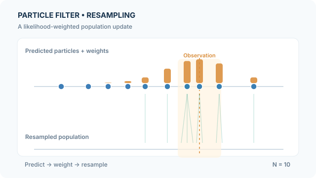

# 粒子濾波器

粒子濾波器（Particle filter）使用一群帶有權重的樣本近似序列貝氏濾波分布。與以單一高斯分布表示信念的[卡爾曼濾波器](kalman-filter.md)不同，粒子濾波可處理非高斯乃至多峰後驗，但會受到有限樣本誤差影響。經典的 Bootstrap filter／抽樣重要性重採樣（SIR）版本由 [Gordon 等人（1993）](https://doi.org/10.1049/ip-f-2.1993.0015)提出。

## 核心概念

對具有狀態轉移 $p(x_t\mid x_{t-1})$ 及觀測概似 $p(y_t\mid x_t)$ 的狀態空間模型，貝氏濾波先由前一時刻後驗預測，再利用最新量測更新權重。粒子近似可寫為：

$$
p(x_t\mid y_{1:t})\approx\sum_{i=1}^{N}w_t^{(i)}\delta(x_t-x_t^{(i)}),\qquad \sum_iw_t^{(i)}=1.
$$

對 Bootstrap proposal，每個粒子由轉移模型抽出，其未正規化的重要性權重就是觀測概似：

$$
\tilde w_t^{(i)}=p(y_t\mid x_t^{(i)}),\qquad
w_t^{(i)}=\frac{\tilde w_t^{(i)}}{\sum_j\tilde w_t^{(j)}}.
$$

接著進行**重採樣**：依權重比例選取祖先粒子，產生權重相等的新粒子群。重採樣不會憑空增加後驗資訊，只是重新分配有限的計算資源，保留更可能的狀態。

## 教學動畫：觀測加權與祖先重採樣

*原創教學動畫，CC BY-SA 4.0。* [GitHub 可讀的最終靜態圖](../../../../assets/concept-animations/particle-weight-resampling-still.svg)。MkDocs 網站提供**播放／暫停**與鍵盤操作，偏好減少動態效果時顯示靜態粒子群；窄螢幕請水平捲動。

十個**人工設定**的一維預測粒子狀態為：

$$
x=(1.0,2.1,2.9,3.7,4.4,5.3,6.1,6.6,7.4,8.8).
$$

假設觀測 $y=6.6$、概似 $p(y\mid x)\propto\exp(-(x-y)^2/(2\cdot1.3^2))$。將各粒子的概似值正規化後，得到圖中的權重長條。以固定起始偏移量執行**系統性重採樣**，門檻 $(0.045,0.145,\ldots,0.945)$ 選出**從 0 開始編號的祖先索引** $(4,5,6,6,6,7,7,8,8,9)$。

動畫把每個被選中的後代，由祖先所在位置移往下方；為了看清重複粒子，圖中加上一點水平位移，**純粹是畫面錯開，不是程序雜訊或粒子突變**。所有數值與抽樣結果都只是教學示意，**不代表實際觀測、實測後驗或模型運算軌跡**。

## 解讀與限制

- 高權重粒子在這次重採樣實例中得到更多後代；低權重祖先可能消失。整體分布仍是近似而非精確後驗。
- 常用有效樣本數 $\mathrm{ESS}=1/\sum_i(w_t^{(i)})^2$ 判斷是否需要重採樣；每一步都重採樣可能加重樣本貧化。
- 粒子數太少或初始覆蓋不佳，可能完全錯過重要分布模式；增加粒子數則提高運算成本。
- 重採樣之後，**下一次預測**才會根據轉移核產生新粒子。重採樣本身是有放回的選擇，不是擴散步驟。
- 當觀測比轉移模型提供更尖銳的限制時，Bootstrap proposal 的效率可能不佳；可考慮其他提議分布或輔助粒子濾波器。

## 參考文獻

### 奠基性論文

- Gordon, N. J., Salmond, D. J. & Smith, A. F. M. (1993). *Novel approach to nonlinear/non-Gaussian Bayesian state estimation*. IEE Proceedings F. https://doi.org/10.1049/ip-f-2.1993.0015 — 提出 Bootstrap 粒子濾波。
- Kitagawa, G. (1996). *Monte Carlo Filter and Smoother for Non-Gaussian Nonlinear State Space Models*. Journal of Computational and Graphical Statistics. https://doi.org/10.1080/10618600.1996.10474692 — 以蒙地卡羅方法進行非線性系統的濾波與平滑。

### 綜述與教科書

- Arulampalam, M. S., Maskell, S., Gordon, N. & Clapp, T. (2002). *A Tutorial on Particle Filters for Online Nonlinear/Non-Gaussian Bayesian Tracking*. IEEE Transactions on Signal Processing. https://doi.org/10.1109/78.978374 — 說明 SIS、SIR、退化現象與實務變體。
- Doucet, A. (2006). *Sequential Monte Carlo Methods*. Encyclopedia of Statistical Sciences. https://doi.org/10.1002/0471667196.ess5089 — 回顧序列重要性抽樣與重採樣。
- Murphy, K. P. (2022). *Probabilistic Machine Learning: An Introduction*. MIT Press. https://github.com/probml/pml-book — 貝氏濾波與推論的入門教材。
