# Gibbs Sampling

Gibbs sampling constructs a Markov chain by repeatedly drawing one variable or block from its full conditional distribution. Each exact conditional update preserves the target joint distribution. [Markov chain Monte Carlo](index.md).[^casella]

## Overview

A joint distribution can be hard to sample directly even when its conditional distributions are easy to sample. For example, a hierarchical Bayesian model can express each unknown's conditional in a familiar family through conjugacy. Gibbs sampling uses those conditionals to build a chain on the joint space.[^gelfand]

## Key concepts

- A **full conditional** $p(\theta_j\mid\theta_{-j})$ conditions on all other coordinates.
- A **systematic scan** updates the coordinates in a fixed order. One sweep updates each coordinate once. A **random scan** chooses a coordinate at each step with fixed probabilities.[^he]
- **Blocking** draws several variables jointly conditional on the rest. It can help when variables move together, if the block conditional can be sampled at a reasonable cost.[^roberts]

## How it works

### Why a conditional update preserves the target

Suppose the current pair $(X,Y)$ has joint density $p(x,y)$. Drawing $X'$ from $p(x'\mid y)$ leaves $Y$ unchanged. Integrating out the old $X$ gives the joint density after the update.[^casella]

$$
\int p(x,y)p(x'\mid y)\,dx=p(y)p(x'\mid y)=p(x',y).
$$

The same argument applies to updating the other coordinate, so composing the updates preserves the joint distribution. Each full-conditional update is reversible. A fixed-order sweep preserves stationarity, but reversibility need not carry over to the composition. With regularity conditions such as irreducibility and aperiodicity for a finite-state chain, the chain approaches the target from its starting state.[^casella][^he]

In a systematic sweep, each draw uses the most recent values of the other coordinates. For two coordinates, draw $X_{t+1}$ given $Y_t$, then $Y_{t+1}$ given $X_{t+1}$. Viewed as a Metropolis–Hastings proposal, the conditional density in the proposal cancels the corresponding factor of the joint density in the acceptance ratio. The exact Gibbs draw therefore has acceptance probability one. [Metropolis–Hastings](metropolis-hastings.md).[^casella]

### Worked example with a correlated Gaussian

Take a zero-mean bivariate normal with unit marginal variances and correlation $|\rho|<1$. Here the second argument of $\mathcal{N}$ is the variance. A sweep consists of the following draws.[^roberts]

$$
X_{t+1}\mid Y_t=y\sim\mathcal{N}(\rho y,1-\rho^2),
\qquad
Y_{t+1}\mid X_{t+1}=x\sim\mathcal{N}(\rho x,1-\rho^2).
$$

For $\rho=0.8$, the conditional standard deviation is $0.6$. Start at $Y_0=1$ and use illustrative standard-normal draws $0.5$ and $-1$. The first update gives $X_1=0.8+0.6(0.5)=1.1$, and the second gives $Y_1=0.8(1.1)-0.6=0.28$.

Substituting the first update into the second gives the recursion below, where $\epsilon_t$ and $\eta_t$ are independent standard-normal draws at each sweep.

$$
Y_{t+1}=\rho^2Y_t+\sqrt{1-\rho^2}\,(\rho\epsilon_t+\eta_t).
$$

At stationarity the lag-one correlation of $Y$ across full sweeps is $\rho^2$. It is $0.64$ at $\rho=0.8$ and $0.9801$ at $\rho=0.99$. Strong dependence can therefore leave consecutive draws similar even with unit acceptance.[^roberts]

## Animated walkthrough

The orange dashed line marks the fixed conditioning coordinate. The teal segment shows the update of the other coordinate. Two horizontal and two vertical moves form two illustrative sweeps. The contours and draw locations are schematic. Use Tab and Enter to operate the MkDocs play/pause control. [Static final-sweep preview](../../../../assets/concept-animations/gibbs-coordinate-sweeps-still.svg).

*Original instructional animation and GitHub fallback, CC BY-SA 4.0.*

## Connections

A Gibbs step samples a variable given the current values of the others. Mean-field coordinate ascent instead optimises a distribution factor using an expectation over the other factors. [Mean-field variational inference](../variational-inference/mean-field.md).

## Applications

Gelfand and Smith used Gibbs sampling to estimate marginal distributions in Bayesian models. Geman and Geman used conditional updates as part of their stochastic relaxation and annealing method for image restoration.[^gelfand][^geman]

## Limitations

- Scan order, blocking and choice of parameterisation can change mixing. Larger blocks trade the cost of a joint draw for potentially lower dependence between sweeps.[^roberts][^he]
- The full conditionals must permit movement between relevant regions. For a target supported only on $(0,0)$ and $(1,1)$, each coordinate is fixed by the other. A single-coordinate chain stays at its initial state even though the target is stationary.

[^casella]: *Explaining the Gibbs Sampler*. https://www2.stat.duke.edu/~scs/Courses/Stat376/Papers/Basic/CasellaGeorge1992.pdf
[^roberts]: *Updating Schemes, Correlation Structure, Blocking and Parameterization for the Gibbs Sampler*. https://www2.stat.duke.edu/~scs/Courses/Stat376/Papers/ConvergeRates/GibbsSampling/RobertsSahu1997.pdf
[^he]: *Scan Order in Gibbs Sampling: Models in Which it Matters and Bounds on How Much*. https://arxiv.org/abs/1606.03432
[^gelfand]: *Sampling-Based Approaches to Calculating Marginal Densities*. https://www.ma.imperial.ac.uk/~das01/MyWeb/SCBI/Papers/GelfandSmith.pdf
[^geman]: *Stochastic Relaxation, Gibbs Distributions, and the Bayesian Restoration of Images*. https://cseweb.ucsd.edu/~dasgupta/291-bayes/geman-geman.pdf

## References

### Seminal papers

- Casella, G. & George, E. I. (1992). *Explaining the Gibbs Sampler*. The American Statistician 46(3), 167–174. https://www2.stat.duke.edu/~scs/Courses/Stat376/Papers/Basic/CasellaGeorge1992.pdf — Explains how successive conditional draws recover the target marginals.
- Roberts, G. O. & Sahu, S. K. (1997). *Updating Schemes, Correlation Structure, Blocking and Parameterization for the Gibbs Sampler*. JRSS B 59(2), 291–317. https://www2.stat.duke.edu/~scs/Courses/Stat376/Papers/ConvergeRates/GibbsSampling/RobertsSahu1997.pdf — Analyses how scan schemes and blocking affect convergence for Gaussian targets.
- He, B. D., De Sa, C. M., Mitliagkas, I. & Ré, C. (2016). *Scan Order in Gibbs Sampling: Models in Which it Matters and Bounds on How Much*. NeurIPS. https://arxiv.org/abs/1606.03432 — Compares scan orders and analyses how their mixing times can differ.
- Gelfand, A. E. & Smith, A. F. M. (1990). *Sampling-Based Approaches to Calculating Marginal Densities*. JASA 85(410), 398–409. https://www.ma.imperial.ac.uk/~das01/MyWeb/SCBI/Papers/GelfandSmith.pdf — Applies Gibbs updates to marginal inference in Bayesian models.
- Geman, S. & Geman, D. (1984). *Stochastic Relaxation, Gibbs Distributions, and the Bayesian Restoration of Images*. IEEE TPAMI 6(6), 721–741. https://cseweb.ucsd.edu/~dasgupta/291-bayes/geman-geman.pdf — Develops conditional updates and annealing for Bayesian image restoration.
