# 吉布斯抽樣

吉布斯抽樣反覆從單一變數或變數區塊的完全條件分布抽樣，以建立馬可夫鏈。每次精確的條件更新都保持目標聯合分布。[馬可夫鏈蒙地卡羅](index.zh-TW.md)。[^casella]

## 概述

即使條件分布容易抽樣，直接從聯合分布抽樣仍可能很困難。例如，階層貝氏模型可利用共軛性，把各未知變數的條件分布寫成常見分布族。吉布斯抽樣利用這些條件分布在聯合空間建立一條鏈。[^gelfand]

## 關鍵概念

- **完全條件分布** $p(\theta_j\mid\theta_{-j})$ 以其他所有座標為條件。
- **系統掃描**依固定順序更新座標，每輪各更新一次。**隨機掃描**則在每一步依固定機率選擇座標。[^he]
- **分塊**在給定其餘變數後，同時抽取數個變數。若這些變數通常一起變動，且從區塊的條件分布抽樣的成本可接受，分塊可能改善混合。[^roberts]

## 運作方式

### 為何條件更新保持目標分布

假設當前的 $(X,Y)$ 服從聯合密度 $p(x,y)$。從 $p(x'\mid y)$ 抽取 $X'$ 時，$Y$ 保持原值。對舊的 $X$ 積分，可得更新後的聯合密度。[^casella]

$$
\int p(x,y)p(x'\mid y)\,dx=p(y)p(x'\mid y)=p(x',y).
$$

更新另一座標也適用同樣的推導，因此依序執行各更新仍會保持聯合分布。每個完全條件更新都可逆。固定順序的一輪更新仍保持平穩分布，但組合後未必可逆。以有限狀態鏈為例，滿足不可約性與非週期性等條件時，鏈會從起點逐步接近目標分布。[^casella][^he]

在系統掃描中，每次抽樣都使用其他座標的最新值。以兩個座標為例，先給定 $Y_t$ 抽取 $X_{t+1}$，再給定 $X_{t+1}$ 抽取 $Y_{t+1}$。若視為 Metropolis–Hastings 提議，提議中的條件密度會與接受比率中聯合密度的對應因子相消，因此精確吉布斯抽樣的接受機率為一。[Metropolis–Hastings](metropolis-hastings.zh-TW.md)。[^casella]

### 相關高斯分布算例

考慮均值為零、邊際變異數皆為一、相關係數滿足 $|\rho|<1$ 的二維常態分布。$\mathcal{N}$ 的第二個引數是變異數。一輪包含下列兩次抽樣。[^roberts]

$$
X_{t+1}\mid Y_t=y\sim\mathcal{N}(\rho y,1-\rho^2),
\qquad
Y_{t+1}\mid X_{t+1}=x\sim\mathcal{N}(\rho x,1-\rho^2).
$$

當 $\rho=0.8$ 時，條件標準差為 $0.6$。從 $Y_0=1$ 開始，使用兩個示意的標準常態抽樣值 $0.5$ 與 $-1$。第一次更新得到 $X_1=0.8+0.6(0.5)=1.1$，第二次得到 $Y_1=0.8(1.1)-0.6=0.28$。

把第一次更新代入第二次，可得下列遞迴式，其中 $\epsilon_t$ 和 $\eta_t$ 是每輪彼此獨立的標準常態抽樣值。

$$
Y_{t+1}=\rho^2Y_t+\sqrt{1-\rho^2}\,(\rho\epsilon_t+\eta_t).
$$

在平穩狀態下，按完整掃描輪次記錄的 $Y$，相鄰兩輪的相關係數是 $\rho^2$。當 $\rho=0.8$ 時為 $0.64$，當 $\rho=0.99$ 時為 $0.9801$。因此即使每步都接受，強相依性仍會讓連續樣本十分接近。[^roberts]

## 動畫示範

橘色虛線標出固定的條件座標，青綠色線段呈現另一座標的更新。兩次水平與兩次垂直移動構成兩輪掃描。圖中的等高線與抽樣位置皆為示意。可用 Tab 和 Enter 操作 MkDocs 的播放／暫停按鈕。[最終掃描的靜態預覽](../../../../assets/concept-animations/gibbs-coordinate-sweeps-still.svg)。

*原創教學動畫及 GitHub 靜態預覽，CC BY-SA 4.0。*

## 與其他頁面的連結

吉布斯抽樣依其他變數的當前值來抽取單一變數。平均場座標上升則對其他因子取期望，再最佳化一個分布因子。[平均場變分推論](../variational-inference/mean-field.zh-TW.md)。

## 應用

Gelfand 與 Smith 以吉布斯抽樣估計貝氏模型的邊際分布。Geman 與 Geman 則在影像復原的隨機鬆弛與退火方法中使用條件更新。[^gelfand][^geman]

## 限制

- 掃描順序、分塊與參數化方式都可能影響混合。較大的區塊增加聯合抽樣的成本，但可能降低相鄰輪次的相依性。[^roberts][^he]
- 完全條件更新必須能讓鏈在相關區域之間移動。例如，若目標分布只在 $(0,0)$ 和 $(1,1)$ 有機率質量，每個座標都由另一座標決定。逐座標更新的鏈會留在起點，即使目標分布確實是平穩分布。

[^casella]: *Explaining the Gibbs Sampler*. https://www2.stat.duke.edu/~scs/Courses/Stat376/Papers/Basic/CasellaGeorge1992.pdf
[^roberts]: *Updating Schemes, Correlation Structure, Blocking and Parameterization for the Gibbs Sampler*. https://www2.stat.duke.edu/~scs/Courses/Stat376/Papers/ConvergeRates/GibbsSampling/RobertsSahu1997.pdf
[^he]: *Scan Order in Gibbs Sampling: Models in Which it Matters and Bounds on How Much*. https://arxiv.org/abs/1606.03432
[^gelfand]: *Sampling-Based Approaches to Calculating Marginal Densities*. https://www.ma.imperial.ac.uk/~das01/MyWeb/SCBI/Papers/GelfandSmith.pdf
[^geman]: *Stochastic Relaxation, Gibbs Distributions, and the Bayesian Restoration of Images*. https://cseweb.ucsd.edu/~dasgupta/291-bayes/geman-geman.pdf

## 參考文獻

### 奠基性論文

- Casella 與 George（1992）。*Explaining the Gibbs Sampler*。The American Statistician 46(3)，167–174。 https://www2.stat.duke.edu/~scs/Courses/Stat376/Papers/Basic/CasellaGeorge1992.pdf — 說明如何透過接續的條件抽樣取得目標邊際分布。
- Roberts 與 Sahu（1997）。*Updating Schemes, Correlation Structure, Blocking and Parameterization for the Gibbs Sampler*。JRSS B 59(2)，291–317。 https://www2.stat.duke.edu/~scs/Courses/Stat376/Papers/ConvergeRates/GibbsSampling/RobertsSahu1997.pdf — 分析掃描方式與分塊如何影響高斯目標的收斂。
- He、De Sa、Mitliagkas 與 Ré（2016）。*Scan Order in Gibbs Sampling: Models in Which it Matters and Bounds on How Much*。NeurIPS。 https://arxiv.org/abs/1606.03432 — 比較掃描順序，並分析混合時間的差異。
- Gelfand 與 Smith（1990）。*Sampling-Based Approaches to Calculating Marginal Densities*。JASA 85(410)，398–409。 https://www.ma.imperial.ac.uk/~das01/MyWeb/SCBI/Papers/GelfandSmith.pdf — 將吉布斯更新用於貝氏模型的邊際推論。
- Geman 與 Geman（1984）。*Stochastic Relaxation, Gibbs Distributions, and the Bayesian Restoration of Images*。IEEE TPAMI 6(6)，721–741。 https://cseweb.ucsd.edu/~dasgupta/291-bayes/geman-geman.pdf — 發展貝氏影像復原所用的條件更新與退火方法。
