# Hamiltonian Monte Carlo

Hamiltonian Monte Carlo (HMC) proposes distant states by simulating the physical dynamics of a particle that moves through the target distribution, and then corrects the result with a Metropolis step. Its use of gradients makes it far more efficient than random-walk proposals in high dimensions. Part of [Markov chain Monte Carlo](index.md).

## Overview

Random-walk proposals move slowly in high dimensions, because most proposed moves land in low-probability regions and are rejected. HMC avoids this by introducing auxiliary momentum variables \(p\) and following Hamiltonian dynamics, which keep the total energy nearly constant. The trajectory explores the distribution along long, smooth paths, and the final state is accepted or rejected to correct for numerical error.

## Key concepts

- **Potential energy**: \(U(\theta) = -\log\pi(\theta)\), so that low-energy regions are high-probability regions.
- **Kinetic energy**: \(K(p) = \tfrac12 p^\top M^{-1} p\), with a mass matrix \(M\) that is usually diagonal.
- **Leapfrog integrator**: a symplectic numerical method that simulates the dynamics with small steps of size \(\varepsilon\) while approximately conserving energy.
- **Step size and path length**: the step size controls accuracy, and the number of steps sets how far the trajectory travels.
- **No-U-Turn Sampler (NUTS)**: an extension that chooses the number of steps automatically by stopping when the trajectory starts to double back (Hoffman & Gelman, 2014).

## How it works

Each HMC iteration does three things:

1. Draw a fresh momentum \(p \sim \mathcal{N}(0, M)\).
2. Simulate Hamiltonian dynamics for \(L\) leapfrog steps from \((\theta, p)\) to \((\theta^\*, p^\*)\).
3. Accept \((\theta^\*, p^\*)\) with probability \(\min\!\big(1, \exp(H(\theta,p)-H(\theta^\*,p^\*))\big)\), where \(H = U + K\).

Because the leapfrog integrator nearly conserves \(H\), the acceptance probability stays high even for long trajectories. Neal (2011) reviews the method and shows why the dynamics give proposals that are both distant and likely to be accepted. The original idea was published as hybrid Monte Carlo in lattice physics by Duane et al. (1987).

Hoffman and Gelman (2014) show that NUTS performs well without hand-tuned path lengths, which made HMC practical in probabilistic programming systems.

## Animated walkthrough

[Static final-state preview for GitHub and reduced-motion readers](../../../../assets/concept-animations/hmc-leapfrog-trajectory-still.svg). The MkDocs **Play animation / Pause animation** button supports keyboard Tab/Enter. The moving markers trace **positions**, not independent posterior draws.

For a constructed two-dimensional standard Gaussian, let \(U(\theta)=\|\theta\|^2/2\), \(M=I\), initial \(\theta=(-1.6,0.4)\), refreshed \(p=(0.6,1.1)\), step size \(\varepsilon=0.35\) and \(L=5\). Leapfrog applies a half momentum kick, a position drift and another half kick per step, ending near \(\theta^*=(0.898,1.023)\). Directly evaluating \(H=U+K\) gives \(H_{\mathrm{start}}=2.145\) and \(H_{\mathrm{end}}\approx2.132\), hence \(\Delta H\approx-0.013\) and \(\alpha=\min(1,e^{-\Delta H})=1\); an illustrative \(u=0.50\) accepts the proposal. The momentum is refreshed **once per trajectory**, not at every leapfrog step. These are computed **toy values**, not measured HMC performance. See Neal (2011) below for the integrator and acceptance correction.

*Original instructional animation and fallback: CC BY-SA 4.0.*

## Key methods

- [Metropolis–Hastings](metropolis-hastings.md): the random-walk method that HMC improves on, and the acceptance correction that HMC still uses.
- No-U-Turn Sampler (NUTS): the adaptive variant described in the references, which removes the need to set the path length by hand.

## Connections

- [Markov chain Monte Carlo](index.md) describes the general framework that HMC belongs to.
- [Calculus and optimisation](../../../math/calculus/index.md) provides the gradients that drive the dynamics, and [optimisation](../../../optimization/index.md) covers gradient methods on the same kinds of functions.
- Langevin dynamics, which uses gradients without momentum, is related to the sampling used in [score-based diffusion models](../../unsupervised/density-and-generative-models/diffusion/index.md).

## Applications

- **Probabilistic programming**: the default sampler in systems such as Stan, where users write models and the sampler runs inference (Hoffman & Gelman, 2014).
- **Hierarchical models**: posterior geometry that is hard for random-walk samplers, handled well by HMC (Neal, 2011).
- **Lattice field theory**: the original use, where the method was introduced for simulating quantum field theories (Duane et al., 1987).

## Open questions

- Gradient cost: each step needs gradients of the log-density, which is expensive for large models.
- Tuning the mass matrix and step size remains partly manual outside NUTS, and the guarantees for adaptive schemes are limited.
- Multimodal posteriors can trap trajectories within one mode, so HMC still needs complementary methods.

## References

### Seminal papers

- Duane, S., Kennedy, A. D., Pendleton, B. J. & Roweth, D. (1987). Hybrid Monte Carlo. *Physics Letters B* 195(2), 216–222. https://ui.adsabs.harvard.edu/abs/1987PhLB..195..216D/abstract — Introduces the hybrid method that combines molecular dynamics with a Metropolis correction.
- Hoffman, M. D. & Gelman, A. (2014). The No-U-Turn sampler: adaptively setting path lengths in Hamiltonian Monte Carlo. *Journal of Machine Learning Research* 15. https://jmlr.org/papers/v15/hoffman14a.html — Introduces NUTS, which chooses the path length automatically.

### Surveys and textbooks

- Neal, R. M. (2011). MCMC using Hamiltonian dynamics. In *Handbook of Markov Chain Monte Carlo*. arXiv:1206.1901. https://arxiv.org/abs/1206.1901 — Review of HMC, including the leapfrog integrator, energy conservation and tuning.
- Andrieu, C., de Freitas, N., Doucet, A. & Jordan, M. I. (2003). An introduction to MCMC for machine learning. *Machine Learning* 50, 5–43. https://doi.org/10.1023/A:1020281327116 — Tutorial that places HMC among the general MCMC algorithms.
- Murphy, K. P. (2022). *Probabilistic Machine Learning: An Introduction*. MIT Press. https://github.com/probml/pml-book — Free textbook; covers HMC and its gradient requirements.
- Gelman, A. et al. (2013). *Bayesian Data Analysis*, 3rd ed. CRC Press. https://sites.stat.columbia.edu/gelman/book — Discusses HMC and NUTS for posterior simulation in applied models.
