# Hamiltonian Monte Carlo

Hamiltonian Monte Carlo (HMC) uses gradients of a continuous target density to propose new positions along a simulated trajectory. A Metropolis step corrects for the numerical integration error so that the target distribution is stationary.[^neal][^stan]

## Overview

HMC introduces auxiliary momentum and uses it to turn local gradients into a sequence of directed moves. A trajectory can cover more distance than a random-walk proposal while keeping the total energy close to its starting value. This can improve exploration when the density is smooth and the integration is accurate. [Markov chain Monte Carlo](index.md).[^neal][^geometry]

## Key concepts

Let $\pi(\theta)$ denote the target density, which may be known up to a constant factor. Choose a fixed positive-definite mass matrix $M$ and give the momentum $p$ a Gaussian distribution independent of $\theta$. The negative log of the joint density is the Hamiltonian $H$ up to an additive constant.[^stan]

$$
U(\theta)=-\log\pi(\theta),\qquad
K(p)=\tfrac12 p^\top M^{-1}p,\qquad
H(\theta,p)=U(\theta)+K(p).
$$

Here $U$ is potential energy and $K$ is kinetic energy. The joint density is proportional to $e^{-H(\theta,p)}$. Integrating out $p$ leaves the target density for $\theta$.[^stan]

## How it works

### One leapfrog step

Leapfrog approximates Hamiltonian dynamics by taking two half steps in momentum around a full step in position. For step size $\varepsilon$, the updates from step $j$ to step $j+1$ are[^neal][^stan]

$$
\begin{aligned}
p_{j+1/2} &= p_j-\tfrac{\varepsilon}{2}\nabla U(\theta_j),\\
\theta_{j+1} &= \theta_j+\varepsilon M^{-1}p_{j+1/2},\\
p_{j+1} &= p_{j+1/2}-\tfrac{\varepsilon}{2}\nabla U(\theta_{j+1}).
\end{aligned}
$$

The middle update uses the intermediate momentum, and the last update uses the gradient at the new position.

### One HMC transition

1. From the current position $\theta_0$, draw $p_0\sim\mathcal{N}(0,M)$.
2. Apply $L$ leapfrog steps. The position proposal is $\theta_L$.
3. Compute $\Delta H=H(\theta_L,p_L)-H(\theta_0,p_0)$ and $\alpha=\min(1,e^{-\Delta H})$. Draw $u$ uniformly on $[0,1]$. Keep $\theta_L$ if $u<\alpha$, and keep $\theta_0$ otherwise. Record the retained position as the next draw, including when it repeats the previous one.[^neal]

Leapfrog preserves volume in the joint position–momentum space. Applying the trajectory map followed by a momentum flip gives a proposal that undoes itself when applied twice. These properties let the Metropolis correction use the joint density ratio $e^{-\Delta H}$. The flip leaves $K$ unchanged and can be omitted when retaining only positions and fully refreshing momentum at the next iteration.[^neal]

## Animated walkthrough

The moving markers trace positions along one trajectory. Use the MkDocs Play/Pause button with Tab and Enter. [Static final-state preview](../../../../assets/concept-animations/hmc-leapfrog-trajectory-still.svg).

In the animation, a two-dimensional standard Gaussian gives $U(\theta)=\|\theta\|^2/2$ up to a constant. With $M=I$, $\theta_0=(-1.6,0.4)$, $p_0=(0.6,1.1)$ and $\varepsilon=0.35$, five steps give $\theta_L\approx(0.898,1.023)$. Energy changes from $2.145$ to about $2.132$, so $\Delta H\approx-0.013$ and the proposal is accepted with probability $1$.

A separate one-dimensional example shows rejection. With $U(\theta)=\theta^2/2$, $M=1$, $\theta_0=0$, $p_0=1$ and $\varepsilon=1$, one step gives $(\theta_1,p_1)=(1,0.5)$. Then $\Delta H=0.125$ and $\alpha\approx0.882$. For $u=0.90$, the recorded position remains $0$. Both examples use constructed teaching values.

*Original instructional animation and fallback, CC BY-SA 4.0.*

## Key methods

- [Metropolis–Hastings](metropolis-hastings.md) supplies the accept/reject construction. HMC builds its proposal by integrating a trajectory.[^neal]
- **No-U-Turn Sampler (NUTS)** builds a trajectory in both directions, stops expansion when it detects a U-turn or hits a stopping limit, and selects a candidate from the trajectory according to its sampling rule. In Stan, step size and the mass matrix are tuned during warmup. NUTS still chooses a trajectory length for each transition during sampling.[^nuts][^stan]

## Connections

Gradients guide HMC proposals, and the resulting chain targets a distribution over positions. Gradient-based optimisers use gradients to search for extrema. [Calculus](../../../math/calculus/index.md), [Optimisation](../../../optimization/index.md).[^geometry]

## Applications

Duane et al. introduced the method for lattice field simulations. Stan uses NUTS by default to sample continuous posterior parameters.[^duane][^stan]

## Limitations

- Each leapfrog step uses gradient information. A very small step size increases the number of steps needed to travel a given distance, and a large step size can cause inaccurate trajectories. The mass matrix can adjust for differences in scale and correlation across parameters.[^stan]
- Divergences flag trajectories with large integration error and can indicate that the sampler struggles to explore a region. Well-separated modes can also be hard to traverse even when local proposals have high acceptance.[^stan][^neal]

[^neal]: Neal, [*MCMC Using Hamiltonian Dynamics*](https://arxiv.org/html/1206.1901), §§2.3, 3.2 and 5.7.
[^stan]: Stan Development Team, [*MCMC Sampling*](https://mc-stan.org/docs/reference-manual/mcmc.html), sections on leapfrog, automatic tuning, NUTS and divergences.
[^geometry]: Betancourt, [*A Conceptual Introduction to Hamiltonian Monte Carlo*](https://arxiv.org/abs/1701.02434), §§2–4.
[^nuts]: Hoffman and Gelman, [*The No-U-Turn Sampler*](https://jmlr.org/papers/v15/hoffman14a.html), §§3–4.
[^duane]: Duane et al., [*Hybrid Monte Carlo*](https://www.sciencedirect.com/science/article/abs/pii/037026938791197X), abstract.

## References

### Seminal papers

- Duane, S., Kennedy, A. D., Pendleton, B. J. & Roweth, D. (1987). *Hybrid Monte Carlo*. Physics Letters B 195(2), 216–222. https://www.sciencedirect.com/science/article/abs/pii/037026938791197X — Introduces the hybrid algorithm for simulation of lattice field theories.
- Hoffman, M. D. & Gelman, A. (2014). *The No-U-Turn Sampler: Adaptively Setting Path Lengths in Hamiltonian Monte Carlo*. JMLR 15, 1593–1623. https://jmlr.org/papers/v15/hoffman14a.html — Derives dynamic trajectory construction and step-size adaptation for HMC.

### Surveys and textbooks

- Neal, R. M. (2011). *MCMC Using Hamiltonian Dynamics*. In Handbook of Markov Chain Monte Carlo. https://arxiv.org/abs/1206.1901 — Derives the leapfrog transition and explains its detailed balance and tuning.
- Betancourt, M. (2017). *A Conceptual Introduction to Hamiltonian Monte Carlo*. https://arxiv.org/abs/1701.02434 — Explains the geometry of HMC and its practical trajectory construction.

### Articles and documentation

- Stan Development Team. *MCMC Sampling*. Stan Reference Manual. https://mc-stan.org/docs/reference-manual/mcmc.html — Documents the implemented samplers, warmup configuration and divergent transitions.
