# 哈密頓蒙地卡羅

哈密頓蒙地卡羅（HMC）利用連續目標密度的梯度，沿模擬軌跡提出新的位置。Metropolis 步驟修正數值積分的誤差，使目標分布成為平穩分布。[^neal][^stan]

## 概述

HMC 加入輔助動量，將局部梯度轉化為一連串有方向的移動。軌跡可以比隨機漫步提議走得更遠，同時使總能量維持在起始值附近。當密度平滑且積分準確時，這有助於探索目標分布。[馬可夫鏈蒙地卡羅](index.zh-TW.md)。[^neal][^geometry]

## 關鍵概念

設 $\pi(\theta)$ 為目標密度。計算時只需知道其相對大小，常數因子可以省略。選定固定的正定質量矩陣 $M$，並令動量 $p$ 服從與 $\theta$ 獨立的高斯分布。聯合密度取負對數後，與哈密頓量 $H$ 相差一個加法常數。[^stan]

$$
U(\theta)=-\log\pi(\theta),\qquad
K(p)=\tfrac12 p^\top M^{-1}p,\qquad
H(\theta,p)=U(\theta)+K(p).
$$

其中 $U$ 是位能，$K$ 是動能。聯合密度與 $e^{-H(\theta,p)}$ 成比例。對 $p$ 積分後，就得到 $\theta$ 的目標密度。[^stan]

## 運作方式

### 一次蛙跳更新

蛙跳法以半步動量更新、一步位置更新、再半步動量更新來近似哈密頓動力學。步長為 $\varepsilon$ 時，從第 $j$ 步到第 $j+1$ 步的更新如下。[^neal][^stan]

$$
\begin{aligned}
p_{j+1/2} &= p_j-\tfrac{\varepsilon}{2}\nabla U(\theta_j),\\
\theta_{j+1} &= \theta_j+\varepsilon M^{-1}p_{j+1/2},\\
p_{j+1} &= p_{j+1/2}-\tfrac{\varepsilon}{2}\nabla U(\theta_{j+1}).
\end{aligned}
$$

中間的更新使用半步動量，最後的更新則使用新位置的梯度。

### 一次 HMC 轉移

1. 從當前位置 $\theta_0$ 出發，抽取 $p_0\sim\mathcal{N}(0,M)$。
2. 執行 $L$ 個蛙跳步驟。候選位置為 $\theta_L$。
3. 計算 $\Delta H=H(\theta_L,p_L)-H(\theta_0,p_0)$ 與 $\alpha=\min(1,e^{-\Delta H})$。從 $[0,1]$ 均勻抽取 $u$。若 $u<\alpha$，保留 $\theta_L$，否則保留 $\theta_0$。將保留的位置記錄為下一筆樣本，即使它和上一筆相同。[^neal]

蛙跳法保持位置與動量聯合空間的體積。完成軌跡後翻轉動量，所得的提議映射執行兩次便會回到起點。這些性質讓 Metropolis 修正能使用聯合密度比 $e^{-\Delta H}$。翻轉動量不改變 $K$。若只記錄位置，並在下一次迭代重新抽取全部動量，實作時可省略翻轉。[^neal]

## 動態流程示意

移動的標記代表同一條軌跡上的位置。可用 Tab 和 Enter 操作 MkDocs 的播放／暫停按鈕。[靜態最終狀態圖](../../../../assets/concept-animations/hmc-leapfrog-trajectory-still.svg)。

動畫採用二維標準高斯分布，位能可寫成 $U(\theta)=\|\theta\|^2/2$，省略加法常數。以 $M=I$、$\theta_0=(-1.6,0.4)$、$p_0=(0.6,1.1)$、$\varepsilon=0.35$ 執行五步，得到 $\theta_L\approx(0.898,1.023)$。能量從 $2.145$ 變為約 $2.132$，因此 $\Delta H\approx-0.013$，接受機率為 $1$。

另一個一維算例示範拒絕提議。令 $U(\theta)=\theta^2/2$、$M=1$、$\theta_0=0$、$p_0=1$、$\varepsilon=1$，一步後得到 $(\theta_1,p_1)=(1,0.5)$。此時 $\Delta H=0.125$，$\alpha\approx0.882$。若 $u=0.90$，記錄的位置仍為 $0$。兩個算例皆採用教學示意值。

*原創教學動畫與靜態圖，CC BY-SA 4.0。*

## 主要方法

- [Metropolis–Hastings](metropolis-hastings.zh-TW.md)提供接受與拒絕的機制。HMC 透過積分軌跡形成提議。[^neal]
- **No-U-Turn 抽樣器（NUTS）**向兩個方向建立軌跡，偵測到折返或達到停止上限時停止擴展，再依抽樣規則從軌跡中選擇候選狀態。Stan 在暖身期間調整步長與質量矩陣，正式抽樣時 NUTS 仍會逐次選擇軌跡長度。[^nuts][^stan]

## 與其他頁面的連結

梯度引導 HMC 提議，所得的馬可夫鏈以位置的分布為目標。梯度式最佳化方法則使用梯度搜尋極值。[微積分](../../../math/calculus/index.zh-TW.md)、[最佳化](../../../optimization/index.zh-TW.md)。[^geometry]

## 應用

Duane 等人最早將此方法用於格點場論模擬。Stan 預設使用 NUTS 對連續後驗參數抽樣。[^duane][^stan]

## 限制

- 每個蛙跳步驟都需要梯度。步長很小時，走同樣距離需要更多步驟。步長過大則可能使軌跡失準。質量矩陣可依參數的尺度差異與相關性調整運動。[^stan]
- 發散表示軌跡的積分誤差過大，可能反映抽樣器難以探索某些區域。即使局部提議的接受率很高，彼此相距甚遠的眾數也可能難以跨越。[^stan][^neal]

[^neal]: Neal，[*MCMC Using Hamiltonian Dynamics*](https://arxiv.org/html/1206.1901)，第 2.3、3.2 與 5.7 節。
[^stan]: Stan 開發團隊，[*MCMC Sampling*](https://mc-stan.org/docs/reference-manual/mcmc.html)，蛙跳法、自動調校、NUTS 與發散章節。
[^geometry]: Betancourt，[*A Conceptual Introduction to Hamiltonian Monte Carlo*](https://arxiv.org/abs/1701.02434)，第 2 至 4 節。
[^nuts]: Hoffman 與 Gelman，[*The No-U-Turn Sampler*](https://jmlr.org/papers/v15/hoffman14a.html)，第 3 至 4 節。
[^duane]: Duane 等人，[*Hybrid Monte Carlo*](https://www.sciencedirect.com/science/article/abs/pii/037026938791197X)，摘要。

## 參考文獻

### 奠基性論文

- Duane、Kennedy、Pendleton 與 Roweth（1987）。*Hybrid Monte Carlo*。Physics Letters B 195(2)，216–222。https://www.sciencedirect.com/science/article/abs/pii/037026938791197X — 提出用於格點場論模擬的混合演算法。
- Hoffman 與 Gelman（2014）。*The No-U-Turn Sampler: Adaptively Setting Path Lengths in Hamiltonian Monte Carlo*。JMLR 15，1593–1623。https://jmlr.org/papers/v15/hoffman14a.html — 推導 HMC 的動態軌跡建構與步長調適。

### 綜述與教科書

- Neal（2011）。*MCMC Using Hamiltonian Dynamics*。收錄於 Handbook of Markov Chain Monte Carlo。https://arxiv.org/abs/1206.1901 — 推導蛙跳轉移，說明其細緻平衡與調校。
- Betancourt（2017）。*A Conceptual Introduction to Hamiltonian Monte Carlo*。https://arxiv.org/abs/1701.02434 — 說明 HMC 的幾何觀點與實際的軌跡建構。

### 文章與文件

- Stan 開發團隊。*MCMC Sampling*。Stan Reference Manual。https://mc-stan.org/docs/reference-manual/mcmc.html — 記載抽樣器的實作、暖身設定與發散轉移。
