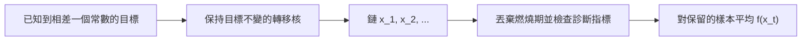

# 馬可夫鏈蒙地卡羅

馬可夫鏈蒙地卡羅（Markov chain Monte Carlo, MCMC）是一族演算法，透過模擬一條馬可夫鏈來抽取某個機率分布的樣本，而這條鏈長期的分布就是目標分布。當分布只能計算到相差一個常數時，它是貝氏推論最常用的工具。只要步數夠多，它的樣本就能精確代表目標分布，因此屬於漸近精確的方法。

## 概述

貝氏推論的最後一步是後驗分布 $p(\theta\mid D)$，它描述參數或隱藏成因的分布。其正規化常數 $p(D)=\int p(D\mid\theta)\,p(\theta)\,d\theta$ 通常無法精確計算，因此後驗通常只能算到相差一個未知常數。後驗的平均數與可信區間，都是後驗下的期望值，而這些期望值可以用樣本來估計，不必計算那個常數。

蒙地卡羅方法用對樣本取平均來取代積分。要從複雜的高維分布中抽出彼此獨立的樣本通常辦不到，因此 MCMC 改為建立一串相依的樣本：每個樣本都由前一個產生，而整條鏈的平穩分布就是目標。這個想法源自統計物理，Metropolis 等人（1953）用隨機移動估計交互作用分子的狀態方程。Andrieu 等人（2003）為機器學習讀者寫了入門教程，Robert 與 Casella（2004）則在教科書中介紹統計理論。

MCMC 是[變分推論](../variational-inference/index.md)的主要替代方法。抽樣方法在極限下精確，但收斂可能很慢；變分方法速度快，但屬於近似，兩者的相對精確度至今仍有爭論。

## 核心概念

- **目標分布** $\pi$：要抽樣的分布。通常只能以未正規化的密度 $\tilde\pi(x)$ 給出，其中 $\pi(x) = \tilde\pi(x)/Z$，而常數 $Z$ 未知。
- **馬可夫鏈**：一個序列 $x_1, x_2, \dots$，每個狀態只依賴前一個狀態，依據的是轉移核 $T(x' \mid x)$。
- **平穩分布**：鏈經過轉移後保持不變的分布。在溫和的條件下，鏈無論從哪個起點出發，都會收斂到它。
- **細緻平衡**：平穩性的一個充分條件，即 $\pi(x)\,T(x'\mid x) = \pi(x')\,T(x\mid x')$。許多 MCMC 演算法都是為了滿足它而設計的。
- **燃燒期**（burn-in）：執行的前段。由於鏈還沒忘記起點，這段樣本會被丟棄。
- **自相關與有效樣本數**：相鄰的樣本彼此相關，所以 $N$ 個樣本所含的資訊少於 $N$ 個獨立樣本。有效樣本數是指能給出同樣精確度的獨立樣本個數。
- **混合**：鏈在整個目標分布上移動的速度。混合慢是實務上最主要的困難。

## 運作方式

鏈收斂之後，沿著一條長執行路徑對函數取平均，就能估計目標下的期望值：

$$
\hat f = \frac{1}{N}\sum_{t=1}^{N} f(x_t) \;\approx\; \mathbb{E}_{\pi}[f(x)].
$$

這之所以成立，是因為鏈具有遍歷性。設計的任務是找到一個保持 $\pi$ 不變、又能快速混合的轉移核 $T$。通常的流程有五步：

1. 選定起點 $x_0$。
2. 反覆套用一個保持 $\pi$ 不變的轉移。
3. 丟棄燃燒期；若儲存空間有限，每隔 $k$ 個保留一個樣本（稀疏化）。
4. 檢查下方列出的診斷指標。
5. 用保留下來的樣本計算估計值。

各種方法的差別在於如何建立轉移。[Metropolis–Hastings 演算法](metropolis-hastings/index.md)先提議一個移動，再決定接受或拒絕。[吉布斯取樣](gibbs-sampling/index.md)每次只更新一個變數，從它的完全條件分布中抽樣。[哈密頓蒙地卡羅](hamiltonian-monte-carlo/index.md)利用對數密度的梯度，模擬動力學來提出較遠的移動。[朗之萬動力學](langevin-dynamics/index.md)沿著梯度方向移動，並加入雜訊。

### 診斷

有限次的執行無法證明收斂，因此實務上要檢查輸出。常見的檢查有四種。

- **軌跡圖**。收斂的鏈看起來像在固定水準附近的平穩雜訊。若出現緩慢漂移或長時間停滯，表示燃燒期太短，或鏈被卡住。
- **Gelman–Rubin 統計量**。從分散的起點執行多條鏈，比較鏈間與鏈內的變異數。數值接近 1 表示各鏈一致（Gelman & Rubin, 1992）。Vehtari 等人（2019）指出原始統計量有嚴重缺陷，並提出以秩正規化的版本。
- **有效樣本數**。鏈的自相關決定這次執行相當於多少個獨立樣本。Geyer（1992）主張推論應建立在單一長執行上，並從該執行的自相關估計蒙地卡羅誤差。
- **實務經驗**。Kass 等人（1998）記錄了一場圓桌討論，內容是如何執行與監控鏈。

## 關鍵方法

下面比較四種代表性方法，每一種都有自己的頁面。

| 方法 | 起源 | 區別 |
|---|---|---|
| [Metropolis–Hastings 演算法](metropolis-hastings/index.md) | 1953；1970 年推廣 | 通用且簡單：先提議，再接受或拒絕。隨機漫步式的提議在高維中探索緩慢 |
| [吉布斯取樣](gibbs-sampling/index.md) | 1984 | 永遠接受。每一步從完全條件分布抽出一個變數，前提是該條件分布可以取得 |
| [哈密頓蒙地卡羅與 NUTS](hamiltonian-monte-carlo/index.md) | 1987；NUTS 為 2011 | 利用梯度提出較遠且會被接受的移動。NUTS 自動選擇路徑長度 |
| [朗之萬動力學](langevin-dynamics/index.md) | 1996；分數版本為 2019 | 帶雜訊地沿梯度漂移。其分數版本驅動現代的擴散式生成器 |

## 關聯

- **貝氏方法**。MCMC 是近似推論中負責抽樣的那一半，[上層總覽](../index.md)會把它與變分方法並列說明。吉布斯取樣適合圖模型，因為每個變數的條件分布只依賴其鄰居。Geman 與 Geman（1984）就是用這個想法，在馬可夫隨機場先驗下還原受損影像。
- **生成模型**。Song 與 Ermon（2019）利用從資料估計出的分數，以退火朗之萬動力學生成樣本。Song 等人（2020）把分數模型與擴散模型放進同一個隨機微分方程的框架，其中朗之萬型的校正步驟會修正樣本。參見[擴散模型](../../unsupervised/density-and-generative-models/diffusion/index.md)與 [DDPM](../../unsupervised/density-and-generative-models/diffusion/ddpm.md)。
- **腦與心智**。一種假說認為，大腦是透過抽樣來表示不確定性。Fiser 等人（2010）回顧神經活動如何編碼後驗的樣本，Berkes 等人（2011）主張自發的皮質活動帶有最佳內部模型的特徵。行為證據則較為分歧。Vul 等人（2014）發現，人們的決策常只依據後驗的一個或少數幾個樣本，遠少於長時間 MCMC 所用的數量。參見[認知科學](../../../../brain-mind/cognitive-science/index.md)。

## 應用

- **統計軟體**。Stan、PyMC 與 NumPyro 都執行 MCMC，其中 Stan 的預設取樣器是 NUTS（Carpenter 等人，2017）。
- **影像模型**。早期的貝氏影像還原依賴馬可夫隨機場上的吉布斯取樣（Geman & Geman, 1984）。

## 開放問題

- **混合**。對於多峰或極高維的目標，目前沒有通用方法能保證快速混合。診斷指標也可能漏掉一條始終困在單一模態的鏈。
- **規模**。精確取樣器的每一步可能都需要整個資料集。小批次變體較快，但放棄了精確的平穩性。
- **自動調校**。步長與提議尺度仍常靠人工設定。在保持目標精確的前提下自動調整，是活躍的研究方向。
- **腦中的抽樣**。神經迴路是否進行抽樣，以及需要多少樣本，仍未確定。行為證據指向非常少的樣本。

## 參考文獻

### 開創性論文

- Metropolis, N., Rosenbluth, A. W., Rosenbluth, M. N., Teller, A. H. & Teller, E. (1953). Equation of State Calculations by Fast Computing Machines. *Journal of Chemical Physics*. https://doi.org/10.1063/1.1699114 — 提出以接受－拒絕鏈計算交互作用粒子狀態方程的 Metropolis 方法。
- Hastings, W. K. (1970). Monte Carlo sampling methods using Markov chains and their applications. *Biometrika*. https://doi.org/10.1093/biomet/57.1.97 — 將接受規則推廣到不必對稱的提議，形成今日使用的 Metropolis–Hastings 演算法。
- Geman, S. & Geman, D. (1984). Stochastic Relaxation, Gibbs Distributions, and the Bayesian Restoration of Images. *IEEE TPAMI*. https://doi.org/10.1109/TPAMI.1984.4767596 — 在馬可夫隨機場上使用吉布斯取樣，進行受損影像的貝氏還原。
- Duane, S., Kennedy, A. D., Pendleton, B. J. & Roweth, D. (1987). Hybrid Monte Carlo. *Physics Letters B*. https://doi.org/10.1016/0370-2693(87)91197-X — 提出結合哈密頓動力學與 Metropolis 修正的混合蒙地卡羅，用於格點場論模擬。
- Hoffman, M. D. & Gelman, A. (2011). The No-U-Turn Sampler: Adaptively Setting Path Lengths in Hamiltonian Monte Carlo. arXiv. https://arxiv.org/abs/1111.4246 — 提出 NUTS，能自動設定蛙跳步數並即時調整步長。
- Song, Y. & Ermon, S. (2019). Generative Modeling by Estimating Gradients of the Data Distribution. arXiv. https://arxiv.org/abs/1907.05600 — 以多個雜訊水準上估計的分數，透過退火朗之萬動力學生成樣本。
- Song, Y., Sohl-Dickstein, J., Kingma, D. P., Kumar, A., Ermon, S. & Poole, B. (2020). Score-Based Generative Modeling through Stochastic Differential Equations. arXiv. https://arxiv.org/abs/2011.13456 — 以漂移項為分數的前向與反向隨機微分方程，統一分數模型與擴散模型，並提出預測－校正取樣器。

### 綜述與教科書

- Andrieu, C., de Freitas, N., Doucet, A. & Jordan, M. I. (2003). An Introduction to MCMC for Machine Learning. *Machine Learning*. https://doi.org/10.1023/A:1020281327116 — 為機器學習讀者解說主要 MCMC 演算法的入門教程。
- Robert, C. P. & Casella, G. (2004). *Monte Carlo Statistical Methods*. Springer. https://doi.org/10.1007/978-1-4757-4145-2 — 研究所層級的教科書，涵蓋蒙地卡羅與 MCMC 方法的理論與實作。
- Neal, R. M. (2012). MCMC using Hamiltonian dynamics. arXiv. https://arxiv.org/abs/1206.1901 — 關於哈密頓動力學作為 MCMC 提議機制的教學文章，附有調校建議。
- Fiser, J., Berkes, P., Orbán, G. & Lengyel, M. (2010). Statistically optimal perception and learning: from behavior to neural representations. *Trends in Cognitive Sciences*. https://doi.org/10.1016/j.tics.2010.01.003 — 回顧貝氏推論如何由神經表徵實現，包括以抽樣為基礎的編碼。

### 文章與文件

- Berkes, P., Orbán, G., Lengyel, M. & Fiser, J. (2011). Spontaneous Cortical Activity Reveals Hallmarks of an Optimal Internal Model of the Environment. *Science*. https://doi.org/10.1126/science.1195870 — 報告自發的皮質活動顯示最佳內部模型的統計特徵。
- Vul, E., Goodman, N., Griffiths, T. L. & Tenenbaum, J. B. (2014). One and Done? Optimal Decisions From Very Few Samples. *Cognitive Science*. https://doi.org/10.1111/cogs.12101 — 主張人類決策可以用極少量的後驗樣本來解釋。
- Geyer, C. J. (1992). Practical Markov Chain Monte Carlo. *Statistical Science*. https://doi.org/10.1214/ss/1177011137 — 主張推論應建立在單一長執行上，並從自相關估計蒙地卡羅誤差。
- Gelman, A. & Rubin, D. B. (1992). Inference from Iterative Simulation Using Multiple Sequences. *Statistical Science*. https://doi.org/10.1214/ss/1177011136 — 最早的多鏈收斂診斷，比較鏈內與鏈間變異數。
- Vehtari, A., Gelman, A., Simpson, D., Carpenter, B. & Bürkner, P.-C. (2019). Rank-normalization, folding, and localization: An improved R-hat for assessing convergence of MCMC. arXiv. https://arxiv.org/abs/1903.08008 — 指出經典 R-hat 的缺陷，並提出更可靠的秩正規化版本。
- Kass, R. E., Carlin, B. P., Gelman, A. & Neal, R. M. (1998). Markov Chain Monte Carlo in Practice: A Roundtable Discussion. *The American Statistician*. https://doi.org/10.1080/00031305.1998.10480547 — 由實務工作者進行的討論，內容是如何執行、監控與報告 MCMC 分析。
- Betancourt, M. (2017). A Conceptual Introduction to Hamiltonian Monte Carlo. arXiv. https://arxiv.org/abs/1701.02434 — 從幾何角度解釋 HMC 表現良好的原因，以及應如何調校。
- Carpenter, B., Gelman, A., Hoffman, M. D., Lee, D., Goodrich, B., Betancourt, M., et al. (2017). Stan: A Probabilistic Programming Language. *Journal of Statistical Software*. https://doi.org/10.18637/jss.v076.i01 — 介紹 Stan 系統，它以 NUTS 作為預設取樣器，並被廣泛用於貝氏推論。
