# Metropolis–Hastings

Metropolis–Hastings constructs a [Markov chain](index.md) for a target distribution by proposing a candidate and applying an acceptance rule. The rule uses the target up to a normalising constant and accounts for the probability of proposing the reverse move.[^hastings]

## Proposal and acceptance

Let $\pi(x)=\tilde{\pi}(x)/Z$ be a proper target mass or density, where $0<Z<\infty$ may be unknown. Initialise the chain at a state with positive, finite target value. From the current state $x$, draw $y$ from $q(\cdot\mid x)$ and use the acceptance probability

$$
\alpha(x,y)=\min\!\left(1,\frac{\tilde{\pi}(y)\,q(x\mid y)}
{\tilde{\pi}(x)\,q(y\mid x)}\right).
$$

The normalising constant cancels. Here $q(y\mid x)$ is the forward proposal probability or density and $q(x\mid y)$ is its reverse. If the proposal has zero target value or zero reverse proposal value, reject the move. A symmetric proposal has equal forward and reverse values, leaving only the target ratio. Metropolis et al. introduced the symmetric rule for statistical physics. Hastings extended it to asymmetric proposals.[^metropolis][^hastings]

### One step in log space

For positive terms in the ratio, compute

$$
\ell=\log\tilde{\pi}(y)-\log\tilde{\pi}(x)
+\log q(x\mid y)-\log q(y\mid x).
$$

Draw $u$ uniformly on $(0,1)$ and accept if $\log u < \min(0,\ell)$. This implements the same rule without exponentiating the log ratio. Record $y$ when accepted and $x$ otherwise. Rejection contributes a transition back to the current state. Keep that repeated state when computing ordinary chain averages.[^intro]

## Why the target is stationary

For distinct $x$ and $y$, the probability flow from $x$ to $y$ at stationarity is proportional to

$$
\tilde{\pi}(x)q(y\mid x)\alpha(x,y)
=\min\!\left(\tilde{\pi}(x)q(y\mid x),\tilde{\pi}(y)q(x\mid y)\right).
$$

The expression is symmetric in the two states, so flow balances in both directions. This property is called **detailed balance**. Integrating or summing it over the starting state shows that one step preserves $\pi$. The probability of staying completes the transition kernel.[^intro][^tierney]

Stationarity describes a chain started in equilibrium. Convergence from an arbitrary start is a separate question. On a finite target support, irreducibility of the accepted transitions and aperiodicity suffice for convergence to the target. For example, a proposal may offer a move between regions that always fails because its reverse has zero probability. Conversely, a chain that deterministically alternates between two equally weighted states is stationary under their uniform distribution but periodic from a fixed start. General state spaces require the corresponding Markov chain conditions.[^tierney]

### Worked example with an asymmetric proposal

Let $\pi(A)=1/4$ and $\pi(B)=3/4$. Choose $q(B\mid A)=3/4$ and $q(A\mid B)=1/8$, with the remaining proposal probability in each row assigned to the current state.

| Move | Forward proposal | Reverse proposal | Acceptance | Probability of the move |
|---|---|---|---|---|
| $A\to B$ | $3/4$ | $1/8$ | $1/2$ | $3/8$ |
| $B\to A$ | $1/8$ | $3/4$ | $1$ | $1/8$ |

For $A\to B$, the acceptance ratio is $(3/4)(1/8)/[(1/4)(3/4)]=1/2$. The stationary flows in the two directions are $(1/4)(3/8)=(3/4)(1/8)=3/32$. The chain stays in $A$ with probability $5/8$ and in $B$ with probability $7/8$. Counting only changes of state would produce alternating visits and lose the unequal time spent in the two states.

## Animated walkthrough

[Static final-state preview for GitHub and reduced-motion readers](../../../../assets/concept-animations/mh-accept-reject-still.svg). On the MkDocs site, use **Play animation / Pause animation**. With a keyboard, press Tab to focus the control, then Enter to activate it.

The animation uses $\pi(\theta)\propto\exp(-\theta^2/2)$ and a symmetric proposal. From $-1.0$ to $0.4$, the acceptance probability is $1$. The next proposal moves from $0.4$ to $2.5$ with acceptance probability $\exp[-(2.5^2-0.4^2)/2]\approx0.048$. The illustrative uniform draw $u=0.60$ rejects the move, so the next recorded state is $0.4$. These values are a constructed teaching example.[^hastings]

*Original instructional animation and fallback licensed CC BY-SA 4.0.*

## Related methods and practical limits

- [Gibbs sampling](gibbs-sampling.md) updates a block from its exact full conditional. The target and proposal factors cancel, giving acceptance probability one for that block update.[^intro]
- [Hamiltonian Monte Carlo](hamiltonian-monte-carlo.md) uses gradients to propose longer moves on continuous targets. This addresses the slow exploration that can result from local random walks.[^neal]
- Acceptance frequency measures only how often proposals pass the test. Tiny random-walk steps can be accepted frequently while producing strongly correlated draws. Compare traces and effective sample sizes for quantities of interest across chains. The [MCMC overview](index.md) introduces these diagnostics.[^intro][^neal]

[^metropolis]: Metropolis et al. (1953), section II, describe the symmetric accept-or-stay step for molecular configurations.
[^hastings]: Hastings (1970), section 2, constructs acceptance rules for a general proposal.
[^intro]: Andrieu et al. (2003), sections 3.2–4, discuss invariance, Metropolis–Hastings and Gibbs updates.
[^tierney]: Tierney (1994), sections 2.3 and 3, formalises Metropolis kernels and conditions for convergence.
[^neal]: Neal (2012 preprint), *MCMC using Hamiltonian dynamics*, explains random-walk exploration and proposals based on Hamiltonian dynamics.

## References

### Seminal papers

- Metropolis, N., Rosenbluth, A. W., Rosenbluth, M. N., Teller, A. H. & Teller, E. (1953). *Equation of State Calculations by Fast Computing Machines*. Journal of Chemical Physics 21(6), 1087–1092. https://bayes.wustl.edu/Manual/EquationOfState.pdf — Introduces the symmetric rule in simulations of molecular configurations.
- Hastings, W. K. (1970). *Monte Carlo Sampling Methods Using Markov Chains and Their Applications*. Biometrika 57(1), 97–109. https://www.probability.ca/hastings/hastings.pdf — Generalises the acceptance rule and gives conditions on transition probabilities.
- Tierney, L. (1994). *Markov Chains for Exploring Posterior Distributions*. Annals of Statistics 22(4), 1701–1728. https://www.ma.imperial.ac.uk/~das01/MyWeb/SCBI/Papers/Tierney94.pdf — Relates invariant kernels, reachability and convergence on general state spaces.

### Surveys and textbooks

- Andrieu, C., de Freitas, N., Doucet, A. & Jordan, M. I. (2003). *An Introduction to MCMC for Machine Learning*. Machine Learning 50, 5–43. https://www.cs.princeton.edu/courses/archive/spr06/cos598C/papers/AndrieuFreitasDoucetJordan2003.pdf — Introduces detailed balance, Metropolis–Hastings and Gibbs updates with examples.
- Neal, R. M. (2012 preprint). *MCMC using Hamiltonian dynamics*. https://arxiv.org/abs/1206.1901 — Explains random-walk behaviour and how gradient-based proposals change exploration.
