# Metropolis–Hastings

Metropolis–Hastings 先提出候選狀態，再套用接受規則，為目標分布建構一條[馬可夫鏈](index.md)。接受規則只需要目標分布未正規化的值，也會納入反向提議的機率或密度。[^hastings]

## 提議與接受

令 $\pi(x)=\tilde{\pi}(x)/Z$ 為可正規化的目標機率質量或密度，其中 $0<Z<\infty$ 可以未知。從目標值為正且有限的狀態起始。目前狀態為 $x$ 時，從 $q(\cdot\mid x)$ 抽取 $y$，並使用下列接受機率。

$$
\alpha(x,y)=\min\!\left(1,\frac{\tilde{\pi}(y)\,q(x\mid y)}
{\tilde{\pi}(x)\,q(y\mid x)}\right).
$$

正規化常數會相消。這裡 $q(y\mid x)$ 是正向提議的機率或密度，$q(x\mid y)$ 是反向提議的值。若候選狀態的目標值或反向提議值為零，就拒絕該提議。對稱提議的正反向值相同，接受機率只剩下目標比值的影響。Metropolis 等人為統計物理提出對稱規則。Hastings 將它推廣到非對稱提議。[^metropolis][^hastings]

### 在對數空間執行一步

當比值中的各項為正時，計算

$$
\ell=\log\tilde{\pi}(y)-\log\tilde{\pi}(x)
+\log q(x\mid y)-\log q(y\mid x).
$$

從 $(0,1)$ 均勻抽取 $u$，若 $\log u < \min(0,\ell)$ 就接受。這與原接受規則等價，且可省去對對數比值取指數。接受時記錄 $y$，拒絕時記錄 $x$。拒絕構成一次返回當前狀態的轉移，計算一般的鏈平均時要保留這些重複狀態。[^intro]

## 目標分布為何是穩態

對不同的 $x$ 與 $y$，穩態下從 $x$ 到 $y$ 的機率流量正比於

$$
\tilde{\pi}(x)q(y\mid x)\alpha(x,y)
=\min\!\left(\tilde{\pi}(x)q(y\mid x),\tilde{\pi}(y)q(x\mid y)\right).
$$

此式對兩個狀態對稱，因此正反向流量相等。這個性質稱為**細緻平衡**。對起始狀態積分或加總，就能證明一步轉移會保留 $\pi$。停留機率則補足轉移核。[^intro][^tierney]

穩態描述從平衡分布起始的鏈，從任意初始狀態收斂則是另一個問題。在有限的目標支撐集上，只要接受後的轉移所形成的鏈具不可約性與非週期性，就足以收斂到目標分布。例如，提議可能允許跨區域移動，卻因反向機率為零而每次都遭拒絕。若一條鏈在兩個等權重狀態間確定性交替，均勻分布雖是穩態，但從固定狀態起始仍會週期性往返。一般狀態空間需滿足相應的馬可夫鏈條件。[^tierney]

### 非對稱提議算例

設 $\pi(A)=1/4$、$\pi(B)=3/4$。選擇 $q(B\mid A)=3/4$ 與 $q(A\mid B)=1/8$，每一列剩餘的提議機率都分配給當前狀態。

| 移動 | 正向提議 | 反向提議 | 接受機率 | 實際移動機率 |
|---|---|---|---|---|
| $A\to B$ | $3/4$ | $1/8$ | $1/2$ | $3/8$ |
| $B\to A$ | $1/8$ | $3/4$ | $1$ | $1/8$ |

$A\to B$ 的接受比值是 $(3/4)(1/8)/[(1/4)(3/4)]=1/2$。穩態下兩個方向的流量為 $(1/4)(3/8)=(3/4)(1/8)=3/32$。鏈留在 $A$ 的機率為 $5/8$，留在 $B$ 的機率為 $7/8$。若只計算狀態變更，兩個狀態會交替出現，因而遺失在兩個狀態停留時間不同的資訊。

## 動態流程示意

[GitHub 與減少動態效果使用者適用的靜態最終狀態圖](../../../../assets/concept-animations/mh-accept-reject-still.svg)。MkDocs 網站可使用**播放動畫／暫停動畫**按鈕。使用鍵盤時，按 Tab 移動焦點，再按 Enter 啟動。

動畫使用 $\pi(\theta)\propto\exp(-\theta^2/2)$ 與對稱提議。從 $-1.0$ 到 $0.4$ 的接受機率為 $1$。接著從 $0.4$ 提議 $2.5$，接受機率為 $\exp[-(2.5^2-0.4^2)/2]\approx0.048$。示意均勻亂數 $u=0.60$ 使此提議遭拒，所以下一個記錄的狀態為 $0.4$。這些數值為自行設定的教學算例。[^hastings]

*原創教學動畫與靜態回退圖採 CC BY-SA 4.0 授權。*

## 相關方法與實務限制

- [吉布斯抽樣](gibbs-sampling.md)從精確的完整條件分布抽取一組變數。目標值與提議值在比率中相消，因此該組更新的接受機率為一。[^intro]
- [哈密頓蒙地卡羅](hamiltonian-monte-carlo.md)利用梯度在連續目標上提出較長的移動，藉此改善局部隨機漫步可能造成的探索緩慢。[^neal]
- 接受頻率衡量提議通過檢驗的頻率。隨機漫步的步長很小時，即使常被接受，抽樣值之間仍可能高度相關。可比較多條鏈的軌跡，以及關注量的有效樣本數。[MCMC 概覽](index.md)介紹這些診斷方式。[^intro][^neal]

[^metropolis]: Metropolis 等人（1953）第 II 節描述分子組態的對稱接受或停留步驟。
[^hastings]: Hastings（1970）第 2 節建構一般提議分布的接受規則。
[^intro]: Andrieu 等人（2003）第 3.2 至 4 節討論不變性、Metropolis–Hastings 與吉布斯更新。
[^tierney]: Tierney（1994）第 2.3 與第 3 節形式化 Metropolis 轉移核與收斂條件。
[^neal]: Neal（2012 年預印本）的《MCMC using Hamiltonian dynamics》說明隨機漫步的探索行為與基於哈密頓動力學的提議。

## 參考文獻

### 奠基性論文

- Metropolis, N., Rosenbluth, A. W., Rosenbluth, M. N., Teller, A. H. & Teller, E. (1953). *Equation of State Calculations by Fast Computing Machines*. Journal of Chemical Physics 21(6), 1087–1092. https://bayes.wustl.edu/Manual/EquationOfState.pdf — 為分子組態的模擬提出對稱規則。
- Hastings, W. K. (1970). *Monte Carlo Sampling Methods Using Markov Chains and Their Applications*. Biometrika 57(1), 97–109. https://www.probability.ca/hastings/hastings.pdf — 推廣接受規則，並給出轉移機率的條件。
- Tierney, L. (1994). *Markov Chains for Exploring Posterior Distributions*. Annals of Statistics 22(4), 1701–1728. https://www.ma.imperial.ac.uk/~das01/MyWeb/SCBI/Papers/Tierney94.pdf — 闡明一般狀態空間中不變轉移核、可達性與收斂的關係。

### 綜述與教科書

- Andrieu, C., de Freitas, N., Doucet, A. & Jordan, M. I. (2003). *An Introduction to MCMC for Machine Learning*. Machine Learning 50, 5–43. https://www.cs.princeton.edu/courses/archive/spr06/cos598C/papers/AndrieuFreitasDoucetJordan2003.pdf — 以範例介紹細緻平衡、Metropolis–Hastings 與吉布斯更新。
- Neal, R. M. (2012 preprint). *MCMC using Hamiltonian dynamics*. https://arxiv.org/abs/1206.1901 — 解釋隨機漫步的行為及梯度式提議如何改變探索。
