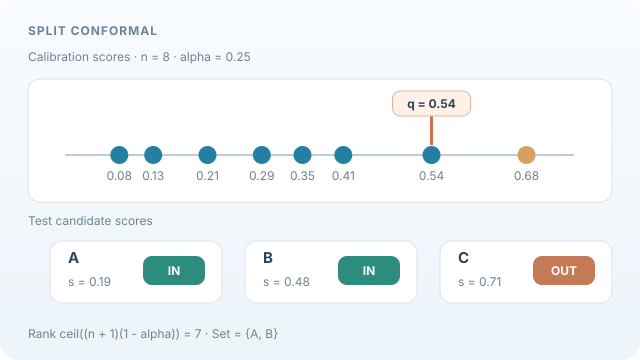
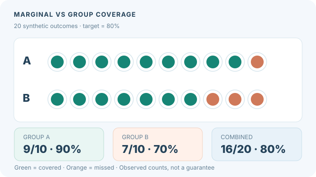
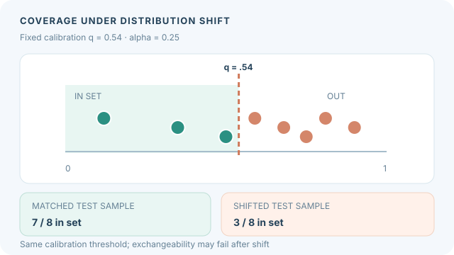
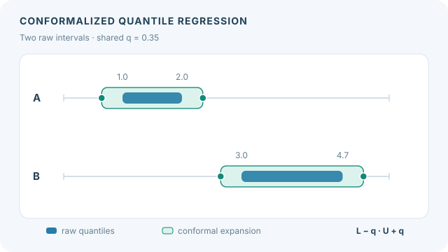
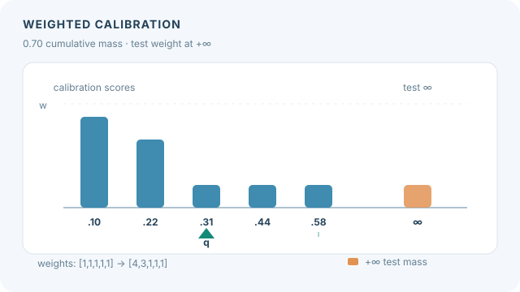
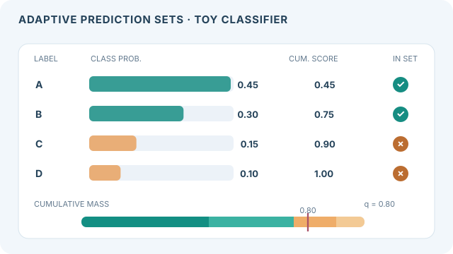
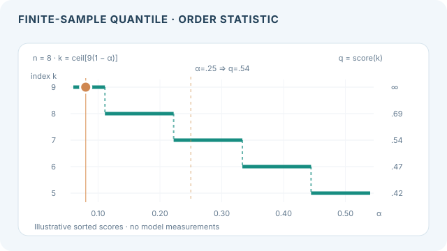
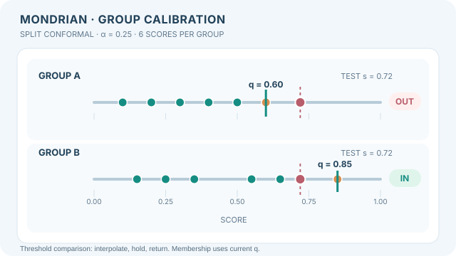
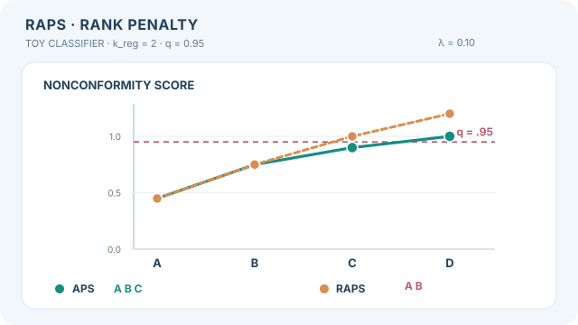

# Conformal Prediction

Conformal prediction turns any predictor into one that outputs prediction sets or intervals with a guaranteed probability of containing the true outcome. The guarantee holds for any model, under the assumption that the data are exchangeable. Part of [Uncertainty quantification and calibration](index.md).

## Overview

A classifier that outputs a single label gives no sense of its uncertainty, and a probability score may be badly calibrated. Conformal prediction takes a different route. It asks for a set of plausible labels that contains the true one with probability at least \(1-\alpha\), for a level \(\alpha\) chosen by the user. The method uses a held-out calibration set to decide how large the set must be.

## Key concepts

- **Nonconformity score**: a measure \(s(x,y)\) of how unusual the label \(y\) is for input \(x\). A common choice is one minus the predicted probability of \(y\).
- **Exchangeability**: the calibration and test data can be permuted without changing their joint distribution. It is weaker than independence and is the assumption behind the guarantee.
- **Coverage**: the probability that the true label lies in the prediction set. The guarantee is on coverage, not on accuracy of the point prediction.

## How it works

In split conformal prediction, the data are split into a training set and a calibration set. The model is trained on the first part. On the calibration set, compute the scores \(s_i=s(x_i,y_i)\) and let \(\hat q\) be the \((1-\alpha)(1+1/n)\)-quantile of these scores. The prediction set for a new input is

\[
C(x)=\{\,y : s(x,y)\le \hat q\,\},
\]

and under exchangeability \(P(Y\in C(X))\ge 1-\alpha\) (Angelopoulos & Bates, 2023). For regression, the same idea gives prediction intervals, and the score can be the absolute residual or a quantity from a quantile model. Lei et al. (2018) develop distribution-free predictive inference for regression in this framework.

*Original animated teaching visual (CC BY-SA 4.0).* With eight illustrative calibration scores and α=0.25, the finite-sample index is ceil((8+1)(1−0.25))=7; the seventh sorted score is q=0.54. For a separate illustrative test input, candidate-label nonconformity scores (A: 0.19, B: 0.48, C: 0.71) give the set **{A, B}**. The animation reveals the calibration scores, threshold, and set membership in that order. **The displayed values are invented for teaching, not empirical coverage or model measurements.** The marginal coverage statement requires exchangeability; it is not a per-input guarantee. MkDocs provides Play/Pause; the [GitHub static preview](../../../../assets/concept-animations/conformal-quantile-still.svg) shows the completed set. Scroll horizontally on narrow screens. See Shafer & Vovk (2008) and Angelopoulos & Bates (2023) in References.

### Why marginal coverage is not subgroup coverage

*Original animated teaching visual (CC BY-SA 4.0).* Consider **20 synthetic outcomes**: 9/10 covered in group A and 7/10 in group B. Their combined **observed fraction** is 16/20 = 80%, even though group B has only 70%. These deliberately arranged outcomes are **not model measurements or an estimate of any population probability**. They illustrate why the split-conformal **marginal** coverage guarantee cannot be read as a conditional or subgroup coverage guarantee (Angelopoulos & Bates, 2023). Green marks a covered outcome, orange a miss. The animation reveals each group's outcomes; GitHub shows the [static preview](../../../../assets/concept-animations/conformal-subgroup-coverage-still.svg). MkDocs provides Play/Pause; on narrow screens, use horizontal scrolling or keyboard navigation.

### What changes when test scores shift

*Original animated teaching visual (CC BY-SA 4.0).* Keep the **illustrative** calibration threshold \(\hat q=0.54\) from the preceding eight calibration examples. A matched *toy test batch* has 7/8 scores at or below the threshold, whereas an invented shifted batch has only 3/8. The colored dots move between **alternative constructed score lists**, not actual tracked observations or measurements of a deployment. These counts **do not estimate coverage probabilities**; they show that a fixed threshold need not retain the same realized inclusion fraction when test-score distributions change. More generally, without calibration/test exchangeability, the usual finite-sample guarantee need not hold (Barber et al., 2023). [GitHub static preview](../../../../assets/concept-animations/conformal-shift-coverage-still.svg); MkDocs provides Play/Pause, and narrow screens support horizontal scrolling.

### Conformalized quantile regression: calibrated intervals with adaptive widths

*Original animated teaching visual (CC BY-SA 4.0).* In conformalized quantile regression (CQR), calibration nonconformity scores are $s_i=\max\{\hat q_L(x_i)-y_i,\ y_i-\hat q_U(x_i)\}$. For five **invented** ordered calibration scores $[0.04,0.12,0.18,0.26,0.35]$ and $\alpha=0.30$, the finite-sample order statistic is $\lceil(5+1)(1-0.30)\rceil=5$, giving **$\hat q=0.35$**. Raw intervals **A = [1.0, 2.0]** and **B = [3.0, 4.7]** become **[0.65, 2.35]** and **[2.65, 5.05]** via $[\hat q_L(x)-\hat q,\hat q_U(x)+\hat q]$. Different initial widths remain different; the motion illustrates *interval expansion*, not model training. **All values are analytic teaching examples, not fitted-model outputs or measured coverage.** Split-CQR's marginal guarantee needs an independent calibration split and exchangeability (Romano et al., 2019). [GitHub static preview](../../../../assets/concept-animations/conformal-cqr-expansion-still.svg); MkDocs provides Play/Pause. On narrow screens scroll horizontally with touch or keyboard.

### Weighted calibration: the test-point atom at infinity

*Original animated teaching visual (CC BY-SA 4.0).* Sort **invented** calibration scores as **[0.10, 0.22, 0.31, 0.44, 0.58]**, add a separate test-point weight at **$+\infty$**, and choose target cumulative normalized weight $1-\alpha=0.70$. Calibration weights **[1,1,1,1,1]** plus test weight **1** yield a threshold of **0.58**. Intermediate calibration weights **[2.5,2,1,1,1]** yield **0.44**, and final weights **[4,3,1,1,1]** yield **0.31**, each retaining the test weight **1**. The indicator *jumps at quantile crossings* while bar heights interpolate between alternative weighting choices; this is **not a stream of observed model outputs**. Including test mass at infinity matters to this particular finite-sample weighted conformal quantile. Theoretical validity depends on the covariate-shift assumptions and correct density-ratio weights; arbitrary distribution shift is **not** automatically corrected (Tibshirani et al., 2019). These invented weights **are not measured density ratios**. [GitHub static preview](../../../../assets/concept-animations/conformal-weighted-quantile-still.svg); MkDocs provides Play/Pause and keyboard-accessible horizontal scrolling.

### Adaptive prediction sets: accumulate class probabilities

*Original animated teaching visual (CC BY-SA 4.0).* For a **synthetic four-class predictor**, sorted probabilities are **[0.45, 0.30, 0.15, 0.10]**. A **nonrandomized cumulative-score** variant of adaptive prediction sets (APS) gives each candidate label the sum of probabilities through its rank: $s(x,y)=\sum_{j:\operatorname{rank}(j)\leq\operatorname{rank}(y)}\hat p_j(x)$. The four scores are **[0.45, 0.75, 0.90, 1.00]**. With a **hypothetical** threshold **$\hat q=0.80$**, the rule $s(x,y)\leq\hat q$ includes **A and B**, but excludes **C and D**; unlike an alternative crossing-label construction, this example does **not** automatically include the first label exceeding the cutoff. The animated cumulative strip shows each probability being added before the decision. **The probabilities and cutoff are invented, not fitted-model results or an actually calibrated quantile.** For coverage validity, the **same APS score** must be computed on a held-out exchangeable calibration set to choose its own finite-sample quantile; this example alone makes no coverage claim (Romano, Sesia & Candès, 2020). [GitHub static preview](../../../../assets/concept-animations/conformal-aps-cumulative-still.svg); MkDocs provides Play/Pause, with keyboard-accessible horizontal scrolling on narrow screens.

### Finite-sample quantiles change in discrete steps

*Original animated teaching visual (CC BY-SA 4.0).* With **eight invented sorted scores** **[0.08, 0.16, 0.24, 0.32, 0.42, 0.47, 0.54, 0.69]**, split conformal uses the rank $k(\alpha)=\lceil(8+1)(1-\alpha)\rceil$ and the order statistic $\hat q=s_{(k)}$, taking **$\hat q=+\infty$ when $k>8$**. For $\alpha=0.08, 0.13, 0.25, 0.37, 0.49$, the pairs $(k,\hat q)$ are **(9,+∞), (8,0.69), (7,0.54), (6,0.47), (5,0.42)**. The moving guide sweeps the miscoverage level smoothly while the rank **jumps at exact ceiling boundaries**; this is a *parameter sweep*, **not a training trajectory or a set of measured outcomes**. The infinity case indicates a vacuous unconstrained prediction set, not a replacement by the largest finite score. Under exchangeability, the finite-sample correction supports marginal coverage for a preselected $\alpha$ (Angelopoulos & Bates, 2023). [GitHub static preview](../../../../assets/concept-animations/conformal-alpha-staircase-still.svg); MkDocs provides Play/Pause and keyboard-accessible horizontal scrolling.

### Mondrian calibration: different thresholds for predefined groups

*Original animated teaching visual (CC BY-SA 4.0).* Artificial sorted calibration scores are **A = [0.10, 0.20, 0.30, 0.40, 0.50, 0.60]** and **B = [0.15, 0.25, 0.35, 0.55, 0.65, 0.85]**. With **α = 0.25** and six observations per group, $k_g=\lceil(6+1)(1-0.25)\rceil=6$, giving **$q_A=0.60$** and **$q_B=0.85$**. Pooling all 12 scores yields a single threshold **0.60** (rank 10). A hypothetical nonconformity score **0.72** is excluded by A's threshold but included by B's. The animation changes from the pooled-threshold comparison to groupwise B calibration; it does **not** depict training or a deployment time series. For **predefined, observable groups**, split Mondrian conformal can guarantee group-conditional coverage under **exchangeability within each group**, not coverage conditioned on every feature vector. With too few calibration examples, a group may yield a vacuous prediction set. **All scores and the test example are synthetic, not observed model outputs or coverage estimates** (Boström & Johansson, 2020). [GitHub static preview](../../../../assets/concept-animations/conformal-mondrian-groups-still.svg); MkDocs adds Play/Pause and keyboard-focusable horizontal scrolling.

### RAPS: rank penalty alters the candidate score ordering

*Original animated teaching visual (CC BY-SA 4.0).* For artificial sorted class probabilities **[0.45, 0.30, 0.15, 0.10]**, the **nonrandomized** score $s_{\mathrm{APS}}(r)=\sum_{j=1}^{r}p_{(j)}$ equals **[0.45, 0.75, 0.90, 1.00]**. A rank penalty $s_{\mathrm{RAPS}}(r)=s_{\mathrm{APS}}(r)+\lambda\max(0,r-k_{\mathrm{reg}})$, with $k_{\mathrm{reg}}=2$ and **λ = 0.10**, yields **[0.45, 0.75, 1.00, 1.20]**. At a **purely illustrative common q = 0.95**, the score rule $s\le q$ selects **{A, B, C}** for APS and **{A, B}** for RAPS. The moving curve is a **parameter sweep**, not optimization. In a valid deployment, **each score design must calibrate its own conformal threshold**; using a common hypothetical cutoff does *not* establish smaller calibrated sets or retained coverage. Practical RAPS can use randomized scores; this toy deliberately uses the deterministic variant (Angelopoulos et al., 2021). No values are model measurements. [GitHub static preview](../../../../assets/concept-animations/conformal-raps-penalty-still.svg); MkDocs adds Play/Pause and keyboard navigation.

## Variants

- **Split conformal** uses one calibration set, which is the simplest and most common form.
- **Full conformal** refits the model for each candidate label, which is more expensive but uses the data more efficiently.
- **Adaptive scores** change the nonconformity measure so that the sets are smaller where the model is confident. Conformalized quantile regression (Romano et al., 2019) is a widely used example for intervals.
- **Weighted calibration** reweights the calibration data to handle a known covariate shift (Tibshirani et al., 2019).

## Results and limits

- The coverage guarantee holds in finite samples under exchangeability, without assumptions on the model. This is the main attraction of the method.
- The guarantee is marginal. Coverage can be too high for some inputs and too low for others, including subgroups, which matters for fairness and medical use.
- Set size depends on the quality of the underlying model. A poor model gives large, uninformative sets that still satisfy the guarantee.
- Under distribution shift, the exchangeability assumption fails, and the guarantee no longer holds without adjustment. Barber et al. (2023) bound the loss of coverage when exchangeability is relaxed.

## Applications

- **Classification with abstention**: returning a set of labels and flagging large sets for human review (Angelopoulos & Bates, 2023).
- **Regression intervals**: prediction intervals with guaranteed coverage for forecasts and measurements (Lei et al., 2018).
- **Medical prediction**: quantifying the uncertainty of diagnostic models in a model-agnostic way.

## Open questions

- Conditional coverage, which holds for each input or subgroup, is generally not achievable without strong assumptions.
- Handling distribution shift with valid coverage, for example by weighting the calibration data, is an active research area.
- Balancing set size and coverage in high-dimensional outputs, such as structured prediction, is difficult.

## References

### Seminal papers

- Angelopoulos, A. N., Bates, S., Malik, J. & Jordan, M. I. (2021). Uncertainty sets for image classifiers using conformal prediction. *ICLR 2021*. https://arxiv.org/abs/2009.14193 — Introduces rank regularization in conformal classification.
- Boström, H. & Johansson, U. (2020). Mondrian conformal regressors. *PMLR* 128, 114–133. https://proceedings.mlr.press/v128/bostrom20a.html — Studies Mondrian calibration categories in regression.

- Romano, Y., Sesia, M. & Candès, E. J. (2020). Classification with valid and adaptive coverage. *Advances in Neural Information Processing Systems* 33. https://proceedings.neurips.cc/paper_files/paper/2020/hash/244edd7e85dc81602b7615cd705545f5-Abstract.html — Introduces adaptive conformal classification scores that use class-probability rankings to construct prediction sets.

- Vovk, V., Gammerman, A. & Shafer, G. (2005). *Algorithmic Learning in a Random World*. Springer. https://doi.org/10.1007/b106715 — Foundational book on conformal prediction and its validity theory.
- Romano, Y., Patterson, E. & Candès, E. J. (2019). Conformalized quantile regression. In *Advances in Neural Information Processing Systems* 32. arXiv:1905.03222. https://arxiv.org/abs/1905.03222 — Combines quantile regression with split conformal calibration for adaptive intervals.
- Tibshirani, R. J., Foygel Barber, R., Candès, E. J. & Ramdas, A. (2019). Conformal prediction under covariate shift. In *Advances in Neural Information Processing Systems* 32. arXiv:1904.06019. https://arxiv.org/abs/1904.06019 — Extends conformal coverage to known covariate shift by weighting.
- Bates, S., Angelopoulos, A., Lei, L., Malik, J. & Jordan, M. (2021). Distribution-free, risk-controlling prediction sets. *Journal of the ACM* 68(6). https://doi.org/10.1145/3478535 — Extends distribution-free set guarantees to general risk control.
- Barber, R. F., Candès, E. J., Ramdas, A. & Tibshirani, R. J. (2023). Conformal prediction beyond exchangeability. *The Annals of Statistics* 51(2), 816–845. https://doi.org/10.1214/23-aos2276 — Gives coverage bounds when exchangeability is relaxed.
- Lei, J., G'Sell, M., Rinaldo, A., Tibshirani, R. J. & Wasserman, L. (2018). Distribution-free predictive inference for regression. *Journal of the American Statistical Association* 113(523), 1094–1111. https://doi.org/10.1080/01621459.2017.1307116 — Gives distribution-free prediction intervals for regression using split conformal methods.
- Shafer, G. & Vovk, V. (2008). A tutorial on conformal prediction. *Journal of Machine Learning Research* 9. https://www.jmlr.org/papers/v9/shafer08a.html — Tutorial introducing the framework and its validity guarantees.

### Surveys and textbooks

- Angelopoulos, A. N. & Bates, S. (2023). Conformal prediction: a gentle introduction. *Foundations and Trends in Machine Learning* 16(4), 494–591. https://doi.org/10.1561/2200000101 — Gentle introduction to conformal methods, including split and adaptive variants.
- Guo, C., Pleiss, G., Sun, Y. & Weinberger, K. Q. (2017). On calibration of modern neural networks. In *Proceedings of the 34th International Conference on Machine Learning*, PMLR 70. https://proceedings.mlr.press/v70/guo17a.html — Documents the miscalibration of neural classifiers that motivates calibrated uncertainty alongside coverage guarantees.
- Murphy, K. P. (2022). *Probabilistic Machine Learning: An Introduction*. MIT Press. https://github.com/probml/pml-book — Repository for Murphy's textbook series; background on predictive uncertainty and intervals.
