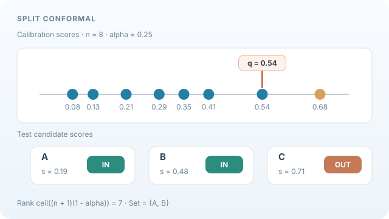

# 共形預測

共形預測可把任何預測器轉換為輸出預測集合或區間的方法，並保證這些集合以指定機率包含真實結果。此保證適用於任何模型，前提是資料具可交換性。本頁是[不確定性量化與校準](index.md)的一部分。

## 概述

只輸出單一標籤的分類器無法說明其不確定性，而機率分數也可能校準得很差。共形預測走另一條路：它要求一組合理的標籤，使其以至少 \(1-\alpha\) 的機率包含真實標籤，其中 \(\alpha\) 由使用者選定。此方法利用保留的校準集來決定預測集合應有多大。

## 關鍵概念

- **不一致分數**：衡量標籤 \(y\) 對輸入 \(x\) 有多不尋常的量 \(s(x,y)\)。常見的選擇是一減去模型對 \(y\) 的預測機率。
- **可交換性**：校準資料與測試資料可以任意置換而不改變其聯合分布。它比獨立性弱，是保證成立的假設。
- **覆蓋率**：真實標籤落在預測集合中的機率。保證的是覆蓋率，而非點預測的準確率。

## 運作方式

在分割式共形預測中，資料分為訓練集與校準集。模型在前半部訓練。在校準集上計算分數 \(s_i=s(x_i,y_i)\)，並令 \(\hat q\) 為這些分數的 \((1-\alpha)(1+1/n)\) 分位數。新輸入的預測集合為

\[
C(x)=\{\,y : s(x,y)\le \hat q\,\},
\]

在可交換性下，\(P(Y\in C(X))\ge 1-\alpha\)（Angelopoulos 與 Bates，2023）。對迴歸而言，同樣的想法產生預測區間，分數可以是絕對殘差，或來自分位數模型的量。Lei 等人（2018）在此框架下發展了迴歸的無分布假設預測推論。

*原創教學動畫（CC BY-SA 4.0）。* 假設有八筆示意校準分數，α=0.25，有限樣本的排序位置為 ceil((8+1)(1−0.25))=7，因此第七小的分數為門檻 q=0.54。另一筆示意測試輸入的候選標籤分數分別為 A: 0.19、B: 0.48、C: 0.71，得到預測集合 **{A, B}**。動畫依序呈現校準分數、門檻與集合成員。**數值是教學假設，不是實測模型結果或經驗覆蓋率。** 邊際覆蓋保證須有可交換性，並非逐筆輸入保證。MkDocs 網站可播放／暫停；[GitHub 靜態預覽](../../../../assets/concept-animations/conformal-quantile-still.svg) 顯示最終集合。手機可水平捲動。來源見 Shafer 與 Vovk（2008）、Angelopoulos 與 Bates（2023）。

## 變體

- **分割式共形預測**使用單一校準集，是最簡單也最常見的形式。
- **完整共形預測**對每個候選標籤重新擬合模型，成本較高，但能更有效率地使用資料。
- **自適應分數**改變不一致度量，使模型有信心的地方預測集合較小。

## 結果與限制

- 覆蓋保證在有限樣本下成立，只需可交換性，對模型沒有假設。這是此方法最主要的吸引力。
- 保證是邊際的。某些輸入（包括子群）的覆蓋率可能偏高，另一些則偏低，這對公平性與醫療應用很重要。
- 預測集合的大小取決於底層模型的品質。模型不佳時，會得到很大而沒有資訊量的集合，但它們仍然滿足保證。
- 在分布偏移下，可交換性不再成立，若不加調整，保證也就不再成立。

## 應用

- **附帶棄權的分類**：回傳一組標籤，並把過大的集合標記給人工檢視（Angelopoulos 與 Bates，2023）。
- **迴歸區間**：為預測與測量提供有保證覆蓋率的預測區間（Lei 等人，2018）。
- **醫療預測**：以與模型無關的方式量化診斷模型的不確定性。

## 開放問題

- 對每個輸入或子群都成立的條件覆蓋率，在一般情況下需要很強的假設才可能達成。
- 在分布偏移下仍保有有效覆蓋，例如以加權校準資料的方式，是活躍的研究方向。
- 在高維輸出（例如結構化預測）中平衡集合大小與覆蓋率，仍然困難。

## 參考文獻

### 奠基性論文

- Lei, J., G'Sell, M., Rinaldo, A., Tibshirani, R. J. & Wasserman, L. (2018). Distribution-free predictive inference for regression. *Journal of the American Statistical Association* 113(523), 1094–1111. https://doi.org/10.1080/01621459.2017.1307116 — 以分割式共形方法為迴歸提供無分布假設的預測區間。
- Shafer, G. & Vovk, V. (2008). A tutorial on conformal prediction. *Journal of Machine Learning Research* 9. https://www.jmlr.org/papers/v9/shafer08a.html — 介紹此框架與其有效性保證的教學文章。

### 綜述與教科書

- Angelopoulos, A. N. & Bates, S. (2023). Conformal prediction: a gentle introduction. *Foundations and Trends in Machine Learning* 16(4), 494–591. https://doi.org/10.1561/2200000101 — 共形方法的入門介紹，包含分割式與自適應變體。
- Guo, C., Pleiss, G., Sun, Y. & Weinberger, K. Q. (2017). On calibration of modern neural networks. In *Proceedings of the 34th International Conference on Machine Learning*, PMLR 70. https://proceedings.mlr.press/v70/guo17a.html — 記錄神經分類器的校準偏差，是與覆蓋保證並列的不確定性動機。
- Murphy, K. P. (2022). *Probabilistic Machine Learning: An Introduction*. MIT Press. https://github.com/probml/pml-book — 免費教科書；提供預測不確定性與區間的背景。
